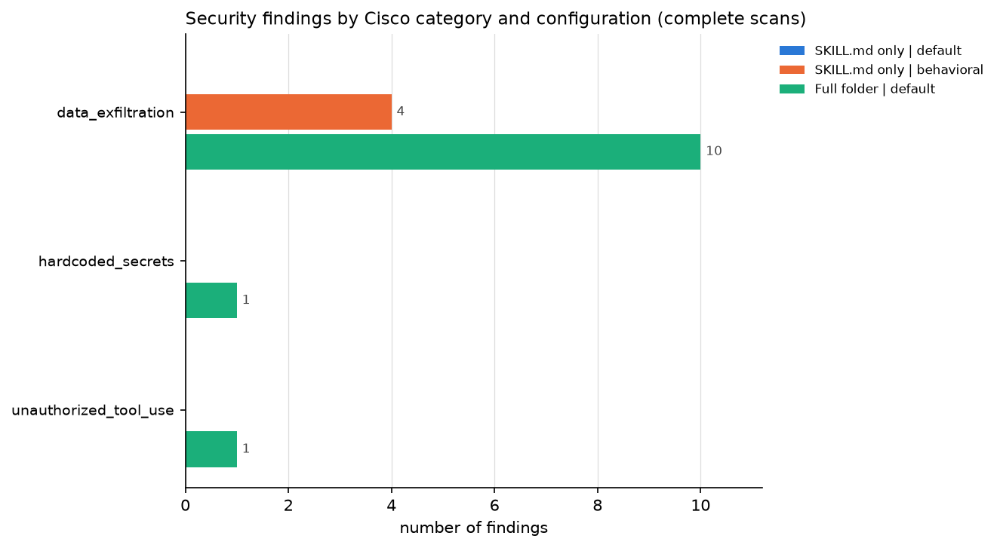
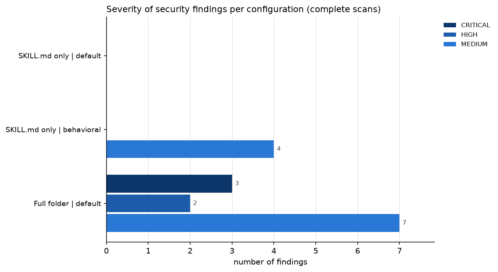
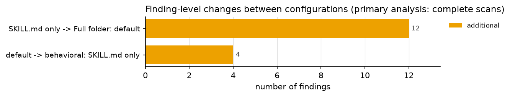

# Cisco Skill Scanner results: `2026-11-03_152815_pilot-canary-reanalysis`

Generated automatically by `notebooks/01_cisco_scanner_dataset_ready.ipynb` on 2026-11-03T23:28:16+00:00. Every number below is computed from the files in this run folder. A finding is a Cisco rule match on an operation, not a confirmed vulnerability.

## A. Experiment overview

| item | value |
|---|---|
| Run ID | 2026-11-03_152815_pilot-canary-reanalysis |
| Run mode | reanalysis of saved run `results/cisco_dataset_runs/pilot_canary_backup` (Cisco not executed) |
| Dataset | agent_skills_sample.db (SHA-256 683888c923a5...) |
| Scanner version that produced the reports | skill-scanner 2.3.1 |
| Scan policy (name / preset) | default / balanced |
| Policy fingerprint(s) | 3f48e661bfbc... |
| Scans executed (report timestamps, UTC) | 2026-11-03 22:38:05 to 2026-11-03 22:38:22 |
| Analysis written | 2026-11-03T23:28:16+00:00 |
| Skills selected / exported | 1 / 1 |
| Skill folders complete / incomplete | 1 / 0 |
| Configurations per skill | 4 |
| Configuration runs attempted | 4 |
| Outcomes | complete: 3, contract_only: 1, partial: 0, failed: 0, skipped: 0, missing: 0 |
| Finding records (all readable reports) | 38 (complete scans: 16, contract-only scans: 22, partial scans: 0) |
| Security finding records in complete scans | 16 |
| Distinct rule/location combinations (skill, rule, file, line), all findings | 22 |
| Distinct rule/location combinations, security findings in complete scans | 16 |

Scan outcomes per configuration (complete = primary results; contract_only = only Cisco's known rule-registration error, used in the sensitivity analysis only; partial = other analyzer problems, preliminary only):

| configuration | complete | contract_only | partial | failed | skipped | missing |
|---|---|---|---|---|---|---|
| SKILL.md only \| default | 1 | 0 | 0 | 0 | 0 | 0 |
| SKILL.md only \| behavioral | 1 | 0 | 0 | 0 | 0 | 0 |
| Full folder \| default | 1 | 0 | 0 | 0 | 0 | 0 |
| Full folder \| behavioral | 0 | 1 | 0 | 0 | 0 | 0 |

## B. Security findings (complete scans only)

B1. Findings by severity

| configuration | CRITICAL | HIGH | MEDIUM | LOW |
|---|---|---|---|---|
| SKILL.md only \| default | 0 | 0 | 0 | 0 |
| SKILL.md only \| behavioral | 0 | 0 | 4 | 0 |
| Full folder \| default | 3 | 2 | 7 | 0 |

B2. Findings by Cisco category (per configuration) and distinct skills affected (any complete configuration)

| cisco_category | SKILL.md only \| default | SKILL.md only \| behavioral | Full folder \| default | distinct_skills |
|---|---|---|---|---|
| data_exfiltration | 0 | 4 | 10 | 1 |
| hardcoded_secrets | 0 | 0 | 1 | 1 |
| unauthorized_tool_use | 0 | 0 | 1 | 1 |

B3. Findings by research category (our mapping; categories without Cisco rules stay at zero)

| research_category | SKILL.md only \| default | SKILL.md only \| behavioral | Full folder \| default | distinct_skills |
|---|---|---|---|---|
| Credential / secret access or exposure | 0 | 0 | 1 | 1 |
| External network communication / data exfiltration | 0 | 4 | 10 | 1 |
| Command execution / dangerous shell operations | 0 | 0 | 0 | 0 |
| File-system access or modification | 0 | 0 | 0 | 0 |
| Prompt injection / instruction manipulation | 0 | 0 | 0 | 0 |
| Excessive permissions / privilege escalation | 0 | 0 | 1 | 1 |
| Supply-chain / dependency risks | 0 | 0 | 0 | 0 |
| Account modification / sensitive external actions | 0 | 0 | 0 | 0 |

B4. Most frequently triggered security rules

| rule_id | cisco_category | findings | distinct_skills | severities |
|---|---|---|---|---|
| DATA_EXFIL_NETWORK_REQUESTS | data_exfiltration | 6 | 1 | MEDIUM |
| MDBLOCK_PYTHON_HTTP_POST | data_exfiltration | 4 | 1 | MEDIUM |
| DATA_EXFIL_HTTP_POST | data_exfiltration | 2 | 1 | CRITICAL |
| CORRELATED_SENSITIVE_NETWORK_FLOW | data_exfiltration | 1 | 1 | HIGH |
| DATA_EXFIL_SOCKET_CONNECT | data_exfiltration | 1 | 1 | CRITICAL |
| SECRET_CONNECTION_STRING | hardcoded_secrets | 1 | 1 | HIGH |
| TOOL_ABUSE_UNDECLARED_NETWORK | unauthorized_tool_use | 1 | 1 | MEDIUM |

B5. Where the findings point

| location | SKILL.md only \| default | SKILL.md only \| behavioral | Full folder \| default |
|---|---|---|---|
| SKILL.md | 0 | 4 | 1 |
| supporting file | 0 | 0 | 11 |

B6. Findings outside the primary group: contract-only and partial scans (excluded from B1-B5)

| run_status | configuration | rule_id | severity | findings |
|---|---|---|---|---|
| CONTRACT_ONLY | Full folder \| behavioral | BEHAVIOR_CROSSFILE_ENV_VAR_EXFILTRATION | CRITICAL | 1 |
| CONTRACT_ONLY | Full folder \| behavioral | BEHAVIOR_ENV_VAR_EXFILTRATION | CRITICAL | 1 |
| CONTRACT_ONLY | Full folder \| behavioral | CORRELATED_SENSITIVE_NETWORK_FLOW | HIGH | 1 |
| CONTRACT_ONLY | Full folder \| behavioral | DATA_EXFIL_HTTP_POST | CRITICAL | 2 |
| CONTRACT_ONLY | Full folder \| behavioral | DATA_EXFIL_NETWORK_REQUESTS | MEDIUM | 6 |
| CONTRACT_ONLY | Full folder \| behavioral | DATA_EXFIL_SOCKET_CONNECT | CRITICAL | 1 |
| CONTRACT_ONLY | Full folder \| behavioral | MDBLOCK_PYTHON_HTTP_POST | MEDIUM | 8 |
| CONTRACT_ONLY | Full folder \| behavioral | SECRET_CONNECTION_STRING | HIGH | 1 |
| CONTRACT_ONLY | Full folder \| behavioral | TOOL_ABUSE_UNDECLARED_NETWORK | MEDIUM | 1 |

## C. Configuration comparisons

The **primary analysis** uses only pairs in which both scans are COMPLETE (and, for SKILL.md-only vs full-folder, the folder is complete). The **sensitivity analysis** adds pairs that contain a CONTRACT_ONLY scan. Contract-only scans are not assumed complete or accurate; the sensitivity analysis only shows whether including them would change a result.

C1. Sample sizes and excluded pairs per comparison (`excluded_*` = pairs left out of the primary analysis, by reason; contract-only pairs are added back in the sensitivity analysis)

| comparison | pairs_total | primary_n | sensitivity_n | excluded_contract_only | excluded_partial | excluded_incomplete_folder | excluded_not_comparable |
|---|---|---|---|---|---|---|---|
| SKILL.md only -> Full folder: default | 1 | 1 | 1 | 0 | 0 | 0 | 0 |
| SKILL.md only -> Full folder: behavioral | 1 | 0 | 1 | 1 | 0 | 0 | 0 |
| default -> behavioral: SKILL.md only | 1 | 1 | 1 | 0 | 0 | 0 | 0 |
| default -> behavioral: Full folder | 1 | 0 | 1 | 1 | 0 | 0 | 0 |

C2. Primary analysis (complete scans only): finding-level changes summed over the pairs used

| comparison | pairs_used | pairs_with_findings | unchanged | changed | possibly_equivalent | additional | missing | skills_with_additional |
|---|---|---|---|---|---|---|---|---|
| SKILL.md only -> Full folder: default | 1 | 1 | 0 | 0 | 0 | 12 | 0 | 1 |
| SKILL.md only -> Full folder: behavioral | 0 | 0 | 0 | 0 | 0 | 0 | 0 | 0 |
| default -> behavioral: SKILL.md only | 1 | 1 | 0 | 0 | 0 | 4 | 0 | 1 |
| default -> behavioral: Full folder | 0 | 0 | 0 | 0 | 0 | 0 | 0 | 0 |

C3. Files that contribute the additional findings in the primary SKILL.md-only vs full-folder comparison (a SKILL.md row means Cisco re-read the instructions once the scripts were present)

| location | file_path | findings | skills | rules |
|---|---|---|---|---|
| SKILL.md | SKILL.md | 1 | 1 | TOOL_ABUSE_UNDECLARED_NETWORK |
| supporting file | scripts/agent.py | 11 | 1 | CORRELATED_SENSITIVE_NETWORK_FLOW, DATA_EXFIL_HTTP_POST, DATA_EXFIL_NETWORK_REQUESTS, DATA_EXFIL_SOCKET_CONNECT, SECRET_CONNECTION_STRING |

C4. Sensitivity analysis (complete + contract-only scans): finding-level changes summed over the pairs used

| comparison | pairs_used | pairs_with_findings | unchanged | changed | possibly_equivalent | additional | missing | skills_with_additional |
|---|---|---|---|---|---|---|---|---|
| SKILL.md only -> Full folder: default | 1 | 1 | 0 | 0 | 0 | 12 | 0 | 1 |
| SKILL.md only -> Full folder: behavioral | 1 | 1 | 4 | 0 | 0 | 18 | 0 | 1 |
| default -> behavioral: SKILL.md only | 1 | 1 | 0 | 0 | 0 | 4 | 0 | 1 |
| default -> behavioral: Full folder | 1 | 1 | 12 | 0 | 0 | 10 | 0 | 1 |

C5. Does including contract-only scans change the comparisons?

- SKILL.md only -> Full folder: default: no contract-only pairs, so the sensitivity analysis equals the primary analysis (n = 1).
- SKILL.md only -> Full folder: behavioral: the primary analysis has no usable pair (n = 0); only the sensitivity analysis (n = 1) covers this comparison, so any conclusion here depends on contract-only scans. Additional findings 0 vs 18, missing 0 vs 0, unchanged 0 vs 4; skills gaining findings 0 vs 1 (primary vs sensitivity).
- default -> behavioral: SKILL.md only: no contract-only pairs, so the sensitivity analysis equals the primary analysis (n = 1).
- default -> behavioral: Full folder: the primary analysis has no usable pair (n = 0); only the sensitivity analysis (n = 1) covers this comparison, so any conclusion here depends on contract-only scans. Additional findings 0 vs 10, missing 0 vs 0, unchanged 0 vs 12; skills gaining findings 0 vs 1 (primary vs sensitivity).
- 1 finding record(s) in contract-only scans carry Cisco's own `rule_contract = invalid` flag (rules: BEHAVIOR_CROSSFILE_ENV_VAR_EXFILTRATION); Cisco excludes these from its policy gating.

C6. Pair status per skill

| comparison | before | after | pair_status |
|---|---|---|---|
| SKILL.md only -> Full folder: default | SKILL.md only \| default (COMPLETE) | Full folder \| default (COMPLETE) | eligible |
| SKILL.md only -> Full folder: behavioral | SKILL.md only \| behavioral (COMPLETE) | Full folder \| behavioral (CONTRACT_ONLY) | sensitivity: contract-only scan |
| default -> behavioral: SKILL.md only | SKILL.md only \| default (COMPLETE) | SKILL.md only \| behavioral (COMPLETE) | eligible |
| default -> behavioral: Full folder | Full folder \| default (COMPLETE) | Full folder \| behavioral (CONTRACT_ONLY) | sensitivity: contract-only scan |

## D. Scanner reliability

D1. Analyzer failures reported by Cisco

| skill_id | configuration | status | analyzer | failure_type | error |
|---|---|---|---|---|---|
| implementing-canary-tokens-for-netw-460e0a897b56 | Full folder \| behavioral | CONTRACT_ONLY | behavioral | finding contract: unregistered rule (known Cisco issue) | FindingContract:BEHAVIOR_CROSSFILE_ENV_VAR_EXFILTRATION:UNKNOWN_BUNDLED_PYTHON_RULE |

D2. Skill folders

| skill_id | supporting_files_exported | files_missing | folder_complete | integrity |
|---|---|---|---|---|
| implementing-canary-tokens-for-netw-460e0a897b56 | 3 | 0 | True | ok: copy matches manifest hashes |

D3. Scanner verdict vs finding severity

| configuration | outcome | is_safe | cisco_max_severity | highest_security_severity | security_findings | security_medium_or_lower | note |
|---|---|---|---|---|---|---|---|
| SKILL.md only \| default | complete | True | SAFE | none | 0 | 0 | no findings |
| SKILL.md only \| behavioral | complete | True | MEDIUM | MEDIUM | 4 | 4 | is_safe=True although there are 4 security finding(s) up to MEDIUM |
| Full folder \| default | complete | False | CRITICAL | CRITICAL | 12 | 7 | is_safe=False because of 5 CRITICAL/HIGH security finding(s) |
| Full folder \| behavioral | contract_only | False | CRITICAL | CRITICAL | 22 | 15 | is_safe=False because of 7 CRITICAL/HIGH security finding(s) |

D4. Evidence check of reported locations (counts of finding records per rule)

| rule_id | ambiguous | exact | mismatch | unavailable |
|---|---|---|---|---|
| BEHAVIOR_CROSSFILE_ENV_VAR_EXFILTRATION | 0 | 0 | 0 | 1 |
| BEHAVIOR_ENV_VAR_EXFILTRATION | 0 | 0 | 0 | 1 |
| CORRELATED_SENSITIVE_NETWORK_FLOW | 0 | 0 | 0 | 2 |
| DATA_EXFIL_HTTP_POST | 0 | 4 | 0 | 0 |
| DATA_EXFIL_NETWORK_REQUESTS | 0 | 12 | 0 | 0 |
| DATA_EXFIL_SOCKET_CONNECT | 0 | 2 | 0 | 0 |
| MDBLOCK_PYTHON_HTTP_POST | 9 | 0 | 3 | 0 |
| SECRET_CONNECTION_STRING | 0 | 2 | 0 | 0 |
| TOOL_ABUSE_UNDECLARED_NETWORK | 0 | 0 | 0 | 2 |

## E. Manual security review

`manual_review_template.csv` lists 22 distinct security finding location(s) (6 seen only in contract-only or partial scans) with Cisco's rule, severity, reported file and line, redacted evidence and evidence check. The columns `reviewer`, `evidence_verified`, `legitimate_purpose`, `interpretation` and `notes` are intentionally blank; no finding has been labelled as a vulnerability or a false positive.

## Figures

## Limitations

- 1 of 4 configuration run(s) were CONTRACT_ONLY: their only recorded problem is Cisco's rule-registration error for BEHAVIOR_CROSSFILE_ENV_VAR_EXFILTRATION. Their 22 finding record(s) are excluded from primary results and used only in the sensitivity analysis; they are not assumed complete or accurate.
- 12 of 38 finding record(s) do not have their evidence on the reported line (mismatch 3, ambiguous 9); rules involved: MDBLOCK_PYTHON_HTTP_POST (12). Reported line numbers are kept unchanged.
- For MDBLOCK_* rules Cisco 2.3.1 counts lines from the code-block fence and, in SKILL.md, from the end of the YAML frontmatter, so their reported lines point above the code; use evidence_candidate_lines to locate it.
- 6 finding record(s) could not be checked against the file (no file, line or evidence text).
- Only 1 skill(s) were analysed: these are pilot observations, not population estimates.
- Scanner findings are rule matches on operations; they are not confirmed vulnerabilities, and nothing here is a false-negative claim (there is no ground truth).
- Finding counts are per matching line; one script can contribute many findings. Distinct skills are reported separately.
- Comparisons match findings by rule, file, reported line and evidence; equivalent behavior reported under different rule IDs is not matched automatically.

## Files in this run folder

- `scan_summary.csv`: one row per skill x configuration: status, outcome, analyzer failures, verdict, counts, versions
- `individual_findings.csv`: one row per Cisco finding: original fields, normalized path, evidence check
- `context_comparison.csv / analyzer_comparison.csv`: finding-level comparisons; pair_status says primary (eligible), sensitivity or preliminary
- `manual_review_template.csv`: blank reviewer columns for manual interpretation
- `run_metadata.json`: settings, dataset hash, scanner versions, policy fingerprints, outcome counts
- `<skill_id>/reports/*.json`: raw Cisco reports, unmodified
- `<skill_id>/manifest.json`: exported files with SHA-256 hashes and missing files
- `figures/*.png`: the charts above
