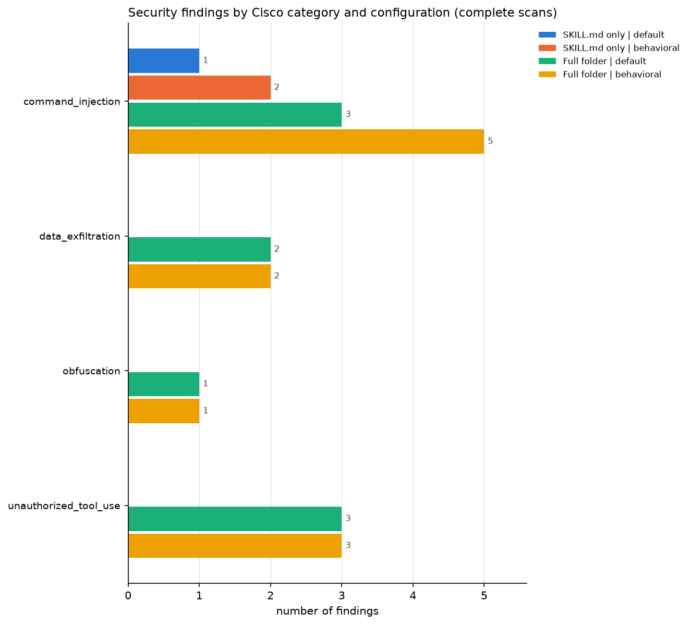
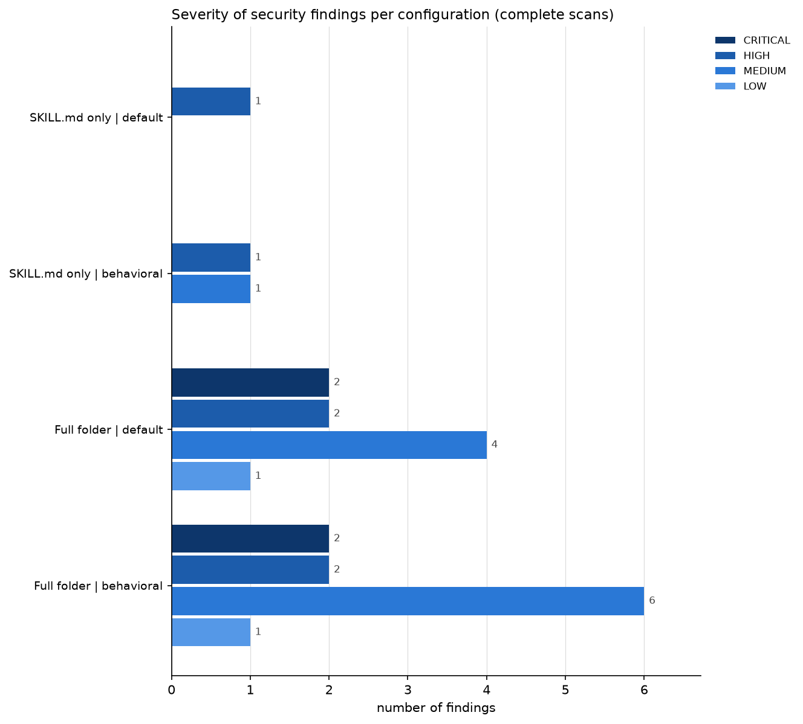
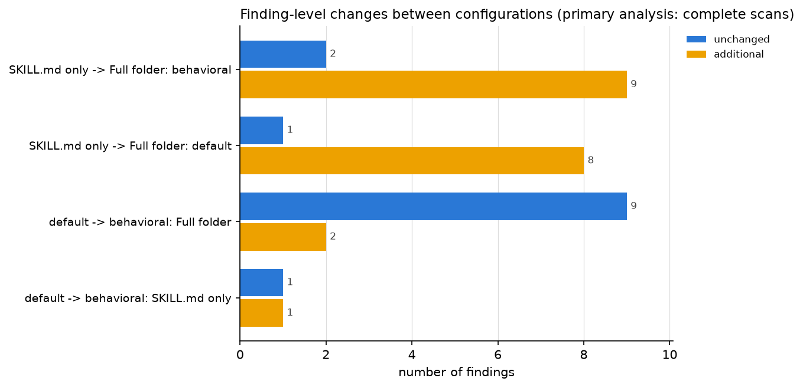

# Cisco Skill Scanner results: `2026-11-03_195654_sample30-seed2027-reanalysis`

Generated automatically by `notebooks/01_cisco_scanner_dataset_ready.ipynb` on 2026-11-04T03:56:57+00:00. Every number below is computed from the files in this run folder. A finding is a Cisco rule match on an operation, not a confirmed vulnerability.

## A. Experiment overview

| item | value |
|---|---|
| Run ID | 2026-11-03_195654_sample30-seed2027-reanalysis |
| Run mode | reanalysis of saved run `results/cisco_dataset_runs/agent_skills_sample/runs/2026-11-03_173516_sample30-seed2027` (Cisco not executed) |
| Dataset | agent_skills_sample.db (SHA-256 683888c923a5...) |
| Sample | agent_skills_sample_seed2027_scripts10_supporting_no_scripts10_skill_md_only10 (30 skills; manifest results/cisco_dataset_runs/agent_skills_sample/runs/2026-11-03_173516_sample30-seed2027/sample/sample_manifest.csv) |
| Scanner version that produced the reports | skill-scanner 2.3.1 |
| Scan policy (name / preset) | default / balanced |
| Policy fingerprint(s) | 3f48e661bfbc... |
| Scans executed (report timestamps, UTC) | 2026-11-04 01:35:21 to 2026-11-04 01:45:35 |
| Analysis written | 2026-11-04T03:56:57+00:00 |
| Skills selected / exported | 30 / 30 |
| Skill folders complete / incomplete | 27 / 3 |
| Configurations per skill | 4 |
| Configurations planned (skills x configurations) | 120 |
| Cisco scans executed | 114 |
| Configurations excluded by design: incomplete GitSkills folder (full-folder scan not run) | 6 |
| Outcomes of the executed scans | complete: 110, contract_only: 0, partial: 4, failed: 0 |
| Finding records (all readable reports) | 141 (complete scans: 137, contract-only scans: 0, partial scans: 4) |
| Security finding records in complete scans | 23 |
| Distinct rule/location combinations (skill, rule, file, line), all findings | 42 |
| Distinct rule/location combinations, security findings in complete scans | 11 |

Planned configurations, executed Cisco scans and outcomes per configuration. complete = primary results; contract_only = only Cisco's known rule-registration error, used in the sensitivity analysis only; partial = other analyzer problems, preliminary only; failed = Cisco ran but produced no usable report; excluded_incomplete_folder = design exclusion, Cisco was not run because GitSkills did not store the whole folder; missing = no saved report:

| configuration | planned | executed | complete | contract_only | partial | failed | excluded_incomplete_folder | missing |
|---|---|---|---|---|---|---|---|---|
| SKILL.md only \| default | 30 | 30 | 29 | 0 | 1 | 0 | 0 | 0 |
| SKILL.md only \| behavioral | 30 | 30 | 29 | 0 | 1 | 0 | 0 | 0 |
| Full folder \| default | 30 | 27 | 26 | 0 | 1 | 0 | 3 | 0 |
| Full folder \| behavioral | 30 | 27 | 26 | 0 | 1 | 0 | 3 | 0 |
| total | 120 | 114 | 110 | 0 | 4 | 0 | 6 | 0 |

Results by sampling stratum. Strata were sampled with equal allocation, so counts within a stratum can be reported directly, but proportions for the whole population need the design weights in `sample/sampling_metadata.json`:

| stratum | skills | complete folders | configurations planned | scans executed | scans complete | scans contract_only | scans partial | scans failed | configurations excluded_incomplete_folder | configurations missing | skills with >= 1 security finding (complete scans) | security finding records (complete scans) |
|---|---|---|---|---|---|---|---|---|---|---|---|---|
| scripts | 10 | 7 | 40 | 34 | 34 | 0 | 0 | 0 | 6 | 0 | 4 | 23 |
| supporting_no_scripts | 10 | 10 | 40 | 40 | 40 | 0 | 0 | 0 | 0 | 0 | 0 | 0 |
| skill_md_only | 10 | 10 | 40 | 40 | 36 | 0 | 4 | 0 | 0 | 0 | 0 | 0 |

## B. Security findings (complete scans only)

B1. Findings by severity

| configuration | CRITICAL | HIGH | MEDIUM | LOW |
|---|---|---|---|---|
| SKILL.md only \| default | 0 | 1 | 0 | 0 |
| SKILL.md only \| behavioral | 0 | 1 | 1 | 0 |
| Full folder \| default | 2 | 2 | 4 | 1 |
| Full folder \| behavioral | 2 | 2 | 6 | 1 |

B2. Findings by Cisco category (per configuration) and distinct skills affected (any complete configuration)

| cisco_category | SKILL.md only \| default | SKILL.md only \| behavioral | Full folder \| default | Full folder \| behavioral | distinct_skills |
|---|---|---|---|---|---|
| command_injection | 1 | 2 | 3 | 5 | 3 |
| data_exfiltration | 0 | 0 | 2 | 2 | 1 |
| obfuscation | 0 | 0 | 1 | 1 | 1 |
| unauthorized_tool_use | 0 | 0 | 3 | 3 | 1 |

B3. Findings by research category (our mapping; categories without Cisco rules stay at zero)

| research_category | SKILL.md only \| default | SKILL.md only \| behavioral | Full folder \| default | Full folder \| behavioral | distinct_skills |
|---|---|---|---|---|---|
| Credential / secret access or exposure | 0 | 0 | 0 | 0 | 0 |
| External network communication / data exfiltration | 0 | 0 | 2 | 2 | 1 |
| Command execution / dangerous shell operations | 1 | 2 | 3 | 5 | 3 |
| File-system access or modification | 0 | 0 | 0 | 0 | 0 |
| Prompt injection / instruction manipulation | 0 | 0 | 0 | 0 | 0 |
| Excessive permissions / privilege escalation | 0 | 0 | 3 | 3 | 1 |
| Supply-chain / dependency risks | 0 | 0 | 0 | 0 | 0 |
| Account modification / sensitive external actions | 0 | 0 | 0 | 0 | 0 |
| Other (obfuscation) | 0 | 0 | 1 | 1 | 1 |

B4. Most frequently triggered security rules

| rule_id | cisco_category | findings | distinct_skills | severities |
|---|---|---|---|---|
| ACTIVE_DYNAMIC_EXECUTION | command_injection | 4 | 1 | HIGH |
| DATA_EXFIL_NETWORK_REQUESTS | data_exfiltration | 4 | 1 | MEDIUM |
| MDBLOCK_PYTHON_SUBPROCESS | command_injection | 3 | 1 | MEDIUM |
| ALLOWED_TOOLS_BASH_VIOLATION | unauthorized_tool_use | 2 | 1 | HIGH |
| ALLOWED_TOOLS_GREP_VIOLATION | unauthorized_tool_use | 2 | 1 | LOW |
| ALLOWED_TOOLS_NETWORK_USAGE | unauthorized_tool_use | 2 | 1 | MEDIUM |
| COMMAND_INJECTION_EVAL | command_injection | 2 | 1 | CRITICAL |
| COMMAND_INJECTION_OS_SYSTEM | command_injection | 2 | 1 | CRITICAL |
| FILE_MAGIC_MISMATCH | obfuscation | 2 | 1 | MEDIUM |

B5. Where the findings point

| location | SKILL.md only \| default | SKILL.md only \| behavioral | Full folder \| default | Full folder \| behavioral |
|---|---|---|---|---|
| SKILL.md | 1 | 2 | 4 | 5 |
| supporting file | 0 | 0 | 5 | 6 |

B6. Findings outside the primary group: contract-only and partial scans (excluded from B1-B5)

_No data._

## C. Configuration comparisons

The **primary analysis** uses only pairs in which both scans are COMPLETE (and, for SKILL.md-only vs full-folder, the folder is complete). The **sensitivity analysis** adds pairs that contain a CONTRACT_ONLY scan. Contract-only scans are not assumed complete or accurate; the sensitivity analysis only shows whether including them would change a result.

C1. Sample sizes and excluded pairs per comparison (`excluded_*` = pairs left out of the primary analysis, by reason; contract-only pairs are added back in the sensitivity analysis)

| comparison | pairs_total | primary_n | sensitivity_n | excluded_contract_only | excluded_partial | excluded_incomplete_folder | excluded_not_comparable |
|---|---|---|---|---|---|---|---|
| SKILL.md only -> Full folder: default | 30 | 26 | 26 | 0 | 1 | 3 | 0 |
| SKILL.md only -> Full folder: behavioral | 30 | 26 | 26 | 0 | 1 | 3 | 0 |
| default -> behavioral: SKILL.md only | 30 | 29 | 29 | 0 | 1 | 0 | 0 |
| default -> behavioral: Full folder | 30 | 26 | 26 | 0 | 1 | 3 | 0 |

C2. Primary analysis (complete scans only): finding-level changes summed over the pairs used

| comparison | pairs_used | pairs_with_findings | unchanged | changed | possibly_equivalent | additional | missing | skills_with_additional |
|---|---|---|---|---|---|---|---|---|
| SKILL.md only -> Full folder: default | 26 | 4 | 1 | 0 | 0 | 8 | 0 | 3 |
| SKILL.md only -> Full folder: behavioral | 26 | 4 | 2 | 0 | 0 | 9 | 0 | 4 |
| default -> behavioral: SKILL.md only | 29 | 1 | 1 | 0 | 0 | 1 | 0 | 1 |
| default -> behavioral: Full folder | 26 | 4 | 9 | 0 | 0 | 2 | 0 | 1 |

C3. Files that contribute the additional findings in the primary SKILL.md-only vs full-folder comparison (a SKILL.md row means Cisco re-read the instructions once the scripts were present)

| location | file_path | findings | skills | rules |
|---|---|---|---|---|
| SKILL.md | SKILL.md | 6 | 1 | ALLOWED_TOOLS_BASH_VIOLATION, ALLOWED_TOOLS_GREP_VIOLATION, ALLOWED_TOOLS_NETWORK_USAGE |
| supporting file | eval-viewer/generate_review.py | 2 | 1 | COMMAND_INJECTION_OS_SYSTEM |
| supporting file | references/ytdlp-quirks.md | 1 | 1 | MDBLOCK_PYTHON_SUBPROCESS |
| supporting file | scripts/__init__.py | 2 | 1 | FILE_MAGIC_MISMATCH |
| supporting file | scripts/compute.py | 2 | 1 | COMMAND_INJECTION_EVAL |
| supporting file | scripts/set_reminder.py | 4 | 1 | DATA_EXFIL_NETWORK_REQUESTS |

C4. Sensitivity analysis (complete + contract-only scans): finding-level changes summed over the pairs used

| comparison | pairs_used | pairs_with_findings | unchanged | changed | possibly_equivalent | additional | missing | skills_with_additional |
|---|---|---|---|---|---|---|---|---|
| SKILL.md only -> Full folder: default | 26 | 4 | 1 | 0 | 0 | 8 | 0 | 3 |
| SKILL.md only -> Full folder: behavioral | 26 | 4 | 2 | 0 | 0 | 9 | 0 | 4 |
| default -> behavioral: SKILL.md only | 29 | 1 | 1 | 0 | 0 | 1 | 0 | 1 |
| default -> behavioral: Full folder | 26 | 4 | 9 | 0 | 0 | 2 | 0 | 1 |

C5. Does including contract-only scans change the comparisons?

- SKILL.md only -> Full folder: default: no contract-only pairs, so the sensitivity analysis equals the primary analysis (n = 26).
- SKILL.md only -> Full folder: behavioral: no contract-only pairs, so the sensitivity analysis equals the primary analysis (n = 26).
- default -> behavioral: SKILL.md only: no contract-only pairs, so the sensitivity analysis equals the primary analysis (n = 29).
- default -> behavioral: Full folder: no contract-only pairs, so the sensitivity analysis equals the primary analysis (n = 26).

C6. Pair status per skill

| comparison | skill_id | before | after | pair_status |
|---|---|---|---|---|
| SKILL.md only -> Full folder: default | skill-558634268929 | SKILL.md only \| default (COMPLETE) | Full folder \| default (SKIPPED_INCOMPLETE_FOLDER) | excluded: incomplete folder |
| SKILL.md only -> Full folder: behavioral | skill-558634268929 | SKILL.md only \| behavioral (COMPLETE) | Full folder \| behavioral (SKIPPED_INCOMPLETE_FOLDER) | excluded: incomplete folder |
| SKILL.md only -> Full folder: default | skill-creator-484c59f65787 | SKILL.md only \| default (COMPLETE) | Full folder \| default (COMPLETE) | eligible |
| SKILL.md only -> Full folder: behavioral | skill-creator-484c59f65787 | SKILL.md only \| behavioral (COMPLETE) | Full folder \| behavioral (COMPLETE) | eligible |
| SKILL.md only -> Full folder: default | oat-brainstorm-89abd5dadad1 | SKILL.md only \| default (COMPLETE) | Full folder \| default (SKIPPED_INCOMPLETE_FOLDER) | excluded: incomplete folder |
| SKILL.md only -> Full folder: behavioral | oat-brainstorm-89abd5dadad1 | SKILL.md only \| behavioral (COMPLETE) | Full folder \| behavioral (SKIPPED_INCOMPLETE_FOLDER) | excluded: incomplete folder |
| SKILL.md only -> Full folder: default | json-visual-diff-53e233791f4c | SKILL.md only \| default (COMPLETE) | Full folder \| default (COMPLETE) | eligible |
| SKILL.md only -> Full folder: behavioral | json-visual-diff-53e233791f4c | SKILL.md only \| behavioral (COMPLETE) | Full folder \| behavioral (COMPLETE) | eligible |
| SKILL.md only -> Full folder: default | cb-user-behavior-analytics-f905993b15c3 | SKILL.md only \| default (COMPLETE) | Full folder \| default (COMPLETE) | eligible |
| SKILL.md only -> Full folder: behavioral | cb-user-behavior-analytics-f905993b15c3 | SKILL.md only \| behavioral (COMPLETE) | Full folder \| behavioral (COMPLETE) | eligible |
| SKILL.md only -> Full folder: default | skill-24eda454b855 | SKILL.md only \| default (COMPLETE) | Full folder \| default (SKIPPED_INCOMPLETE_FOLDER) | excluded: incomplete folder |
| SKILL.md only -> Full folder: behavioral | skill-24eda454b855 | SKILL.md only \| behavioral (COMPLETE) | Full folder \| behavioral (SKIPPED_INCOMPLETE_FOLDER) | excluded: incomplete folder |
| SKILL.md only -> Full folder: default | set-reminder-7652ed9105a8 | SKILL.md only \| default (COMPLETE) | Full folder \| default (COMPLETE) | eligible |
| SKILL.md only -> Full folder: behavioral | set-reminder-7652ed9105a8 | SKILL.md only \| behavioral (COMPLETE) | Full folder \| behavioral (COMPLETE) | eligible |
| SKILL.md only -> Full folder: default | youtube-content-7162d1c45997 | SKILL.md only \| default (COMPLETE) | Full folder \| default (COMPLETE) | eligible |
| SKILL.md only -> Full folder: behavioral | youtube-content-7162d1c45997 | SKILL.md only \| behavioral (COMPLETE) | Full folder \| behavioral (COMPLETE) | eligible |
| SKILL.md only -> Full folder: default | synthdata-compute-82db1d3c4db1 | SKILL.md only \| default (COMPLETE) | Full folder \| default (COMPLETE) | eligible |
| SKILL.md only -> Full folder: behavioral | synthdata-compute-82db1d3c4db1 | SKILL.md only \| behavioral (COMPLETE) | Full folder \| behavioral (COMPLETE) | eligible |
| SKILL.md only -> Full folder: default | spatial-domains-712e4a65bdd1 | SKILL.md only \| default (COMPLETE) | Full folder \| default (COMPLETE) | eligible |
| SKILL.md only -> Full folder: behavioral | spatial-domains-712e4a65bdd1 | SKILL.md only \| behavioral (COMPLETE) | Full folder \| behavioral (COMPLETE) | eligible |

_100 more row(s) in the CSV files._

## D. Scanner reliability

D1. Analyzer failures reported by Cisco

| skill_id | configuration | status | analyzer | failure_type | error |
|---|---|---|---|---|---|
| virtualenv-setup-46ac173e49cb | SKILL.md only \| default | PARTIAL | skill_loader | skill loader | SkillLoadError:MISSING_REQUIRED_MANIFEST_FIELD |
| virtualenv-setup-46ac173e49cb | SKILL.md only \| behavioral | PARTIAL | skill_loader | skill loader | SkillLoadError:MISSING_REQUIRED_MANIFEST_FIELD |
| virtualenv-setup-46ac173e49cb | Full folder \| default | PARTIAL | skill_loader | skill loader | SkillLoadError:MISSING_REQUIRED_MANIFEST_FIELD |
| virtualenv-setup-46ac173e49cb | Full folder \| behavioral | PARTIAL | skill_loader | skill loader | SkillLoadError:MISSING_REQUIRED_MANIFEST_FIELD |

D2. Skill folders

| skill_id | supporting_files_exported | files_missing | folder_complete | integrity |
|---|---|---|---|---|
| skill-558634268929 | 11 | 2 | False | ok: copy matches manifest hashes |
| skill-creator-484c59f65787 | 14 | 0 | True | ok: copy matches manifest hashes |
| oat-brainstorm-89abd5dadad1 | 8 | 1 | False | ok: copy matches manifest hashes |
| json-visual-diff-53e233791f4c | 1 | 0 | True | ok: copy matches manifest hashes |
| cb-user-behavior-analytics-f905993b15c3 | 1 | 0 | True | ok: copy matches manifest hashes |
| skill-24eda454b855 | 0 | 176 | False | ok: copy matches manifest hashes |
| set-reminder-7652ed9105a8 | 1 | 0 | True | ok: copy matches manifest hashes |
| youtube-content-7162d1c45997 | 16 | 0 | True | ok: copy matches manifest hashes |
| synthdata-compute-82db1d3c4db1 | 1 | 0 | True | ok: copy matches manifest hashes |
| spatial-domains-712e4a65bdd1 | 2 | 0 | True | ok: copy matches manifest hashes |
| create-research-questions-7f1c9df74a9c | 2 | 0 | True | ok: copy matches manifest hashes |
| spdd-123721de2fa1 | 2 | 0 | True | ok: copy matches manifest hashes |
| bounty-hunting-c7d411d69db8 | 1 | 0 | True | ok: copy matches manifest hashes |
| admkrs-cs-performance-reporting-2290661edc90 | 2 | 0 | True | ok: copy matches manifest hashes |
| moonshot-teams-runner-b816482cad2c | 1 | 0 | True | ok: copy matches manifest hashes |
| f-hypothesis-ledger-0b6cb775953e | 2 | 0 | True | ok: copy matches manifest hashes |
| lxc-setup-dcc11cf17ae2 | 1 | 0 | True | ok: copy matches manifest hashes |
| product-interviewer-888617f63ea3 | 1 | 0 | True | ok: copy matches manifest hashes |
| llama-cpp-9983d0524812 | 3 | 0 | True | ok: copy matches manifest hashes |
| python-f1868b2af2ee | 2 | 0 | True | ok: copy matches manifest hashes |

_10 more row(s) in the CSV files._

D3. Scanner verdict vs finding severity

| skill_id | configuration | outcome | is_safe | cisco_max_severity | highest_security_severity | security_findings | security_medium_or_lower | note |
|---|---|---|---|---|---|---|---|---|
| skill-558634268929 | SKILL.md only \| default | complete | True | INFO | none | 0 | 0 | only metadata/coverage findings |
| skill-558634268929 | SKILL.md only \| behavioral | complete | True | INFO | none | 0 | 0 | only metadata/coverage findings |
| skill-creator-484c59f65787 | SKILL.md only \| default | complete | True | INFO | none | 0 | 0 | only metadata/coverage findings |
| skill-creator-484c59f65787 | SKILL.md only \| behavioral | complete | True | INFO | none | 0 | 0 | only metadata/coverage findings |
| skill-creator-484c59f65787 | Full folder \| default | complete | False | CRITICAL | CRITICAL | 2 | 1 | is_safe=False because of 1 CRITICAL/HIGH security finding(s) |
| skill-creator-484c59f65787 | Full folder \| behavioral | complete | False | CRITICAL | CRITICAL | 2 | 1 | is_safe=False because of 1 CRITICAL/HIGH security finding(s) |
| oat-brainstorm-89abd5dadad1 | SKILL.md only \| default | complete | True | INFO | none | 0 | 0 | only metadata/coverage findings |
| oat-brainstorm-89abd5dadad1 | SKILL.md only \| behavioral | complete | True | INFO | none | 0 | 0 | only metadata/coverage findings |
| json-visual-diff-53e233791f4c | SKILL.md only \| default | complete | True | INFO | none | 0 | 0 | only metadata/coverage findings |
| json-visual-diff-53e233791f4c | SKILL.md only \| behavioral | complete | True | INFO | none | 0 | 0 | only metadata/coverage findings |
| json-visual-diff-53e233791f4c | Full folder \| default | complete | True | INFO | none | 0 | 0 | only metadata/coverage findings |
| json-visual-diff-53e233791f4c | Full folder \| behavioral | complete | True | INFO | none | 0 | 0 | only metadata/coverage findings |
| cb-user-behavior-analytics-f905993b15c3 | SKILL.md only \| default | complete | True | INFO | none | 0 | 0 | only metadata/coverage findings |
| cb-user-behavior-analytics-f905993b15c3 | SKILL.md only \| behavioral | complete | True | INFO | none | 0 | 0 | only metadata/coverage findings |
| cb-user-behavior-analytics-f905993b15c3 | Full folder \| default | complete | True | INFO | none | 0 | 0 | only metadata/coverage findings |
| cb-user-behavior-analytics-f905993b15c3 | Full folder \| behavioral | complete | True | INFO | none | 0 | 0 | only metadata/coverage findings |
| skill-24eda454b855 | SKILL.md only \| default | complete | True | INFO | none | 0 | 0 | only metadata/coverage findings |
| skill-24eda454b855 | SKILL.md only \| behavioral | complete | True | INFO | none | 0 | 0 | only metadata/coverage findings |
| set-reminder-7652ed9105a8 | SKILL.md only \| default | complete | True | INFO | none | 0 | 0 | only metadata/coverage findings |
| set-reminder-7652ed9105a8 | SKILL.md only \| behavioral | complete | True | INFO | none | 0 | 0 | only metadata/coverage findings |

_94 more row(s) in the CSV files._

D4. Evidence check of reported locations (counts of finding records per rule)

| rule_id | exact | mismatch | unavailable |
|---|---|---|---|
| ACTIVE_DYNAMIC_EXECUTION | 4 | 0 | 0 |
| ALLOWED_TOOLS_BASH_VIOLATION | 0 | 0 | 2 |
| ALLOWED_TOOLS_GREP_VIOLATION | 0 | 0 | 2 |
| ALLOWED_TOOLS_NETWORK_USAGE | 0 | 0 | 2 |
| COMMAND_INJECTION_EVAL | 2 | 0 | 0 |
| COMMAND_INJECTION_OS_SYSTEM | 2 | 0 | 0 |
| DATA_EXFIL_NETWORK_REQUESTS | 4 | 0 | 0 |
| FILE_MAGIC_MISMATCH | 0 | 0 | 2 |
| MANIFEST_INVALID_NAME | 0 | 0 | 8 |
| MANIFEST_MISSING_LICENSE | 0 | 0 | 106 |
| MDBLOCK_PYTHON_SUBPROCESS | 0 | 3 | 0 |
| SKILL_LOAD_FALLBACK_USED | 0 | 0 | 4 |

## E. Manual security review

`manual_review_template.csv` lists 11 distinct security finding location(s) (0 seen only in contract-only or partial scans) with Cisco's rule, severity, reported file and line, redacted evidence and evidence check. The columns `reviewer`, `evidence_verified`, `legitimate_purpose`, `interpretation` and `notes` are intentionally blank; no finding has been labelled as a vulnerability or a false positive.

## Figures

## Limitations

- 4 of 114 executed scan(s) were PARTIAL (Cisco analyzer failure: skill loader: 4). Their 4 finding record(s) are preliminary evidence and are excluded from primary tables and comparisons.
- 3 skill folder(s) are incomplete in GitSkills (179 supporting file(s) without stored text). This is a design exclusion, not a scanner failure: 6 of 120 planned configuration(s) (their full-folder scans) were not run, so 114 Cisco scans were executed. Their SKILL.md-only scans are kept, but their context-comparison pairs are reported as `excluded: incomplete folder`, and no finding count of zero is implied for the excluded configurations.
- 3 of 141 finding record(s) do not have their evidence on the reported line (mismatch 3, ambiguous 0); rules involved: MDBLOCK_PYTHON_SUBPROCESS (3). Reported line numbers are kept unchanged.
- For MDBLOCK_* rules Cisco 2.3.1 counts lines from the code-block fence and, in SKILL.md, from the end of the YAML frontmatter, so their reported lines point above the code; use evidence_candidate_lines to locate it.
- 126 finding record(s) could not be checked against the file (no file, line or evidence text).
- Scanner findings are rule matches on operations; they are not confirmed vulnerabilities, and nothing here is a false-negative claim (there is no ground truth).
- Finding counts are per matching line; one script can contribute many findings. Distinct skills are reported separately.
- Comparisons match findings by rule, file, reported line and evidence; equivalent behavior reported under different rule IDs is not matched automatically.

## Files in this run folder

- `scan_summary.csv`: one row per skill x configuration: status, outcome, analyzer failures, verdict, counts, versions
- `individual_findings.csv`: one row per Cisco finding: original fields, normalized path, evidence check
- `context_comparison.csv / analyzer_comparison.csv`: finding-level comparisons; pair_status says primary (eligible), sensitivity or preliminary
- `manual_review_template.csv`: blank reviewer columns for manual interpretation
- `run_metadata.json`: settings, dataset hash, scanner versions, policy fingerprints, outcome counts
- `<skill_id>/reports/*.json`: raw Cisco reports, unmodified
- `<skill_id>/manifest.json`: exported files with SHA-256 hashes and missing files
- `figures/*.png`: the charts above
