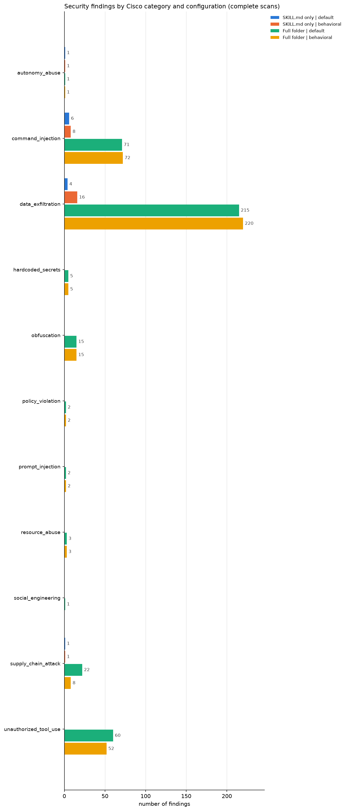
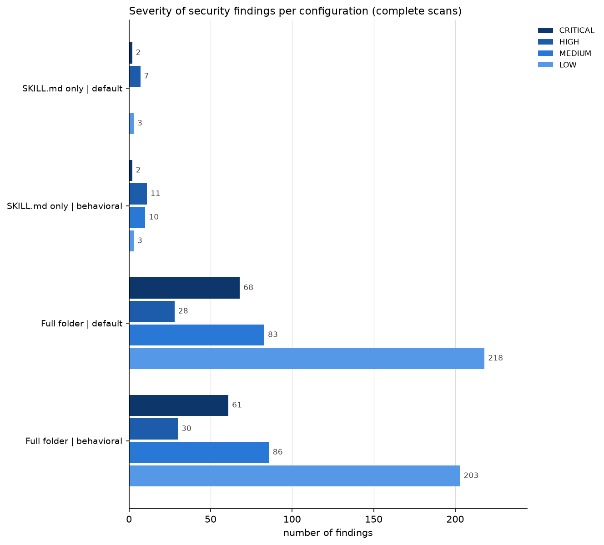
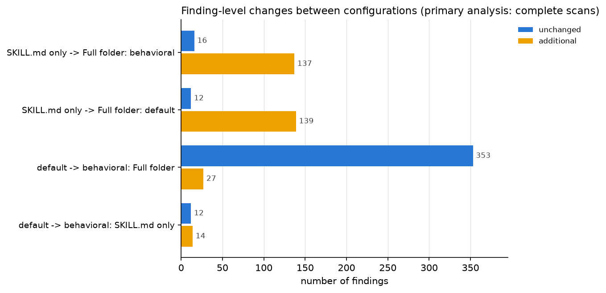

# Cisco Skill Scanner results: `2026-11-15_220827_sample1000-seed2030-batch1`

Generated automatically by `notebooks/01_cisco_scanner_dataset_ready.ipynb` on 2026-11-16T07:15:51+00:00. Every number below is computed from the files in this run folder. A finding is a Cisco rule match on an operation, not a confirmed vulnerability.

## A. Experiment overview

| item | value |
|---|---|
| Run ID | 2026-11-15_220827_sample1000-seed2030-batch1 |
| Run mode | scan (Cisco executed in this run) |
| Dataset | agent_skills_sample.db (SHA-256 683888c923a5...) |
| Sample | agent_skills_sample_seed2030_scripts400_supporting_no_scripts300_skill_md_only300 (250 skills; manifest results/skillguard_runs/main1000/manifests/batch1_of4_manifest.csv) |
| Scanner version that produced the reports | skill-scanner 2.3.1 |
| Scan policy (name / preset) | default / balanced |
| Policy fingerprint(s) | 3f48e661bfbc... |
| Scans executed (report timestamps, UTC) | 2026-11-16 06:08:32 to 2026-11-16 07:15:46 |
| Analysis written | 2026-11-16T07:15:51+00:00 |
| Skills selected / exported | 250 / 250 |
| Skill folders complete / incomplete | 212 / 38 |
| Configurations per skill | 4 |
| Configurations planned (skills x configurations) | 1000 |
| Cisco scans executed | 1000 |
| Configurations excluded by design: incomplete GitSkills folder (full-folder scan not run) | 0 |
| Outcomes of the executed scans | complete: 937, contract_only: 3, partial: 60, failed: 0 |
| Finding records (all readable reports) | 1824 (complete scans: 1656, contract-only scans: 56, partial scans: 112) |
| Security finding records in complete scans | 815 |
| Distinct rule/location combinations (skill, rule, file, line), all findings | 683 |
| Distinct rule/location combinations, security findings in complete scans | 425 |

Planned configurations, executed Cisco scans and outcomes per configuration. complete = primary results; contract_only = only Cisco's known rule-registration error, used in the sensitivity analysis only; partial = other analyzer problems, preliminary only; failed = Cisco ran but produced no usable report; excluded_incomplete_folder = design exclusion, Cisco was not run because GitSkills did not store the whole folder; missing = no saved report:

| configuration | planned | executed | complete | contract_only | partial | failed | excluded_incomplete_folder | missing |
|---|---|---|---|---|---|---|---|---|
| SKILL.md only \| default | 250 | 250 | 235 | 0 | 15 | 0 | 0 | 0 |
| SKILL.md only \| behavioral | 250 | 250 | 235 | 0 | 15 | 0 | 0 | 0 |
| Full folder \| default | 250 | 250 | 235 | 0 | 15 | 0 | 0 | 0 |
| Full folder \| behavioral | 250 | 250 | 232 | 3 | 15 | 0 | 0 | 0 |
| total | 1000 | 1000 | 937 | 3 | 60 | 0 | 0 | 0 |

Results by sampling stratum. Strata were sampled with equal allocation, so counts within a stratum can be reported directly, but proportions for the whole population need the design weights in `sample/sampling_metadata.json`:

| stratum | skills | complete folders | configurations planned | scans executed | scans complete | scans contract_only | scans partial | scans failed | configurations excluded_incomplete_folder | configurations missing | skills with >= 1 security finding (complete scans) | security finding records (complete scans) |
|---|---|---|---|---|---|---|---|---|---|---|---|---|
| scripts | 100 | 72 | 400 | 400 | 373 | 3 | 24 | 0 | 0 | 0 | 52 | 746 |
| supporting_no_scripts | 75 | 65 | 300 | 300 | 292 | 0 | 8 | 0 | 0 | 0 | 8 | 53 |
| skill_md_only | 75 | 75 | 300 | 300 | 272 | 0 | 28 | 0 | 0 | 0 | 2 | 16 |

## B. Security findings (complete scans only)

B1. Findings by severity

| configuration | CRITICAL | HIGH | MEDIUM | LOW |
|---|---|---|---|---|
| SKILL.md only \| default | 2 | 7 | 0 | 3 |
| SKILL.md only \| behavioral | 2 | 11 | 10 | 3 |
| Full folder \| default | 68 | 28 | 83 | 218 |
| Full folder \| behavioral | 61 | 30 | 86 | 203 |

B2. Findings by Cisco category (per configuration) and distinct skills affected (any complete configuration)

| cisco_category | SKILL.md only \| default | SKILL.md only \| behavioral | Full folder \| default | Full folder \| behavioral | distinct_skills |
|---|---|---|---|---|---|
| autonomy_abuse | 1 | 1 | 1 | 1 | 1 |
| command_injection | 6 | 8 | 71 | 72 | 21 |
| data_exfiltration | 4 | 16 | 215 | 220 | 31 |
| hardcoded_secrets | 0 | 0 | 5 | 5 | 2 |
| obfuscation | 0 | 0 | 15 | 15 | 12 |
| policy_violation | 0 | 0 | 2 | 2 | 2 |
| prompt_injection | 0 | 0 | 2 | 2 | 1 |
| resource_abuse | 0 | 0 | 3 | 3 | 2 |
| social_engineering | 0 | 0 | 1 | 0 | 1 |
| supply_chain_attack | 1 | 1 | 22 | 8 | 7 |
| unauthorized_tool_use | 0 | 0 | 60 | 52 | 31 |

B3. Findings by research category (our mapping; categories without Cisco rules stay at zero)

| research_category | SKILL.md only \| default | SKILL.md only \| behavioral | Full folder \| default | Full folder \| behavioral | distinct_skills |
|---|---|---|---|---|---|
| Credential / secret access or exposure | 0 | 0 | 7 | 7 | 3 |
| External network communication / data exfiltration | 2 | 3 | 209 | 191 | 22 |
| Command execution / dangerous shell operations | 8 | 21 | 75 | 99 | 28 |
| File-system access or modification | 0 | 0 | 0 | 0 | 0 |
| Prompt injection / instruction manipulation | 0 | 0 | 3 | 2 | 2 |
| Excessive permissions / privilege escalation | 1 | 1 | 61 | 53 | 32 |
| Supply-chain / dependency risks | 1 | 1 | 22 | 8 | 7 |
| Account modification / sensitive external actions | 0 | 0 | 0 | 0 | 0 |
| Other (obfuscation) | 0 | 0 | 15 | 15 | 12 |
| Other (policy_violation) | 0 | 0 | 2 | 2 | 2 |
| Other (resource_abuse) | 0 | 0 | 3 | 3 | 2 |

B4. Most frequently triggered security rules

| rule_id | cisco_category | findings | distinct_skills | severities |
|---|---|---|---|---|
| DATA_EXFIL_JS_FS_ACCESS | data_exfiltration | 308 | 6 | LOW |
| COMMAND_INJECTION_JS_CHILD_PROCESS | command_injection | 96 | 10 | CRITICAL |
| UNDECLARED_NETWORK_DESTINATION | unauthorized_tool_use | 63 | 20 | LOW |
| DATA_EXFIL_JS_NETWORK | data_exfiltration | 40 | 8 | MEDIUM |
| DATA_EXFIL_NETWORK_REQUESTS | data_exfiltration | 38 | 8 | MEDIUM |
| BEHAVIOR_BASH_TAINT_FLOW | data_exfiltration | 34 | 6 | HIGH, MEDIUM |
| SUPPLY_CHAIN_UNPINNED_DEPENDENCY | supply_chain_attack | 30 | 6 | LOW |
| TOOL_ABUSE_UNDECLARED_NETWORK | unauthorized_tool_use | 25 | 14 | MEDIUM |
| FILE_MAGIC_MISMATCH | obfuscation | 24 | 9 | LOW, MEDIUM |
| COMMAND_INJECTION_SHELL_TRUE | command_injection | 14 | 2 | HIGH |

B5. Where the findings point

| location | SKILL.md only \| default | SKILL.md only \| behavioral | Full folder \| default | Full folder \| behavioral |
|---|---|---|---|---|
| SKILL.md | 12 | 26 | 38 | 47 |
| supporting file | 0 | 0 | 359 | 333 |

B6. Findings outside the primary group: contract-only and partial scans (excluded from B1-B5)

| run_status | configuration | rule_id | severity | findings |
|---|---|---|---|---|
| CONTRACT_ONLY | Full folder \| behavioral | BEHAVIOR_BASH_TAINT_FLOW | MEDIUM | 1 |
| CONTRACT_ONLY | Full folder \| behavioral | BEHAVIOR_CROSSFILE_ENV_VAR_EXFILTRATION | CRITICAL | 3 |
| CONTRACT_ONLY | Full folder \| behavioral | BEHAVIOR_CROSSFILE_EXFILTRATION_CHAIN | CRITICAL | 2 |
| CONTRACT_ONLY | Full folder \| behavioral | BEHAVIOR_ENV_VAR_EXFILTRATION | CRITICAL | 3 |
| CONTRACT_ONLY | Full folder \| behavioral | COMMAND_INJECTION_OS_SYSTEM | CRITICAL | 2 |
| CONTRACT_ONLY | Full folder \| behavioral | CORRELATED_SENSITIVE_NETWORK_FLOW | HIGH | 2 |
| CONTRACT_ONLY | Full folder \| behavioral | DATA_EXFIL_NETWORK_REQUESTS | MEDIUM | 16 |
| CONTRACT_ONLY | Full folder \| behavioral | DATA_EXFIL_SOCKET_CONNECT | CRITICAL | 1 |
| CONTRACT_ONLY | Full folder \| behavioral | SOCIAL_ENG_MISLEADING_DESC | MEDIUM | 1 |
| CONTRACT_ONLY | Full folder \| behavioral | SUPPLY_CHAIN_UNPINNED_DEPENDENCY | LOW | 14 |
| CONTRACT_ONLY | Full folder \| behavioral | TOOL_ABUSE_SYSTEM_MODIFICATION | CRITICAL | 4 |
| CONTRACT_ONLY | Full folder \| behavioral | TOOL_ABUSE_UNDECLARED_NETWORK | MEDIUM | 3 |
| CONTRACT_ONLY | Full folder \| behavioral | UNDECLARED_NETWORK_DESTINATION | LOW | 1 |
| PARTIAL | SKILL.md only \| default | ACTIVE_OS_PERSISTENCE_DIRECTIVE | HIGH | 2 |
| PARTIAL | SKILL.md only \| behavioral | ACTIVE_OS_PERSISTENCE_DIRECTIVE | HIGH | 2 |
| PARTIAL | Full folder \| default | ACTIVE_OS_PERSISTENCE_DIRECTIVE | HIGH | 2 |
| PARTIAL | Full folder \| default | FILE_MAGIC_MISMATCH | MEDIUM | 1 |
| PARTIAL | Full folder \| default | HIDDEN_DATA_FILE | LOW | 2 |
| PARTIAL | Full folder \| default | RESOURCE_ABUSE_INFINITE_LOOP | HIGH | 1 |
| PARTIAL | Full folder \| default | SUPPLY_CHAIN_UNPINNED_DEPENDENCY | LOW | 13 |

_9 more row(s) in the CSV files._

## C. Configuration comparisons

The **primary analysis** uses only pairs in which both scans are COMPLETE (and, for SKILL.md-only vs full-folder, the folder is complete). The **sensitivity analysis** adds pairs that contain a CONTRACT_ONLY scan. Contract-only scans are not assumed complete or accurate; the sensitivity analysis only shows whether including them would change a result.

C1. Sample sizes and excluded pairs per comparison (`excluded_*` = pairs left out of the primary analysis, by reason; contract-only pairs are added back in the sensitivity analysis)

| comparison | pairs_total | primary_n | sensitivity_n | excluded_contract_only | excluded_partial | excluded_incomplete_folder | excluded_not_comparable |
|---|---|---|---|---|---|---|---|
| SKILL.md only -> Full folder: default | 250 | 200 | 200 | 0 | 12 | 38 | 0 |
| SKILL.md only -> Full folder: behavioral | 250 | 199 | 200 | 1 | 12 | 38 | 0 |
| default -> behavioral: SKILL.md only | 250 | 235 | 235 | 0 | 15 | 0 | 0 |
| default -> behavioral: Full folder | 250 | 232 | 235 | 3 | 15 | 0 | 0 |

C2. Primary analysis (complete scans only): finding-level changes summed over the pairs used

| comparison | pairs_used | pairs_with_findings | unchanged | changed | possibly_equivalent | additional | missing | skills_with_additional |
|---|---|---|---|---|---|---|---|---|
| SKILL.md only -> Full folder: default | 200 | 40 | 12 | 0 | 0 | 139 | 0 | 35 |
| SKILL.md only -> Full folder: behavioral | 199 | 41 | 16 | 0 | 0 | 137 | 0 | 35 |
| default -> behavioral: SKILL.md only | 235 | 11 | 12 | 0 | 0 | 14 | 0 | 6 |
| default -> behavioral: Full folder | 232 | 59 | 353 | 0 | 0 | 27 | 0 | 8 |

C3. Files that contribute the additional findings in the primary SKILL.md-only vs full-folder comparison (a SKILL.md row means Cisco re-read the instructions once the scripts were present)

| location | file_path | findings | skills | rules |
|---|---|---|---|---|
| SKILL.md | SKILL.md | 31 | 13 | ALLOWED_TOOLS_BASH_VIOLATION, ALLOWED_TOOLS_GREP_VIOLATION, ALLOWED_TOOLS_NETWORK_USAGE, ALLOWED_TOOLS_READ_VIOLATION, ALLOWED_TOOLS_WRITE_VIOLATION, TOOL_ABUSE_UNDECLARED_NETWORK |
| supporting file | .deno.SKILL.md | 2 | 1 | HIDDEN_DATA_FILE |
| supporting file | .skill-meta.json | 2 | 1 | HIDDEN_DATA_FILE |
| supporting file | assets/summary_report.html | 2 | 1 | FILE_MAGIC_MISMATCH |
| supporting file | bad-skill.sh | 2 | 1 | CORRELATED_MANIFEST_CAPABILITY_MISMATCH |
| supporting file | categories/maps/bake-basemap.mjs | 12 | 1 | COMMAND_INJECTION_JS_CHILD_PROCESS, DATA_EXFIL_JS_NETWORK, UNDECLARED_NETWORK_DESTINATION |
| supporting file | code/report-template.html | 2 | 1 | FILE_MAGIC_MISMATCH |
| supporting file | eval-viewer/generate_review.py | 2 | 1 | COMMAND_INJECTION_OS_SYSTEM |
| supporting file | examples/minimal-typescript/package.json | 6 | 1 | SUPPLY_CHAIN_UNPINNED_DEPENDENCY |
| supporting file | grounding/locate.mjs | 4 | 1 | COMMAND_INJECTION_JS_CHILD_PROCESS, DATA_EXFIL_JS_NETWORK |
| supporting file | memory.md | 2 | 1 | PIPELINE_TAINT_FLOW |
| supporting file | play_audio.py | 4 | 1 | COMMAND_INJECTION_OS_SYSTEM, COMMAND_INJECTION_SHELL_TRUE |
| supporting file | pyproject.toml | 2 | 1 | SUPPLY_CHAIN_UNPINNED_DEPENDENCY |
| supporting file | references/artifact-template.html | 2 | 1 | FILE_MAGIC_MISMATCH |
| supporting file | references/implementation-patterns.md | 3 | 2 | FILE_MAGIC_MISMATCH, MDBLOCK_PYTHON_SUBPROCESS |
| supporting file | requirements.txt | 4 | 1 | SUPPLY_CHAIN_UNPINNED_DEPENDENCY |
| supporting file | scripts/_resume_init.py | 2 | 1 | FILE_MAGIC_MISMATCH |
| supporting file | scripts/agent.py | 8 | 2 | DATA_EXFIL_NETWORK_REQUESTS, DATA_EXFIL_SOCKET_CONNECT, YARA_jailbreak_generic |
| supporting file | scripts/artifact.mjs | 8 | 1 | COMMAND_INJECTION_JS_CHILD_PROCESS, DATA_EXFIL_JS_NETWORK |
| supporting file | scripts/batch.mjs | 4 | 1 | COMMAND_INJECTION_JS_CHILD_PROCESS |

_31 more row(s) in the CSV files._

C4. Sensitivity analysis (complete + contract-only scans): finding-level changes summed over the pairs used

| comparison | pairs_used | pairs_with_findings | unchanged | changed | possibly_equivalent | additional | missing | skills_with_additional |
|---|---|---|---|---|---|---|---|---|
| SKILL.md only -> Full folder: default | 200 | 40 | 12 | 0 | 0 | 139 | 0 | 35 |
| SKILL.md only -> Full folder: behavioral | 200 | 42 | 16 | 0 | 0 | 143 | 0 | 36 |
| default -> behavioral: SKILL.md only | 235 | 11 | 12 | 0 | 0 | 14 | 0 | 6 |
| default -> behavioral: Full folder | 235 | 62 | 397 | 0 | 0 | 36 | 0 | 11 |

C5. Does including contract-only scans change the comparisons?

- SKILL.md only -> Full folder: default: no contract-only pairs, so the sensitivity analysis equals the primary analysis (n = 200).
- SKILL.md only -> Full folder: behavioral: primary n = 199, sensitivity n = 200. Additional findings 137 vs 143, missing 0 vs 0, unchanged 16 vs 16; skills gaining findings 35 vs 36 (primary vs sensitivity).
- default -> behavioral: SKILL.md only: no contract-only pairs, so the sensitivity analysis equals the primary analysis (n = 235).
- default -> behavioral: Full folder: primary n = 232, sensitivity n = 235. Additional findings 27 vs 36, missing 0 vs 0, unchanged 353 vs 397; skills gaining findings 8 vs 11 (primary vs sensitivity).
- 5 finding record(s) in contract-only scans carry Cisco's own `rule_contract = invalid` flag (rules: BEHAVIOR_CROSSFILE_ENV_VAR_EXFILTRATION, BEHAVIOR_CROSSFILE_EXFILTRATION_CHAIN); Cisco excludes these from its policy gating.

C6. Pair status per skill

| comparison | skill_id | before | after | pair_status |
|---|---|---|---|---|
| SKILL.md only -> Full folder: default | taxonomy-7c7d8d0b722f | SKILL.md only \| default (COMPLETE) | Full folder \| default (COMPLETE) | eligible |
| SKILL.md only -> Full folder: behavioral | taxonomy-7c7d8d0b722f | SKILL.md only \| behavioral (COMPLETE) | Full folder \| behavioral (COMPLETE) | eligible |
| SKILL.md only -> Full folder: default | skill-43c055a9006a | SKILL.md only \| default (COMPLETE) | Full folder \| default (COMPLETE) | eligible |
| SKILL.md only -> Full folder: behavioral | skill-43c055a9006a | SKILL.md only \| behavioral (COMPLETE) | Full folder \| behavioral (COMPLETE) | eligible |
| SKILL.md only -> Full folder: default | quiz-generator-acd0e5548bb6 | SKILL.md only \| default (COMPLETE) | Full folder \| default (COMPLETE) | preliminary: incomplete folder |
| SKILL.md only -> Full folder: behavioral | quiz-generator-acd0e5548bb6 | SKILL.md only \| behavioral (COMPLETE) | Full folder \| behavioral (COMPLETE) | preliminary: incomplete folder |
| SKILL.md only -> Full folder: default | governance-autoresearch-d2d08db986b2 | SKILL.md only \| default (COMPLETE) | Full folder \| default (COMPLETE) | eligible |
| SKILL.md only -> Full folder: behavioral | governance-autoresearch-d2d08db986b2 | SKILL.md only \| behavioral (COMPLETE) | Full folder \| behavioral (COMPLETE) | eligible |
| SKILL.md only -> Full folder: default | vault-organizer-a4eea17fa1ac | SKILL.md only \| default (COMPLETE) | Full folder \| default (COMPLETE) | eligible |
| SKILL.md only -> Full folder: behavioral | vault-organizer-a4eea17fa1ac | SKILL.md only \| behavioral (COMPLETE) | Full folder \| behavioral (COMPLETE) | eligible |
| SKILL.md only -> Full folder: default | prompt_to_production-48e1d61795e7 | SKILL.md only \| default (COMPLETE) | Full folder \| default (COMPLETE) | eligible |
| SKILL.md only -> Full folder: behavioral | prompt_to_production-48e1d61795e7 | SKILL.md only \| behavioral (COMPLETE) | Full folder \| behavioral (COMPLETE) | eligible |
| SKILL.md only -> Full folder: default | docs-b65906b04632 | SKILL.md only \| default (COMPLETE) | Full folder \| default (COMPLETE) | eligible |
| SKILL.md only -> Full folder: behavioral | docs-b65906b04632 | SKILL.md only \| behavioral (COMPLETE) | Full folder \| behavioral (COMPLETE) | eligible |
| SKILL.md only -> Full folder: default | vllm-compare-reqs-b58e203bc21d | SKILL.md only \| default (COMPLETE) | Full folder \| default (COMPLETE) | eligible |
| SKILL.md only -> Full folder: behavioral | vllm-compare-reqs-b58e203bc21d | SKILL.md only \| behavioral (COMPLETE) | Full folder \| behavioral (COMPLETE) | eligible |
| SKILL.md only -> Full folder: default | pr-review-d32033bd5783 | SKILL.md only \| default (COMPLETE) | Full folder \| default (COMPLETE) | preliminary: incomplete folder |
| SKILL.md only -> Full folder: behavioral | pr-review-d32033bd5783 | SKILL.md only \| behavioral (COMPLETE) | Full folder \| behavioral (CONTRACT_ONLY) | preliminary: incomplete folder |
| SKILL.md only -> Full folder: default | pr-retro-6ff29e12e7b5 | SKILL.md only \| default (COMPLETE) | Full folder \| default (COMPLETE) | eligible |
| SKILL.md only -> Full folder: behavioral | pr-retro-6ff29e12e7b5 | SKILL.md only \| behavioral (COMPLETE) | Full folder \| behavioral (COMPLETE) | eligible |

_980 more row(s) in the CSV files._

## D. Scanner reliability

D1. Analyzer failures reported by Cisco

| skill_id | configuration | status | analyzer | failure_type | error |
|---|---|---|---|---|---|
| pr-review-d32033bd5783 | Full folder \| behavioral | CONTRACT_ONLY | behavioral | finding contract: unregistered rule (known Cisco issue) | FindingContract:BEHAVIOR_CROSSFILE_EXFILTRATION_CHAIN:UNKNOWN_BUNDLED_PYTHON_RULE |
| pr-review-d32033bd5783 | Full folder \| behavioral | CONTRACT_ONLY | behavioral | finding contract: unregistered rule (known Cisco issue) | FindingContract:BEHAVIOR_CROSSFILE_ENV_VAR_EXFILTRATION:UNKNOWN_BUNDLED_PYTHON_RULE |
| screenplay-696a24bc0dad | SKILL.md only \| default | PARTIAL | skill_loader | skill loader | SkillLoadError:MISSING_REQUIRED_MANIFEST_FIELD |
| screenplay-696a24bc0dad | SKILL.md only \| behavioral | PARTIAL | skill_loader | skill loader | SkillLoadError:MISSING_REQUIRED_MANIFEST_FIELD |
| screenplay-696a24bc0dad | Full folder \| default | PARTIAL | skill_loader | skill loader | SkillLoadError:MISSING_REQUIRED_MANIFEST_FIELD |
| screenplay-696a24bc0dad | Full folder \| behavioral | PARTIAL | skill_loader | skill loader | SkillLoadError:MISSING_REQUIRED_MANIFEST_FIELD |
| obfuscated-skill-8f7e9e12a229 | SKILL.md only \| default | PARTIAL | skill_loader | skill loader | SkillLoadError:MISSING_REQUIRED_MANIFEST_FIELD |
| obfuscated-skill-8f7e9e12a229 | SKILL.md only \| behavioral | PARTIAL | skill_loader | skill loader | SkillLoadError:MISSING_REQUIRED_MANIFEST_FIELD |
| obfuscated-skill-8f7e9e12a229 | Full folder \| default | PARTIAL | skill_loader | skill loader | SkillLoadError:MISSING_REQUIRED_MANIFEST_FIELD |
| obfuscated-skill-8f7e9e12a229 | Full folder \| behavioral | PARTIAL | skill_loader | skill loader | SkillLoadError:MISSING_REQUIRED_MANIFEST_FIELD |
| skill-64b11169493d | Full folder \| behavioral | CONTRACT_ONLY | behavioral | finding contract: unregistered rule (known Cisco issue) | FindingContract:BEHAVIOR_CROSSFILE_EXFILTRATION_CHAIN:UNKNOWN_BUNDLED_PYTHON_RULE |
| skill-64b11169493d | Full folder \| behavioral | CONTRACT_ONLY | behavioral | finding contract: unregistered rule (known Cisco issue) | FindingContract:BEHAVIOR_CROSSFILE_ENV_VAR_EXFILTRATION:UNKNOWN_BUNDLED_PYTHON_RULE |
| skill-01e8f31dd5aa | SKILL.md only \| default | PARTIAL | skill_loader | skill loader | SkillLoadError:MISSING_REQUIRED_MANIFEST_FIELD |
| skill-01e8f31dd5aa | SKILL.md only \| behavioral | PARTIAL | skill_loader | skill loader | SkillLoadError:MISSING_REQUIRED_MANIFEST_FIELD |
| skill-01e8f31dd5aa | Full folder \| default | PARTIAL | skill_loader | skill loader | SkillLoadError:MISSING_REQUIRED_MANIFEST_FIELD |
| skill-01e8f31dd5aa | Full folder \| behavioral | PARTIAL | skill_loader | skill loader | SkillLoadError:MISSING_REQUIRED_MANIFEST_FIELD |
| ai-amazon-inventory-management-b9aaaa4f23c5 | Full folder \| behavioral | CONTRACT_ONLY | behavioral | finding contract: unregistered rule (known Cisco issue) | FindingContract:BEHAVIOR_CROSSFILE_ENV_VAR_EXFILTRATION:UNKNOWN_BUNDLED_PYTHON_RULE |
| launchd-cron-installer-04a39183afa5 | SKILL.md only \| default | PARTIAL | skill_loader | skill loader | SkillLoadError:MISSING_REQUIRED_MANIFEST_FIELD |
| launchd-cron-installer-04a39183afa5 | SKILL.md only \| behavioral | PARTIAL | skill_loader | skill loader | SkillLoadError:MISSING_REQUIRED_MANIFEST_FIELD |
| launchd-cron-installer-04a39183afa5 | Full folder \| default | PARTIAL | skill_loader | skill loader | SkillLoadError:MISSING_REQUIRED_MANIFEST_FIELD |

_45 more row(s) in the CSV files._

D2. Skill folders

| skill_id | supporting_files_exported | files_missing | folder_complete | integrity |
|---|---|---|---|---|
| taxonomy-7c7d8d0b722f | 4 | 0 | True | ok: written in this run |
| skill-43c055a9006a | 4 | 0 | True | ok: written in this run |
| quiz-generator-acd0e5548bb6 | 2 | 0 | False | ok: written in this run |
| governance-autoresearch-d2d08db986b2 | 1 | 0 | True | ok: written in this run |
| vault-organizer-a4eea17fa1ac | 12 | 0 | True | ok: written in this run |
| prompt_to_production-48e1d61795e7 | 13 | 0 | True | ok: written in this run |
| docs-b65906b04632 | 4 | 0 | True | ok: written in this run |
| vllm-compare-reqs-b58e203bc21d | 1 | 0 | True | ok: written in this run |
| pr-review-d32033bd5783 | 23 | 1 | False | ok: written in this run |
| pr-retro-6ff29e12e7b5 | 2 | 0 | True | ok: written in this run |
| scene-detector-8f35a909e493 | 1 | 0 | True | ok: written in this run |
| screenplay-696a24bc0dad | 9 | 0 | True | ok: written in this run |
| recovering-from-ransomware-attack-40a804f686b3 | 6 | 0 | True | ok: written in this run |
| minimap-92360e59ce0c | 13 | 2 | False | ok: written in this run |
| mermaid-studio-d9030faf4ffd | 13 | 0 | True | ok: written in this run |
| algorithmic-art-fc6369bd9fe2 | 2 | 0 | True | ok: written in this run |
| performing-kubernetes-penetration-t-0e7d90397422 | 7 | 0 | True | ok: written in this run |
| rai-deployment-235be160c57c | 13 | 0 | True | ok: written in this run |
| ygopro-cdb48eb1b170 | 48 | 1 | False | ok: written in this run |
| obfuscated-skill-8f7e9e12a229 | 1 | 0 | True | ok: written in this run |

_230 more row(s) in the CSV files._

D3. Scanner verdict vs finding severity

| skill_id | configuration | outcome | is_safe | cisco_max_severity | highest_security_severity | security_findings | security_medium_or_lower | note |
|---|---|---|---|---|---|---|---|---|
| taxonomy-7c7d8d0b722f | SKILL.md only \| default | complete | True | INFO | none | 0 | 0 | only metadata/coverage findings |
| taxonomy-7c7d8d0b722f | SKILL.md only \| behavioral | complete | True | INFO | none | 0 | 0 | only metadata/coverage findings |
| taxonomy-7c7d8d0b722f | Full folder \| default | complete | True | LOW | LOW | 1 | 1 | is_safe=True although there are 1 security finding(s) up to LOW |
| taxonomy-7c7d8d0b722f | Full folder \| behavioral | complete | True | LOW | LOW | 1 | 1 | is_safe=True although there are 1 security finding(s) up to LOW |
| skill-43c055a9006a | SKILL.md only \| default | complete | True | INFO | none | 0 | 0 | only metadata/coverage findings |
| skill-43c055a9006a | SKILL.md only \| behavioral | complete | True | INFO | none | 0 | 0 | only metadata/coverage findings |
| skill-43c055a9006a | Full folder \| default | complete | True | MEDIUM | MEDIUM | 3 | 3 | is_safe=True although there are 3 security finding(s) up to MEDIUM |
| skill-43c055a9006a | Full folder \| behavioral | complete | True | MEDIUM | MEDIUM | 3 | 3 | is_safe=True although there are 3 security finding(s) up to MEDIUM |
| quiz-generator-acd0e5548bb6 | SKILL.md only \| default | complete | True | INFO | none | 0 | 0 | only metadata/coverage findings |
| quiz-generator-acd0e5548bb6 | SKILL.md only \| behavioral | complete | True | INFO | none | 0 | 0 | only metadata/coverage findings |
| quiz-generator-acd0e5548bb6 | Full folder \| default | complete | True | INFO | none | 0 | 0 | only metadata/coverage findings |
| quiz-generator-acd0e5548bb6 | Full folder \| behavioral | complete | True | INFO | none | 0 | 0 | only metadata/coverage findings |
| governance-autoresearch-d2d08db986b2 | SKILL.md only \| default | complete | True | INFO | none | 0 | 0 | only metadata/coverage findings |
| governance-autoresearch-d2d08db986b2 | SKILL.md only \| behavioral | complete | True | INFO | none | 0 | 0 | only metadata/coverage findings |
| governance-autoresearch-d2d08db986b2 | Full folder \| default | complete | True | LOW | LOW | 2 | 2 | is_safe=True although there are 2 security finding(s) up to LOW |
| governance-autoresearch-d2d08db986b2 | Full folder \| behavioral | complete | True | LOW | LOW | 2 | 2 | is_safe=True although there are 2 security finding(s) up to LOW |
| vault-organizer-a4eea17fa1ac | SKILL.md only \| default | complete | True | INFO | none | 0 | 0 | only metadata/coverage findings |
| vault-organizer-a4eea17fa1ac | SKILL.md only \| behavioral | complete | True | MEDIUM | MEDIUM | 1 | 1 | is_safe=True although there are 1 security finding(s) up to MEDIUM |
| vault-organizer-a4eea17fa1ac | Full folder \| default | complete | True | INFO | none | 0 | 0 | only metadata/coverage findings |
| vault-organizer-a4eea17fa1ac | Full folder \| behavioral | complete | True | MEDIUM | MEDIUM | 1 | 1 | is_safe=True although there are 1 security finding(s) up to MEDIUM |

_980 more row(s) in the CSV files._

D4. Evidence check of reported locations (counts of finding records per rule)

| rule_id | ambiguous | exact | mismatch | unavailable |
|---|---|---|---|---|
| ACTIVE_DYNAMIC_EXECUTION | 0 | 8 | 0 | 0 |
| ACTIVE_OS_PERSISTENCE_DIRECTIVE | 0 | 0 | 8 | 0 |
| ALLOWED_TOOLS_BASH_VIOLATION | 0 | 0 | 0 | 4 |
| ALLOWED_TOOLS_GLOB_VIOLATION | 0 | 0 | 0 | 2 |
| ALLOWED_TOOLS_GREP_VIOLATION | 0 | 0 | 0 | 6 |
| ALLOWED_TOOLS_NETWORK_USAGE | 0 | 0 | 0 | 4 |
| ALLOWED_TOOLS_READ_VIOLATION | 0 | 0 | 0 | 2 |
| ALLOWED_TOOLS_WRITE_VIOLATION | 0 | 0 | 0 | 4 |
| BEHAVIOR_BASH_TAINT_FLOW | 8 | 13 | 14 | 0 |
| BEHAVIOR_CROSSFILE_ENV_VAR_EXFILTRATION | 0 | 0 | 0 | 3 |
| BEHAVIOR_CROSSFILE_EXFILTRATION_CHAIN | 0 | 0 | 0 | 2 |
| BEHAVIOR_ENV_VAR_EXFILTRATION | 0 | 0 | 0 | 3 |
| COMMAND_INJECTION_EVAL | 0 | 4 | 0 | 0 |
| COMMAND_INJECTION_JS_CHILD_PROCESS | 0 | 96 | 0 | 0 |
| COMMAND_INJECTION_JS_FUNCTION_CONSTRUCTOR | 0 | 2 | 0 | 0 |
| COMMAND_INJECTION_OS_SYSTEM | 0 | 14 | 0 | 0 |
| COMMAND_INJECTION_SHELL_TRUE | 0 | 14 | 0 | 0 |
| COMPOUND_EXTRACT_EXECUTE | 0 | 0 | 2 | 0 |
| COMPOUND_FETCH_EXECUTE | 0 | 0 | 8 | 0 |
| CORRELATED_MANIFEST_CAPABILITY_MISMATCH | 0 | 0 | 0 | 2 |

_28 more row(s) in the CSV files._

## E. Manual security review

`manual_review_template.csv` lists 457 distinct security finding location(s) (32 seen only in contract-only or partial scans) with Cisco's rule, severity, reported file and line, redacted evidence and evidence check. The columns `reviewer`, `evidence_verified`, `legitimate_purpose`, `interpretation` and `notes` are intentionally blank; no finding has been labelled as a vulnerability or a false positive.

## Figures

## Limitations

- 3 of 1000 executed scan(s) were CONTRACT_ONLY: their only recorded problem is Cisco's rule-registration error for BEHAVIOR_CROSSFILE_ENV_VAR_EXFILTRATION, BEHAVIOR_CROSSFILE_EXFILTRATION_CHAIN. Their 56 finding record(s) are excluded from primary results and used only in the sensitivity analysis; they are not assumed complete or accurate.
- 60 of 1000 executed scan(s) were PARTIAL (Cisco analyzer failure: skill loader: 60). Their 112 finding record(s) are preliminary evidence and are excluded from primary tables and comparisons.
- 38 skill folder(s) are incomplete in GitSkills (611 supporting file(s) without stored text). This is a design exclusion, not a scanner failure: 0 of 1000 planned configuration(s) (their full-folder scans) were not run, so 1000 Cisco scans were executed. Their SKILL.md-only scans are kept, but their context-comparison pairs are reported as `excluded: incomplete folder`, and no finding count of zero is implied for the excluded configurations.
- 69 of 1824 finding record(s) do not have their evidence on the reported line (mismatch 55, ambiguous 14); rules involved: BEHAVIOR_BASH_TAINT_FLOW (22), PIPELINE_TAINT_FLOW (12), ACTIVE_OS_PERSISTENCE_DIRECTIVE (8), COMPOUND_FETCH_EXECUTE (8), SUPPLY_CHAIN_UNPINNED_DEPENDENCY (6), MDBLOCK_PYTHON_SUBPROCESS (5), MANDATORY_AUTOMATIC_HELPER_EXECUTION (4), MDBLOCK_PYTHON_HTTP_POST (2), COMPOUND_EXTRACT_EXECUTE (2). Reported line numbers are kept unchanged.
- For MDBLOCK_* rules Cisco 2.3.1 counts lines from the code-block fence and, in SKILL.md, from the end of the YAML frontmatter, so their reported lines point above the code; use evidence_candidate_lines to locate it.
- 1100 finding record(s) could not be checked against the file (no file, line or evidence text).
- Scanner findings are rule matches on operations; they are not confirmed vulnerabilities, and nothing here is a false-negative claim (there is no ground truth).
- Finding counts are per matching line; one script can contribute many findings. Distinct skills are reported separately.
- Comparisons match findings by rule, file, reported line and evidence; equivalent behavior reported under different rule IDs is not matched automatically.

## Files in this run folder

- `scan_summary.csv`: one row per skill x configuration: status, outcome, analyzer failures, verdict, counts, versions
- `individual_findings.csv`: one row per Cisco finding: original fields, normalized path, evidence check
- `context_comparison.csv / analyzer_comparison.csv`: finding-level comparisons; pair_status says primary (eligible), sensitivity or preliminary
- `manual_review_template.csv`: blank reviewer columns for manual interpretation
- `run_metadata.json`: settings, dataset hash, scanner versions, policy fingerprints, outcome counts
- `<skill_id>/reports/*.json`: raw Cisco reports, unmodified
- `<skill_id>/manifest.json`: exported files with SHA-256 hashes and missing files
- `figures/*.png`: the charts above
