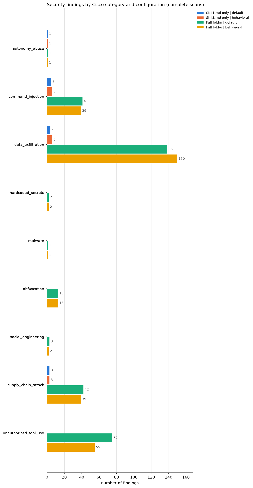
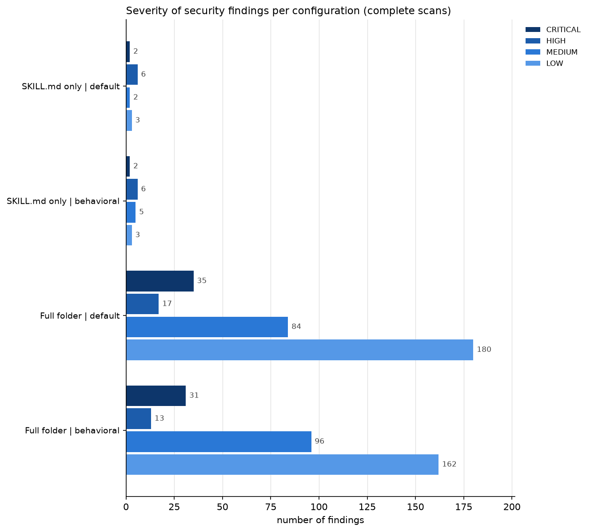
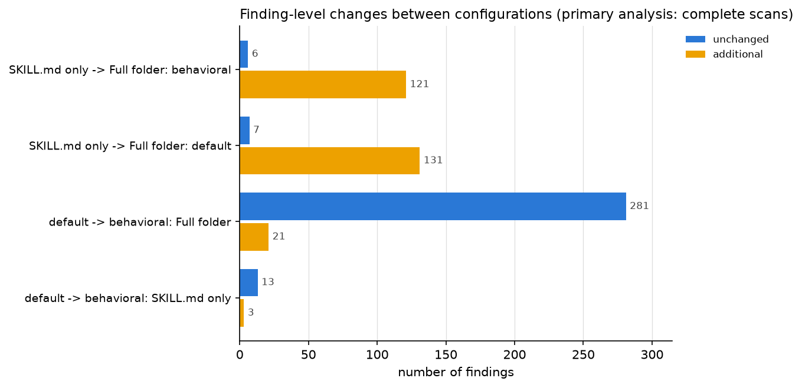

# Cisco Skill Scanner results: `2026-11-15_231707_sample1000-seed2030-batch2`

Generated automatically by `notebooks/01_cisco_scanner_dataset_ready.ipynb` on 2026-11-16T07:58:29+00:00. Every number below is computed from the files in this run folder. A finding is a Cisco rule match on an operation, not a confirmed vulnerability.

## A. Experiment overview

| item | value |
|---|---|
| Run ID | 2026-11-15_231707_sample1000-seed2030-batch2 |
| Run mode | scan (Cisco executed in this run) |
| Dataset | agent_skills_sample.db (SHA-256 683888c923a5...) |
| Sample | agent_skills_sample_seed2030_scripts400_supporting_no_scripts300_skill_md_only300 (250 skills; manifest results/skillguard_runs/main1000/manifests/batch2_of4_manifest.csv) |
| Scanner version that produced the reports | skill-scanner 2.3.1 |
| Scan policy (name / preset) | default / balanced |
| Policy fingerprint(s) | 3f48e661bfbc... |
| Scans executed (report timestamps, UTC) | 2026-11-16 07:17:10 to 2026-11-16 07:58:24 |
| Analysis written | 2026-11-16T07:58:29+00:00 |
| Skills selected / exported | 250 / 250 |
| Skill folders complete / incomplete | 216 / 34 |
| Configurations per skill | 4 |
| Configurations planned (skills x configurations) | 1000 |
| Cisco scans executed | 1000 |
| Configurations excluded by design: incomplete GitSkills folder (full-folder scan not run) | 0 |
| Outcomes of the executed scans | complete: 900, contract_only: 4, partial: 96, failed: 0 |
| Finding records (all readable reports) | 1691 (complete scans: 1487, contract-only scans: 54, partial scans: 150) |
| Security finding records in complete scans | 647 |
| Distinct rule/location combinations (skill, rule, file, line), all findings | 613 |
| Distinct rule/location combinations, security findings in complete scans | 336 |

Planned configurations, executed Cisco scans and outcomes per configuration. complete = primary results; contract_only = only Cisco's known rule-registration error, used in the sensitivity analysis only; partial = other analyzer problems, preliminary only; failed = Cisco ran but produced no usable report; excluded_incomplete_folder = design exclusion, Cisco was not run because GitSkills did not store the whole folder; missing = no saved report:

| configuration | planned | executed | complete | contract_only | partial | failed | excluded_incomplete_folder | missing |
|---|---|---|---|---|---|---|---|---|
| SKILL.md only \| default | 250 | 250 | 226 | 0 | 24 | 0 | 0 | 0 |
| SKILL.md only \| behavioral | 250 | 250 | 226 | 0 | 24 | 0 | 0 | 0 |
| Full folder \| default | 250 | 250 | 226 | 0 | 24 | 0 | 0 | 0 |
| Full folder \| behavioral | 250 | 250 | 222 | 4 | 24 | 0 | 0 | 0 |
| total | 1000 | 1000 | 900 | 4 | 96 | 0 | 0 | 0 |

Results by sampling stratum. Strata were sampled with equal allocation, so counts within a stratum can be reported directly, but proportions for the whole population need the design weights in `sample/sampling_metadata.json`:

| stratum | skills | complete folders | configurations planned | scans executed | scans complete | scans contract_only | scans partial | scans failed | configurations excluded_incomplete_folder | configurations missing | skills with >= 1 security finding (complete scans) | security finding records (complete scans) |
|---|---|---|---|---|---|---|---|---|---|---|---|---|
| scripts | 100 | 74 | 400 | 400 | 348 | 4 | 48 | 0 | 0 | 0 | 49 | 637 |
| supporting_no_scripts | 75 | 67 | 300 | 300 | 276 | 0 | 24 | 0 | 0 | 0 | 4 | 10 |
| skill_md_only | 75 | 75 | 300 | 300 | 276 | 0 | 24 | 0 | 0 | 0 | 0 | 0 |

## B. Security findings (complete scans only)

B1. Findings by severity

| configuration | CRITICAL | HIGH | MEDIUM | LOW |
|---|---|---|---|---|
| SKILL.md only \| default | 2 | 6 | 2 | 3 |
| SKILL.md only \| behavioral | 2 | 6 | 5 | 3 |
| Full folder \| default | 35 | 17 | 84 | 180 |
| Full folder \| behavioral | 31 | 13 | 96 | 162 |

B2. Findings by Cisco category (per configuration) and distinct skills affected (any complete configuration)

| cisco_category | SKILL.md only \| default | SKILL.md only \| behavioral | Full folder \| default | Full folder \| behavioral | distinct_skills |
|---|---|---|---|---|---|
| autonomy_abuse | 1 | 1 | 1 | 1 | 1 |
| command_injection | 5 | 6 | 41 | 39 | 16 |
| data_exfiltration | 4 | 6 | 138 | 150 | 32 |
| hardcoded_secrets | 0 | 0 | 2 | 2 | 1 |
| malware | 0 | 0 | 1 | 1 | 1 |
| obfuscation | 0 | 0 | 13 | 13 | 6 |
| social_engineering | 0 | 0 | 3 | 2 | 3 |
| supply_chain_attack | 3 | 3 | 42 | 39 | 8 |
| unauthorized_tool_use | 0 | 0 | 75 | 55 | 31 |

B3. Findings by research category (our mapping; categories without Cisco rules stay at zero)

| research_category | SKILL.md only \| default | SKILL.md only \| behavioral | Full folder \| default | Full folder \| behavioral | distinct_skills |
|---|---|---|---|---|---|
| Credential / secret access or exposure | 0 | 0 | 3 | 3 | 2 |
| External network communication / data exfiltration | 2 | 3 | 133 | 126 | 25 |
| Command execution / dangerous shell operations | 7 | 9 | 43 | 60 | 19 |
| File-system access or modification | 0 | 0 | 2 | 2 | 2 |
| Prompt injection / instruction manipulation | 0 | 0 | 3 | 2 | 3 |
| Excessive permissions / privilege escalation | 1 | 1 | 72 | 52 | 31 |
| Supply-chain / dependency risks | 3 | 3 | 46 | 43 | 9 |
| Account modification / sensitive external actions | 0 | 0 | 0 | 0 | 0 |
| Other (malware) | 0 | 0 | 1 | 1 | 1 |
| Other (obfuscation) | 0 | 0 | 13 | 13 | 6 |

B4. Most frequently triggered security rules

| rule_id | cisco_category | findings | distinct_skills | severities |
|---|---|---|---|---|
| DATA_EXFIL_JS_FS_ACCESS | data_exfiltration | 162 | 6 | LOW |
| SUPPLY_CHAIN_UNPINNED_DEPENDENCY | supply_chain_attack | 87 | 8 | LOW |
| UNDECLARED_NETWORK_DESTINATION | unauthorized_tool_use | 80 | 20 | LOW |
| DATA_EXFIL_NETWORK_REQUESTS | data_exfiltration | 73 | 13 | MEDIUM |
| TOOL_ABUSE_UNDECLARED_NETWORK | unauthorized_tool_use | 32 | 18 | MEDIUM |
| COMMAND_INJECTION_JS_CHILD_PROCESS | command_injection | 31 | 3 | CRITICAL |
| BEHAVIOR_BASH_TAINT_FLOW | data_exfiltration | 20 | 7 | MEDIUM |
| DATA_EXFIL_JS_NETWORK | data_exfiltration | 18 | 6 | MEDIUM |
| FILE_MAGIC_MISMATCH | obfuscation | 14 | 4 | LOW, MEDIUM |
| HIDDEN_DATA_FILE | obfuscation | 12 | 3 | LOW |

B5. Where the findings point

| location | SKILL.md only \| default | SKILL.md only \| behavioral | Full folder \| default | Full folder \| behavioral |
|---|---|---|---|---|
| SKILL.md | 13 | 16 | 39 | 32 |
| supporting file | 0 | 0 | 277 | 270 |

B6. Findings outside the primary group: contract-only and partial scans (excluded from B1-B5)

| run_status | configuration | rule_id | severity | findings |
|---|---|---|---|---|
| CONTRACT_ONLY | Full folder \| behavioral | ALLOWED_TOOLS_GREP_VIOLATION | LOW | 1 |
| CONTRACT_ONLY | Full folder \| behavioral | ALLOWED_TOOLS_NETWORK_USAGE | MEDIUM | 1 |
| CONTRACT_ONLY | Full folder \| behavioral | BEHAVIOR_CROSSFILE_ENV_VAR_EXFILTRATION | CRITICAL | 4 |
| CONTRACT_ONLY | Full folder \| behavioral | BEHAVIOR_CROSSFILE_EXFILTRATION_CHAIN | CRITICAL | 3 |
| CONTRACT_ONLY | Full folder \| behavioral | BEHAVIOR_ENV_VAR_EXFILTRATION | CRITICAL | 7 |
| CONTRACT_ONLY | Full folder \| behavioral | COMMAND_INJECTION_JS_CHILD_PROCESS | CRITICAL | 3 |
| CONTRACT_ONLY | Full folder \| behavioral | COMMAND_INJECTION_OS_SYSTEM | CRITICAL | 1 |
| CONTRACT_ONLY | Full folder \| behavioral | CORRELATED_SENSITIVE_NETWORK_FLOW | HIGH | 4 |
| CONTRACT_ONLY | Full folder \| behavioral | DATA_EXFIL_NETWORK_REQUESTS | MEDIUM | 3 |
| CONTRACT_ONLY | Full folder \| behavioral | MDBLOCK_PYTHON_HTTP_POST | MEDIUM | 1 |
| CONTRACT_ONLY | Full folder \| behavioral | SOCIAL_ENG_MISLEADING_DESC | MEDIUM | 1 |
| CONTRACT_ONLY | Full folder \| behavioral | SUPPLY_CHAIN_UNPINNED_DEPENDENCY | LOW | 3 |
| CONTRACT_ONLY | Full folder \| behavioral | TOOL_ABUSE_UNDECLARED_NETWORK | MEDIUM | 4 |
| CONTRACT_ONLY | Full folder \| behavioral | UNDECLARED_NETWORK_DESTINATION | LOW | 14 |
| PARTIAL | SKILL.md only \| behavioral | BEHAVIOR_BASH_TAINT_FLOW | MEDIUM | 2 |
| PARTIAL | Full folder \| default | COMMAND_INJECTION_EVAL | CRITICAL | 1 |
| PARTIAL | Full folder \| default | COMPOUND_FIND_EXEC | CRITICAL | 1 |
| PARTIAL | Full folder \| default | CORRELATED_NETWORK_EXECUTION_FLOW | HIGH | 1 |
| PARTIAL | Full folder \| default | DATA_EXFIL_JS_FS_ACCESS | LOW | 14 |
| PARTIAL | Full folder \| default | DATA_EXFIL_JS_NETWORK | MEDIUM | 1 |

_16 more row(s) in the CSV files._

## C. Configuration comparisons

The **primary analysis** uses only pairs in which both scans are COMPLETE (and, for SKILL.md-only vs full-folder, the folder is complete). The **sensitivity analysis** adds pairs that contain a CONTRACT_ONLY scan. Contract-only scans are not assumed complete or accurate; the sensitivity analysis only shows whether including them would change a result.

C1. Sample sizes and excluded pairs per comparison (`excluded_*` = pairs left out of the primary analysis, by reason; contract-only pairs are added back in the sensitivity analysis)

| comparison | pairs_total | primary_n | sensitivity_n | excluded_contract_only | excluded_partial | excluded_incomplete_folder | excluded_not_comparable |
|---|---|---|---|---|---|---|---|
| SKILL.md only -> Full folder: default | 250 | 196 | 196 | 0 | 20 | 34 | 0 |
| SKILL.md only -> Full folder: behavioral | 250 | 193 | 196 | 3 | 20 | 34 | 0 |
| default -> behavioral: SKILL.md only | 250 | 226 | 226 | 0 | 24 | 0 | 0 |
| default -> behavioral: Full folder | 250 | 222 | 226 | 4 | 24 | 0 | 0 |

C2. Primary analysis (complete scans only): finding-level changes summed over the pairs used

| comparison | pairs_used | pairs_with_findings | unchanged | changed | possibly_equivalent | additional | missing | skills_with_additional |
|---|---|---|---|---|---|---|---|---|
| SKILL.md only -> Full folder: default | 196 | 37 | 7 | 0 | 0 | 131 | 0 | 35 |
| SKILL.md only -> Full folder: behavioral | 193 | 34 | 6 | 0 | 0 | 121 | 0 | 33 |
| default -> behavioral: SKILL.md only | 226 | 7 | 13 | 0 | 0 | 3 | 0 | 3 |
| default -> behavioral: Full folder | 222 | 49 | 281 | 0 | 0 | 21 | 0 | 8 |

C3. Files that contribute the additional findings in the primary SKILL.md-only vs full-folder comparison (a SKILL.md row means Cisco re-read the instructions once the scripts were present)

| location | file_path | findings | skills | rules |
|---|---|---|---|---|
| SKILL.md | SKILL.md | 34 | 15 | ALLOWED_TOOLS_GREP_VIOLATION, ALLOWED_TOOLS_NETWORK_USAGE, SOCIAL_ENG_MISLEADING_DESC, TOOL_ABUSE_UNDECLARED_NETWORK |
| supporting file | .clawhub/origin.json | 2 | 1 | HIDDEN_DATA_FILE |
| supporting file | .openskills.json | 2 | 1 | HIDDEN_DATA_FILE |
| supporting file | SKILL.test.ts | 2 | 1 | COMMAND_INJECTION_JS_FUNCTION_CONSTRUCTOR |
| supporting file | balance.js | 2 | 1 | DATA_EXFIL_JS_FS_ACCESS |
| supporting file | eval-viewer/generate_review.py | 4 | 2 | COMMAND_INJECTION_OS_SYSTEM |
| supporting file | generate-image.ts | 2 | 1 | DATA_EXFIL_JS_NETWORK |
| supporting file | index.js | 2 | 1 | DATA_EXFIL_JS_NETWORK |
| supporting file | package.json | 2 | 1 | SUPPLY_CHAIN_UNPINNED_DEPENDENCY |
| supporting file | references/languages/java/scripts/upgrade_bom.py | 2 | 1 | DATA_EXFIL_NETWORK_REQUESTS |
| supporting file | references/pyproject.toml | 2 | 1 | SUPPLY_CHAIN_UNPINNED_DEPENDENCY |
| supporting file | references/standard-subject-mapping-income-statement.md | 2 | 1 | FILE_MAGIC_MISMATCH |
| supporting file | references/ytdlp-quirks.md | 1 | 1 | MDBLOCK_PYTHON_SUBPROCESS |
| supporting file | requirements.txt | 2 | 1 | SUPPLY_CHAIN_UNPINNED_DEPENDENCY |
| supporting file | scripts/__init__.py | 2 | 1 | FILE_MAGIC_MISMATCH |
| supporting file | scripts/_role_provision.part1.txt | 2 | 1 | FILE_MAGIC_MISMATCH |
| supporting file | scripts/_role_provision.part2.txt | 2 | 1 | FILE_MAGIC_MISMATCH |
| supporting file | scripts/_role_provision.part3.txt | 4 | 1 | FILE_MAGIC_MISMATCH, YARA_code_execution_generic |
| supporting file | scripts/_role_provision.py | 2 | 1 | COMMAND_INJECTION_EVAL |
| supporting file | scripts/agent.py | 16 | 2 | COMMAND_INJECTION_EVAL, DATA_EXFIL_NETWORK_REQUESTS, UNDECLARED_NETWORK_DESTINATION |

_33 more row(s) in the CSV files._

C4. Sensitivity analysis (complete + contract-only scans): finding-level changes summed over the pairs used

| comparison | pairs_used | pairs_with_findings | unchanged | changed | possibly_equivalent | additional | missing | skills_with_additional |
|---|---|---|---|---|---|---|---|---|
| SKILL.md only -> Full folder: default | 196 | 37 | 7 | 0 | 0 | 131 | 0 | 35 |
| SKILL.md only -> Full folder: behavioral | 196 | 37 | 9 | 0 | 0 | 141 | 0 | 36 |
| default -> behavioral: SKILL.md only | 226 | 7 | 13 | 0 | 0 | 3 | 0 | 3 |
| default -> behavioral: Full folder | 226 | 53 | 316 | 0 | 0 | 36 | 0 | 12 |

C5. Does including contract-only scans change the comparisons?

- SKILL.md only -> Full folder: default: no contract-only pairs, so the sensitivity analysis equals the primary analysis (n = 196).
- SKILL.md only -> Full folder: behavioral: primary n = 193, sensitivity n = 196. Additional findings 121 vs 141, missing 0 vs 0, unchanged 6 vs 9; skills gaining findings 33 vs 36 (primary vs sensitivity).
- default -> behavioral: SKILL.md only: no contract-only pairs, so the sensitivity analysis equals the primary analysis (n = 226).
- default -> behavioral: Full folder: primary n = 222, sensitivity n = 226. Additional findings 21 vs 36, missing 0 vs 0, unchanged 281 vs 316; skills gaining findings 8 vs 12 (primary vs sensitivity).
- 7 finding record(s) in contract-only scans carry Cisco's own `rule_contract = invalid` flag (rules: BEHAVIOR_CROSSFILE_ENV_VAR_EXFILTRATION, BEHAVIOR_CROSSFILE_EXFILTRATION_CHAIN); Cisco excludes these from its policy gating.

C6. Pair status per skill

| comparison | skill_id | before | after | pair_status |
|---|---|---|---|---|
| SKILL.md only -> Full folder: default | performing-threat-modeling-with-owa-544917512477 | SKILL.md only \| default (COMPLETE) | Full folder \| default (COMPLETE) | eligible |
| SKILL.md only -> Full folder: behavioral | performing-threat-modeling-with-owa-544917512477 | SKILL.md only \| behavioral (COMPLETE) | Full folder \| behavioral (COMPLETE) | eligible |
| SKILL.md only -> Full folder: default | vestaboard-safari-screenshots-2eb56d416f0e | SKILL.md only \| default (COMPLETE) | Full folder \| default (COMPLETE) | eligible |
| SKILL.md only -> Full folder: behavioral | vestaboard-safari-screenshots-2eb56d416f0e | SKILL.md only \| behavioral (COMPLETE) | Full folder \| behavioral (COMPLETE) | eligible |
| SKILL.md only -> Full folder: default | ui-design-system-4dbc34901efb | SKILL.md only \| default (COMPLETE) | Full folder \| default (COMPLETE) | preliminary: incomplete folder |
| SKILL.md only -> Full folder: behavioral | ui-design-system-4dbc34901efb | SKILL.md only \| behavioral (COMPLETE) | Full folder \| behavioral (COMPLETE) | preliminary: incomplete folder |
| SKILL.md only -> Full folder: default | drawing-diagrams-bed1aced29cd | SKILL.md only \| default (COMPLETE) | Full folder \| default (COMPLETE) | eligible |
| SKILL.md only -> Full folder: behavioral | drawing-diagrams-bed1aced29cd | SKILL.md only \| behavioral (COMPLETE) | Full folder \| behavioral (COMPLETE) | eligible |
| SKILL.md only -> Full folder: default | sample-skill-8b2fd2a3cb08 | SKILL.md only \| default (COMPLETE) | Full folder \| default (COMPLETE) | eligible |
| SKILL.md only -> Full folder: behavioral | sample-skill-8b2fd2a3cb08 | SKILL.md only \| behavioral (COMPLETE) | Full folder \| behavioral (COMPLETE) | eligible |
| SKILL.md only -> Full folder: default | botlearn-selfoptimize-f9b81f1634b9 | SKILL.md only \| default (COMPLETE) | Full folder \| default (COMPLETE) | preliminary: incomplete folder |
| SKILL.md only -> Full folder: behavioral | botlearn-selfoptimize-f9b81f1634b9 | SKILL.md only \| behavioral (COMPLETE) | Full folder \| behavioral (COMPLETE) | preliminary: incomplete folder |
| SKILL.md only -> Full folder: default | e2e-test-writing-d3e2e70da80c | SKILL.md only \| default (COMPLETE) | Full folder \| default (COMPLETE) | eligible |
| SKILL.md only -> Full folder: behavioral | e2e-test-writing-d3e2e70da80c | SKILL.md only \| behavioral (COMPLETE) | Full folder \| behavioral (COMPLETE) | eligible |
| SKILL.md only -> Full folder: default | detecting-golden-ticket-forgery-0b384ff76feb | SKILL.md only \| default (COMPLETE) | Full folder \| default (COMPLETE) | eligible |
| SKILL.md only -> Full folder: behavioral | detecting-golden-ticket-forgery-0b384ff76feb | SKILL.md only \| behavioral (COMPLETE) | Full folder \| behavioral (COMPLETE) | eligible |
| SKILL.md only -> Full folder: default | excalidraw-diagram-c05bce28883e | SKILL.md only \| default (COMPLETE) | Full folder \| default (COMPLETE) | eligible |
| SKILL.md only -> Full folder: behavioral | excalidraw-diagram-c05bce28883e | SKILL.md only \| behavioral (COMPLETE) | Full folder \| behavioral (COMPLETE) | eligible |
| SKILL.md only -> Full folder: default | academic-formatting-workflow-b2c174e98f5b | SKILL.md only \| default (COMPLETE) | Full folder \| default (COMPLETE) | eligible |
| SKILL.md only -> Full folder: behavioral | academic-formatting-workflow-b2c174e98f5b | SKILL.md only \| behavioral (COMPLETE) | Full folder \| behavioral (COMPLETE) | eligible |

_980 more row(s) in the CSV files._

## D. Scanner reliability

D1. Analyzer failures reported by Cisco

| skill_id | configuration | status | analyzer | failure_type | error |
|---|---|---|---|---|---|
| mean-reversion-66d706784017 | Full folder \| behavioral | CONTRACT_ONLY | behavioral | finding contract: unregistered rule (known Cisco issue) | FindingContract:BEHAVIOR_CROSSFILE_EXFILTRATION_CHAIN:UNKNOWN_BUNDLED_PYTHON_RULE |
| mean-reversion-66d706784017 | Full folder \| behavioral | CONTRACT_ONLY | behavioral | finding contract: unregistered rule (known Cisco issue) | FindingContract:BEHAVIOR_CROSSFILE_ENV_VAR_EXFILTRATION:UNKNOWN_BUNDLED_PYTHON_RULE |
| skill-d079d2317018 | Full folder \| behavioral | CONTRACT_ONLY | behavioral | finding contract: unregistered rule (known Cisco issue) | FindingContract:BEHAVIOR_CROSSFILE_EXFILTRATION_CHAIN:UNKNOWN_BUNDLED_PYTHON_RULE |
| skill-d079d2317018 | Full folder \| behavioral | CONTRACT_ONLY | behavioral | finding contract: unregistered rule (known Cisco issue) | FindingContract:BEHAVIOR_CROSSFILE_ENV_VAR_EXFILTRATION:UNKNOWN_BUNDLED_PYTHON_RULE |
| slurm-monitoring-accounting-starter-01ed21229420 | SKILL.md only \| default | PARTIAL | skill_loader | skill loader | SkillLoadError:MISSING_REQUIRED_MANIFEST_FIELD |
| slurm-monitoring-accounting-starter-01ed21229420 | SKILL.md only \| behavioral | PARTIAL | skill_loader | skill loader | SkillLoadError:MISSING_REQUIRED_MANIFEST_FIELD |
| slurm-monitoring-accounting-starter-01ed21229420 | Full folder \| default | PARTIAL | skill_loader | skill loader | SkillLoadError:MISSING_REQUIRED_MANIFEST_FIELD |
| slurm-monitoring-accounting-starter-01ed21229420 | Full folder \| behavioral | PARTIAL | skill_loader | skill loader | SkillLoadError:MISSING_REQUIRED_MANIFEST_FIELD |
| social-publisher-e348b66f0637 | SKILL.md only \| default | PARTIAL | skill_loader | skill loader | SkillLoadError:MALFORMED_YAML_FRONTMATTER |
| social-publisher-e348b66f0637 | SKILL.md only \| behavioral | PARTIAL | skill_loader | skill loader | SkillLoadError:MALFORMED_YAML_FRONTMATTER |
| social-publisher-e348b66f0637 | Full folder \| default | PARTIAL | skill_loader | skill loader | SkillLoadError:MALFORMED_YAML_FRONTMATTER |
| social-publisher-e348b66f0637 | Full folder \| behavioral | PARTIAL | skill_loader | skill loader | SkillLoadError:MALFORMED_YAML_FRONTMATTER |
| appmesh-remote-d14de949cd3b | SKILL.md only \| default | PARTIAL | skill_loader | skill loader | SkillLoadError:MISSING_REQUIRED_MANIFEST_FIELD |
| appmesh-remote-d14de949cd3b | SKILL.md only \| behavioral | PARTIAL | skill_loader | skill loader | SkillLoadError:MISSING_REQUIRED_MANIFEST_FIELD |
| appmesh-remote-d14de949cd3b | Full folder \| default | PARTIAL | skill_loader | skill loader | SkillLoadError:MISSING_REQUIRED_MANIFEST_FIELD |
| appmesh-remote-d14de949cd3b | Full folder \| behavioral | PARTIAL | skill_loader | skill loader | SkillLoadError:MISSING_REQUIRED_MANIFEST_FIELD |
| journal_skill-884b7ddbcb9c | SKILL.md only \| default | PARTIAL | skill_loader | skill loader | SkillLoadError:MISSING_REQUIRED_MANIFEST_FIELD |
| journal_skill-884b7ddbcb9c | SKILL.md only \| behavioral | PARTIAL | skill_loader | skill loader | SkillLoadError:MISSING_REQUIRED_MANIFEST_FIELD |
| journal_skill-884b7ddbcb9c | Full folder \| default | PARTIAL | skill_loader | skill loader | SkillLoadError:MISSING_REQUIRED_MANIFEST_FIELD |
| journal_skill-884b7ddbcb9c | Full folder \| behavioral | PARTIAL | skill_loader | skill loader | SkillLoadError:MISSING_REQUIRED_MANIFEST_FIELD |

_83 more row(s) in the CSV files._

D2. Skill folders

| skill_id | supporting_files_exported | files_missing | folder_complete | integrity |
|---|---|---|---|---|
| performing-threat-modeling-with-owa-544917512477 | 7 | 0 | True | ok: written in this run |
| vestaboard-safari-screenshots-2eb56d416f0e | 3 | 0 | True | ok: written in this run |
| ui-design-system-4dbc34901efb | 5 | 0 | False | ok: written in this run |
| drawing-diagrams-bed1aced29cd | 1 | 0 | True | ok: written in this run |
| sample-skill-8b2fd2a3cb08 | 1 | 0 | True | ok: written in this run |
| botlearn-selfoptimize-f9b81f1634b9 | 10 | 0 | False | ok: written in this run |
| e2e-test-writing-d3e2e70da80c | 11 | 0 | True | ok: written in this run |
| detecting-golden-ticket-forgery-0b384ff76feb | 3 | 0 | True | ok: written in this run |
| excalidraw-diagram-c05bce28883e | 5 | 0 | True | ok: written in this run |
| academic-formatting-workflow-b2c174e98f5b | 10 | 0 | True | ok: written in this run |
| mean-reversion-66d706784017 | 4 | 0 | True | ok: written in this run |
| color-93bdfd999d7b | 3 | 0 | True | ok: written in this run |
| output-96fabae8dee6 | 15 | 0 | True | ok: written in this run |
| listenhub-7b57a00218af | 12 | 0 | True | ok: written in this run |
| audit-evidence-export-b8bf7d4ec17f | 2 | 0 | True | ok: written in this run |
| skill-creator-a637bbe2981a | 4 | 6 | False | ok: written in this run |
| notion-bill-b5608eb0294b | 6 | 0 | True | ok: written in this run |
| polymarket-weather-trader-50c328a8fcbf | 5 | 0 | False | ok: written in this run |
| post-bridge-e00c2dccb897 | 1 | 0 | True | ok: written in this run |
| youtube-content-7162d1c45997 | 16 | 0 | True | ok: written in this run |

_230 more row(s) in the CSV files._

D3. Scanner verdict vs finding severity

| skill_id | configuration | outcome | is_safe | cisco_max_severity | highest_security_severity | security_findings | security_medium_or_lower | note |
|---|---|---|---|---|---|---|---|---|
| performing-threat-modeling-with-owa-544917512477 | SKILL.md only \| default | complete | True | SAFE | none | 0 | 0 | no findings |
| performing-threat-modeling-with-owa-544917512477 | SKILL.md only \| behavioral | complete | True | SAFE | none | 0 | 0 | no findings |
| performing-threat-modeling-with-owa-544917512477 | Full folder \| default | complete | True | SAFE | none | 0 | 0 | no findings |
| performing-threat-modeling-with-owa-544917512477 | Full folder \| behavioral | complete | True | SAFE | none | 0 | 0 | no findings |
| vestaboard-safari-screenshots-2eb56d416f0e | SKILL.md only \| default | complete | True | INFO | none | 0 | 0 | only metadata/coverage findings |
| vestaboard-safari-screenshots-2eb56d416f0e | SKILL.md only \| behavioral | complete | True | INFO | none | 0 | 0 | only metadata/coverage findings |
| vestaboard-safari-screenshots-2eb56d416f0e | Full folder \| default | complete | True | MEDIUM | MEDIUM | 3 | 3 | is_safe=True although there are 3 security finding(s) up to MEDIUM |
| vestaboard-safari-screenshots-2eb56d416f0e | Full folder \| behavioral | complete | True | MEDIUM | MEDIUM | 3 | 3 | is_safe=True although there are 3 security finding(s) up to MEDIUM |
| ui-design-system-4dbc34901efb | SKILL.md only \| default | complete | True | INFO | none | 0 | 0 | only metadata/coverage findings |
| ui-design-system-4dbc34901efb | SKILL.md only \| behavioral | complete | True | INFO | none | 0 | 0 | only metadata/coverage findings |
| ui-design-system-4dbc34901efb | Full folder \| default | complete | True | INFO | none | 0 | 0 | only metadata/coverage findings |
| ui-design-system-4dbc34901efb | Full folder \| behavioral | complete | True | INFO | none | 0 | 0 | only metadata/coverage findings |
| drawing-diagrams-bed1aced29cd | SKILL.md only \| default | complete | True | SAFE | none | 0 | 0 | no findings |
| drawing-diagrams-bed1aced29cd | SKILL.md only \| behavioral | complete | True | SAFE | none | 0 | 0 | no findings |
| drawing-diagrams-bed1aced29cd | Full folder \| default | complete | True | SAFE | none | 0 | 0 | no findings |
| drawing-diagrams-bed1aced29cd | Full folder \| behavioral | complete | True | SAFE | none | 0 | 0 | no findings |
| sample-skill-8b2fd2a3cb08 | SKILL.md only \| default | complete | True | INFO | none | 0 | 0 | only metadata/coverage findings |
| sample-skill-8b2fd2a3cb08 | SKILL.md only \| behavioral | complete | True | INFO | none | 0 | 0 | only metadata/coverage findings |
| sample-skill-8b2fd2a3cb08 | Full folder \| default | complete | True | INFO | none | 0 | 0 | only metadata/coverage findings |
| sample-skill-8b2fd2a3cb08 | Full folder \| behavioral | complete | True | INFO | none | 0 | 0 | only metadata/coverage findings |

_980 more row(s) in the CSV files._

D4. Evidence check of reported locations (counts of finding records per rule)

| rule_id | exact | mismatch | unavailable |
|---|---|---|---|
| ACTIVE_DYNAMIC_EXECUTION | 4 | 0 | 0 |
| ALLOWED_TOOLS_BASH_VIOLATION | 0 | 0 | 2 |
| ALLOWED_TOOLS_GREP_VIOLATION | 0 | 0 | 4 |
| ALLOWED_TOOLS_NETWORK_USAGE | 0 | 0 | 4 |
| BEHAVIOR_BASH_TAINT_FLOW | 20 | 6 | 0 |
| BEHAVIOR_CROSSFILE_ENV_VAR_EXFILTRATION | 0 | 0 | 4 |
| BEHAVIOR_CROSSFILE_EXFILTRATION_CHAIN | 0 | 0 | 3 |
| BEHAVIOR_ENV_VAR_EXFILTRATION | 0 | 0 | 7 |
| COMMAND_INJECTION_EVAL | 14 | 0 | 0 |
| COMMAND_INJECTION_JS_CHILD_PROCESS | 34 | 0 | 0 |
| COMMAND_INJECTION_JS_FUNCTION_CONSTRUCTOR | 6 | 0 | 0 |
| COMMAND_INJECTION_OS_SYSTEM | 8 | 0 | 0 |
| COMPOUND_FETCH_EXECUTE | 6 | 6 | 0 |
| COMPOUND_FIND_EXEC | 0 | 2 | 0 |
| CORRELATED_NETWORK_EXECUTION_FLOW | 0 | 0 | 12 |
| CORRELATED_NETWORK_FILE_WRITE_FLOW | 0 | 0 | 2 |
| CORRELATED_SENSITIVE_NETWORK_FLOW | 0 | 0 | 14 |
| DATA_EXFIL_ENV_VARS | 2 | 0 | 0 |
| DATA_EXFIL_JS_FS_ACCESS | 190 | 0 | 0 |
| DATA_EXFIL_JS_NETWORK | 20 | 0 | 0 |

_22 more row(s) in the CSV files._

## E. Manual security review

`manual_review_template.csv` lists 378 distinct security finding location(s) (42 seen only in contract-only or partial scans) with Cisco's rule, severity, reported file and line, redacted evidence and evidence check. The columns `reviewer`, `evidence_verified`, `legitimate_purpose`, `interpretation` and `notes` are intentionally blank; no finding has been labelled as a vulnerability or a false positive.

## Figures

## Limitations

- 4 of 1000 executed scan(s) were CONTRACT_ONLY: their only recorded problem is Cisco's rule-registration error for BEHAVIOR_CROSSFILE_ENV_VAR_EXFILTRATION, BEHAVIOR_CROSSFILE_EXFILTRATION_CHAIN. Their 54 finding record(s) are excluded from primary results and used only in the sensitivity analysis; they are not assumed complete or accurate.
- 96 of 1000 executed scan(s) were PARTIAL (Cisco analyzer failure: skill loader: 96). Their 150 finding record(s) are preliminary evidence and are excluded from primary tables and comparisons.
- 34 skill folder(s) are incomplete in GitSkills (524 supporting file(s) without stored text). This is a design exclusion, not a scanner failure: 0 of 1000 planned configuration(s) (their full-folder scans) were not run, so 1000 Cisco scans were executed. Their SKILL.md-only scans are kept, but their context-comparison pairs are reported as `excluded: incomplete folder`, and no finding count of zero is implied for the excluded configurations.
- 35 of 1691 finding record(s) do not have their evidence on the reported line (mismatch 35, ambiguous 0); rules involved: PIPELINE_TAINT_FLOW (12), COMPOUND_FETCH_EXECUTE (6), BEHAVIOR_BASH_TAINT_FLOW (6), MANDATORY_AUTOMATIC_HELPER_EXECUTION (4), MDBLOCK_PYTHON_SUBPROCESS (3), COMPOUND_FIND_EXEC (2), MDBLOCK_PYTHON_HTTP_POST (2). Reported line numbers are kept unchanged.
- For MDBLOCK_* rules Cisco 2.3.1 counts lines from the code-block fence and, in SKILL.md, from the end of the YAML frontmatter, so their reported lines point above the code; use evidence_candidate_lines to locate it.
- 1176 finding record(s) could not be checked against the file (no file, line or evidence text).
- Scanner findings are rule matches on operations; they are not confirmed vulnerabilities, and nothing here is a false-negative claim (there is no ground truth).
- Finding counts are per matching line; one script can contribute many findings. Distinct skills are reported separately.
- Comparisons match findings by rule, file, reported line and evidence; equivalent behavior reported under different rule IDs is not matched automatically.

## Files in this run folder

- `scan_summary.csv`: one row per skill x configuration: status, outcome, analyzer failures, verdict, counts, versions
- `individual_findings.csv`: one row per Cisco finding: original fields, normalized path, evidence check
- `context_comparison.csv / analyzer_comparison.csv`: finding-level comparisons; pair_status says primary (eligible), sensitivity or preliminary
- `manual_review_template.csv`: blank reviewer columns for manual interpretation
- `run_metadata.json`: settings, dataset hash, scanner versions, policy fingerprints, outcome counts
- `<skill_id>/reports/*.json`: raw Cisco reports, unmodified
- `<skill_id>/manifest.json`: exported files with SHA-256 hashes and missing files
- `figures/*.png`: the charts above
