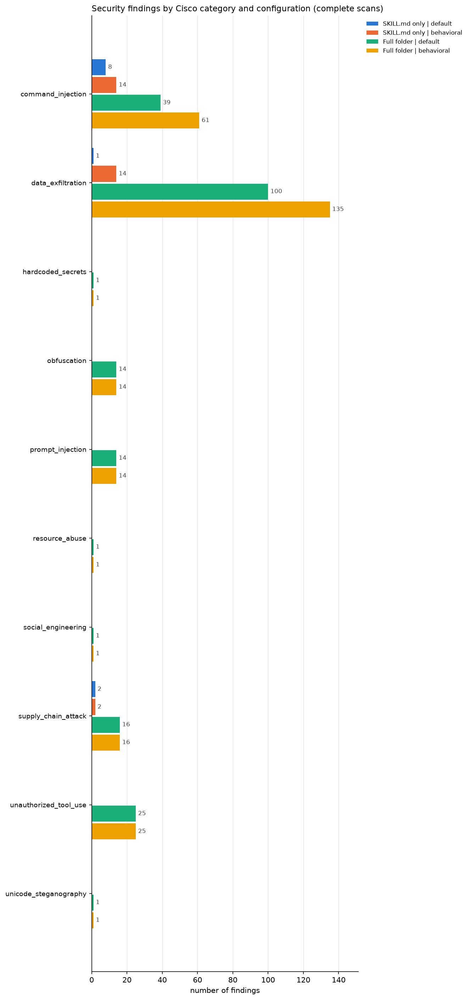
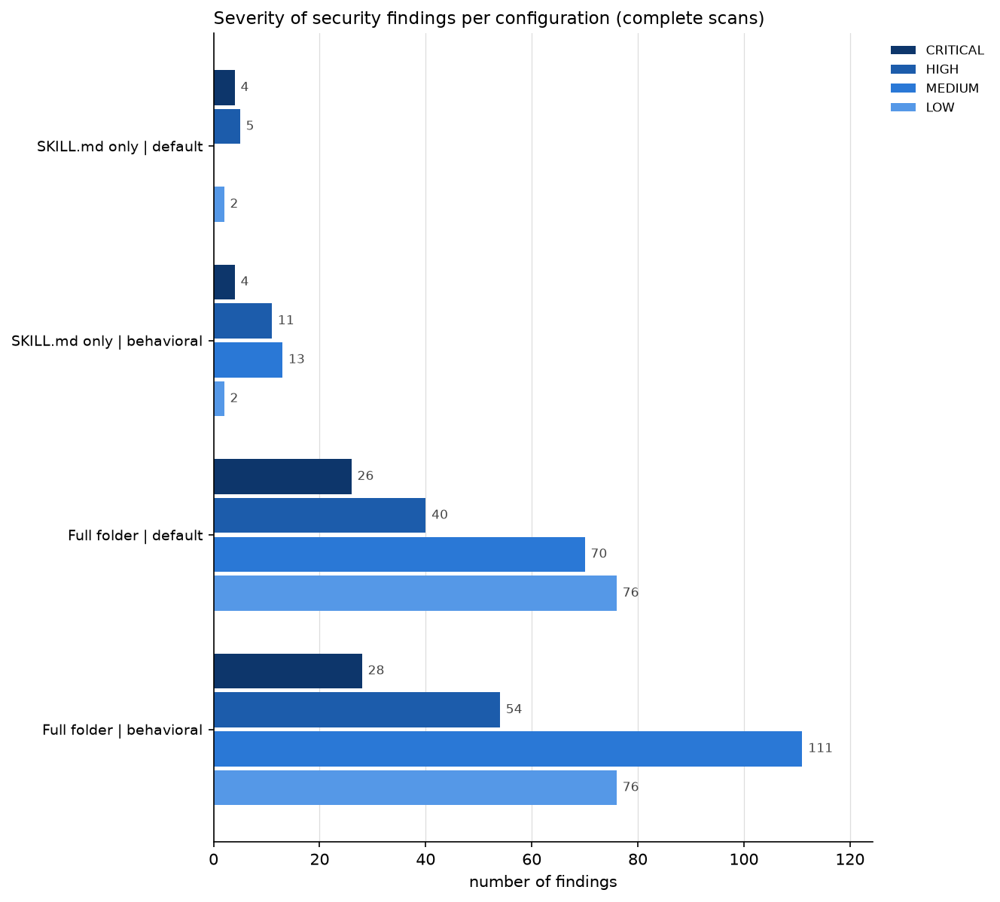
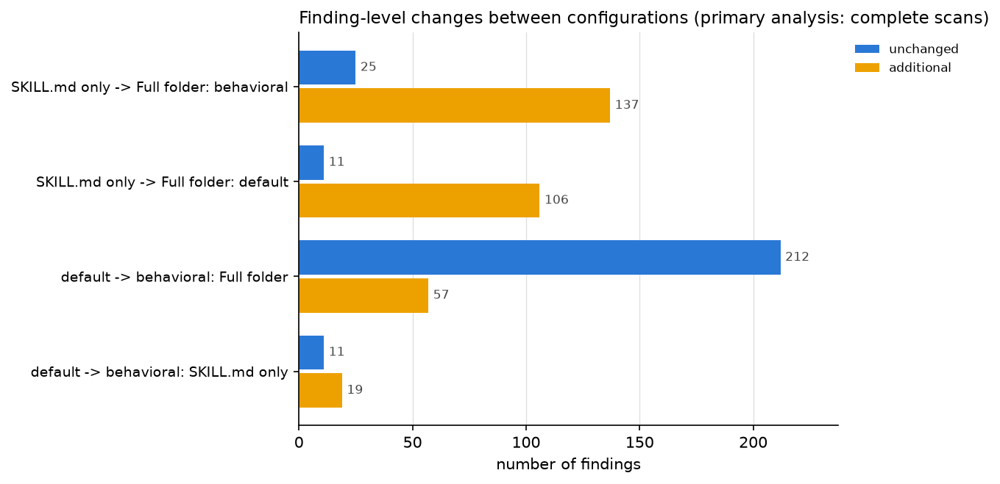

# Cisco Skill Scanner results: `2026-11-15_235841_sample1000-seed2030-batch3`

Generated automatically by `notebooks/01_cisco_scanner_dataset_ready.ipynb` on 2026-11-16T08:39:49+00:00. Every number below is computed from the files in this run folder. A finding is a Cisco rule match on an operation, not a confirmed vulnerability.

## A. Experiment overview

| item | value |
|---|---|
| Run ID | 2026-11-15_235841_sample1000-seed2030-batch3 |
| Run mode | scan (Cisco executed in this run) |
| Dataset | agent_skills_sample.db (SHA-256 683888c923a5...) |
| Sample | agent_skills_sample_seed2030_scripts400_supporting_no_scripts300_skill_md_only300 (250 skills; manifest results/skillguard_runs/main1000/manifests/batch3_of4_manifest.csv) |
| Scanner version that produced the reports | skill-scanner 2.3.1 |
| Scan policy (name / preset) | default / balanced |
| Policy fingerprint(s) | 3f48e661bfbc... |
| Scans executed (report timestamps, UTC) | 2026-11-16 07:58:44 to 2026-11-16 08:39:45 |
| Analysis written | 2026-11-16T08:39:49+00:00 |
| Skills selected / exported | 250 / 250 |
| Skill folders complete / incomplete | 210 / 40 |
| Configurations per skill | 4 |
| Configurations planned (skills x configurations) | 1000 |
| Cisco scans executed | 1000 |
| Configurations excluded by design: incomplete GitSkills folder (full-folder scan not run) | 0 |
| Outcomes of the executed scans | complete: 932, contract_only: 0, partial: 64, failed: 4 |
| Finding records (all readable reports) | 1476 (complete scans: 1406, contract-only scans: 0, partial scans: 70) |
| Security finding records in complete scans | 522 |
| Distinct rule/location combinations (skill, rule, file, line), all findings | 508 |
| Distinct rule/location combinations, security findings in complete scans | 268 |

Planned configurations, executed Cisco scans and outcomes per configuration. complete = primary results; contract_only = only Cisco's known rule-registration error, used in the sensitivity analysis only; partial = other analyzer problems, preliminary only; failed = Cisco ran but produced no usable report; excluded_incomplete_folder = design exclusion, Cisco was not run because GitSkills did not store the whole folder; missing = no saved report:

| configuration | planned | executed | complete | contract_only | partial | failed | excluded_incomplete_folder | missing |
|---|---|---|---|---|---|---|---|---|
| SKILL.md only \| default | 250 | 250 | 233 | 0 | 16 | 1 | 0 | 0 |
| SKILL.md only \| behavioral | 250 | 250 | 233 | 0 | 16 | 1 | 0 | 0 |
| Full folder \| default | 250 | 250 | 233 | 0 | 16 | 1 | 0 | 0 |
| Full folder \| behavioral | 250 | 250 | 233 | 0 | 16 | 1 | 0 | 0 |
| total | 1000 | 1000 | 932 | 0 | 64 | 4 | 0 | 0 |

Results by sampling stratum. Strata were sampled with equal allocation, so counts within a stratum can be reported directly, but proportions for the whole population need the design weights in `sample/sampling_metadata.json`:

| stratum | skills | complete folders | configurations planned | scans executed | scans complete | scans contract_only | scans partial | scans failed | configurations excluded_incomplete_folder | configurations missing | skills with >= 1 security finding (complete scans) | security finding records (complete scans) |
|---|---|---|---|---|---|---|---|---|---|---|---|---|
| scripts | 100 | 70 | 400 | 400 | 368 | 0 | 28 | 4 | 0 | 0 | 47 | 481 |
| supporting_no_scripts | 75 | 65 | 300 | 300 | 280 | 0 | 20 | 0 | 0 | 0 | 7 | 33 |
| skill_md_only | 75 | 75 | 300 | 300 | 284 | 0 | 16 | 0 | 0 | 0 | 1 | 8 |

## B. Security findings (complete scans only)

B1. Findings by severity

| configuration | CRITICAL | HIGH | MEDIUM | LOW |
|---|---|---|---|---|
| SKILL.md only \| default | 4 | 5 | 0 | 2 |
| SKILL.md only \| behavioral | 4 | 11 | 13 | 2 |
| Full folder \| default | 26 | 40 | 70 | 76 |
| Full folder \| behavioral | 28 | 54 | 111 | 76 |

B2. Findings by Cisco category (per configuration) and distinct skills affected (any complete configuration)

| cisco_category | SKILL.md only \| default | SKILL.md only \| behavioral | Full folder \| default | Full folder \| behavioral | distinct_skills |
|---|---|---|---|---|---|
| command_injection | 8 | 14 | 39 | 61 | 17 |
| data_exfiltration | 1 | 14 | 100 | 135 | 28 |
| hardcoded_secrets | 0 | 0 | 1 | 1 | 1 |
| obfuscation | 0 | 0 | 14 | 14 | 6 |
| prompt_injection | 0 | 0 | 14 | 14 | 2 |
| resource_abuse | 0 | 0 | 1 | 1 | 1 |
| social_engineering | 0 | 0 | 1 | 1 | 1 |
| supply_chain_attack | 2 | 2 | 16 | 16 | 6 |
| unauthorized_tool_use | 0 | 0 | 25 | 25 | 17 |
| unicode_steganography | 0 | 0 | 1 | 1 | 1 |

B3. Findings by research category (our mapping; categories without Cisco rules stay at zero)

| research_category | SKILL.md only \| default | SKILL.md only \| behavioral | Full folder \| default | Full folder \| behavioral | distinct_skills |
|---|---|---|---|---|---|
| Credential / secret access or exposure | 0 | 0 | 2 | 2 | 2 |
| External network communication / data exfiltration | 0 | 1 | 95 | 99 | 18 |
| Command execution / dangerous shell operations | 9 | 27 | 43 | 96 | 28 |
| File-system access or modification | 0 | 0 | 0 | 0 | 0 |
| Prompt injection / instruction manipulation | 0 | 0 | 16 | 16 | 3 |
| Excessive permissions / privilege escalation | 0 | 0 | 25 | 25 | 17 |
| Supply-chain / dependency risks | 2 | 2 | 16 | 16 | 6 |
| Account modification / sensitive external actions | 0 | 0 | 0 | 0 | 0 |
| Other (obfuscation) | 0 | 0 | 14 | 14 | 6 |
| Other (resource_abuse) | 0 | 0 | 1 | 1 | 1 |

B4. Most frequently triggered security rules

| rule_id | cisco_category | findings | distinct_skills | severities |
|---|---|---|---|---|
| DATA_EXFIL_JS_FS_ACCESS | data_exfiltration | 88 | 5 | LOW |
| DATA_EXFIL_JS_NETWORK | data_exfiltration | 56 | 4 | MEDIUM |
| BEHAVIOR_BASH_TAINT_FLOW | data_exfiltration | 43 | 11 | CRITICAL, MEDIUM |
| DATA_EXFIL_NETWORK_REQUESTS | data_exfiltration | 38 | 6 | MEDIUM |
| SUPPLY_CHAIN_UNPINNED_DEPENDENCY | supply_chain_attack | 36 | 6 | LOW |
| YARA_jailbreak_generic | prompt_injection | 26 | 2 | HIGH |
| COMMAND_INJECTION_EVAL | command_injection | 24 | 4 | CRITICAL |
| FILE_MAGIC_MISMATCH | obfuscation | 22 | 4 | LOW, MEDIUM |
| MDBLOCK_PYTHON_EVAL_EXEC | command_injection | 20 | 4 | HIGH |
| COMMAND_INJECTION_JS_CHILD_PROCESS | command_injection | 18 | 2 | CRITICAL |

B5. Where the findings point

| location | SKILL.md only \| default | SKILL.md only \| behavioral | Full folder \| default | Full folder \| behavioral |
|---|---|---|---|---|
| SKILL.md | 11 | 30 | 29 | 48 |
| supporting file | 0 | 0 | 183 | 221 |

B6. Findings outside the primary group: contract-only and partial scans (excluded from B1-B5)

| run_status | configuration | rule_id | severity | findings |
|---|---|---|---|---|
| PARTIAL | Full folder \| default | UNDECLARED_NETWORK_DESTINATION | LOW | 3 |
| PARTIAL | Full folder \| behavioral | UNDECLARED_NETWORK_DESTINATION | LOW | 3 |

## C. Configuration comparisons

The **primary analysis** uses only pairs in which both scans are COMPLETE (and, for SKILL.md-only vs full-folder, the folder is complete). The **sensitivity analysis** adds pairs that contain a CONTRACT_ONLY scan. Contract-only scans are not assumed complete or accurate; the sensitivity analysis only shows whether including them would change a result.

C1. Sample sizes and excluded pairs per comparison (`excluded_*` = pairs left out of the primary analysis, by reason; contract-only pairs are added back in the sensitivity analysis)

| comparison | pairs_total | primary_n | sensitivity_n | excluded_contract_only | excluded_partial | excluded_incomplete_folder | excluded_not_comparable |
|---|---|---|---|---|---|---|---|
| SKILL.md only -> Full folder: default | 250 | 196 | 196 | 0 | 13 | 40 | 1 |
| SKILL.md only -> Full folder: behavioral | 250 | 196 | 196 | 0 | 13 | 40 | 1 |
| default -> behavioral: SKILL.md only | 250 | 233 | 233 | 0 | 16 | 0 | 1 |
| default -> behavioral: Full folder | 250 | 233 | 233 | 0 | 16 | 0 | 1 |

C2. Primary analysis (complete scans only): finding-level changes summed over the pairs used

| comparison | pairs_used | pairs_with_findings | unchanged | changed | possibly_equivalent | additional | missing | skills_with_additional |
|---|---|---|---|---|---|---|---|---|
| SKILL.md only -> Full folder: default | 196 | 31 | 11 | 0 | 0 | 106 | 0 | 29 |
| SKILL.md only -> Full folder: behavioral | 196 | 40 | 25 | 0 | 0 | 137 | 0 | 36 |
| default -> behavioral: SKILL.md only | 233 | 10 | 11 | 0 | 0 | 19 | 0 | 6 |
| default -> behavioral: Full folder | 233 | 55 | 212 | 0 | 0 | 57 | 0 | 17 |

C3. Files that contribute the additional findings in the primary SKILL.md-only vs full-folder comparison (a SKILL.md row means Cisco re-read the instructions once the scripts were present)

| location | file_path | findings | skills | rules |
|---|---|---|---|---|
| SKILL.md | SKILL.md | 26 | 10 | ALLOWED_TOOLS_BASH_VIOLATION, ALLOWED_TOOLS_GREP_VIOLATION, ALLOWED_TOOLS_NETWORK_USAGE, ALLOWED_TOOLS_READ_VIOLATION, SOCIAL_ENG_MISLEADING_DESC, TOOL_ABUSE_UNDECLARED_NETWORK |
| supporting file | app/package.json | 12 | 1 | SUPPLY_CHAIN_UNPINNED_DEPENDENCY |
| supporting file | app/src/lib/api.ts | 16 | 1 | DATA_EXFIL_JS_NETWORK |
| supporting file | assets/acceptance-review-prompt-template.md | 2 | 1 | FILE_MAGIC_MISMATCH |
| supporting file | assets/line-by-line-audit-prompt-template.md | 2 | 1 | FILE_MAGIC_MISMATCH |
| supporting file | examples/wayfinder-productboard-setup.md | 1 | 1 | MDBLOCK_PYTHON_HTTP_POST |
| supporting file | references/api.md | 1 | 1 | BEHAVIOR_BASH_TAINT_FLOW |
| supporting file | references/dangerous-code-patterns.md | 12 | 1 | MDBLOCK_PYTHON_EVAL_EXEC, MDBLOCK_PYTHON_HTTP_POST, MDBLOCK_PYTHON_SUBPROCESS, OBFUSCATION_BASE64_LARGE |
| supporting file | references/data-governance.md | 1 | 1 | MDBLOCK_PYTHON_HTTP_POST |
| supporting file | references/patterns-ctf.md | 1 | 1 | MDBLOCK_PYTHON_SUBPROCESS |
| supporting file | references/prompt-injection-patterns.md | 26 | 1 | PROMPT_INJECTION_UNRESTRICTED_MODE, YARA_jailbreak_generic |
| supporting file | references/responsive-design.md | 2 | 1 | YARA_jailbreak_generic |
| supporting file | references/tools-advanced.md | 1 | 1 | MDBLOCK_PYTHON_EVAL_EXEC |
| supporting file | references/tools-dynamic.md | 2 | 1 | MDBLOCK_PYTHON_EVAL_EXEC |
| supporting file | references/tools-emulation.md | 1 | 1 | MDBLOCK_PYTHON_SUBPROCESS |
| supporting file | references/tools-reference.md | 2 | 1 | MDBLOCK_PYTHON_EVAL_EXEC |
| supporting file | scripts/_refresh_config.py | 6 | 1 | CORRELATED_SENSITIVE_NETWORK_FLOW, DATA_EXFIL_NETWORK_REQUESTS |
| supporting file | scripts/_role_provision.py | 8 | 1 | COMMAND_INJECTION_EVAL, CORRELATED_OBFUSCATION_EXECUTION_FLOW, OBFUSCATION_BASE64_LARGE, YARA_code_execution_generic |
| supporting file | scripts/agent.py | 22 | 3 | COMMAND_INJECTION_EVAL, COMMAND_INJECTION_SHELL_TRUE, DATA_EXFIL_NETWORK_REQUESTS |
| supporting file | scripts/apply-approved-updates.sh | 2 | 1 | FILE_MAGIC_MISMATCH |

_32 more row(s) in the CSV files._

C4. Sensitivity analysis (complete + contract-only scans): finding-level changes summed over the pairs used

| comparison | pairs_used | pairs_with_findings | unchanged | changed | possibly_equivalent | additional | missing | skills_with_additional |
|---|---|---|---|---|---|---|---|---|
| SKILL.md only -> Full folder: default | 196 | 31 | 11 | 0 | 0 | 106 | 0 | 29 |
| SKILL.md only -> Full folder: behavioral | 196 | 40 | 25 | 0 | 0 | 137 | 0 | 36 |
| default -> behavioral: SKILL.md only | 233 | 10 | 11 | 0 | 0 | 19 | 0 | 6 |
| default -> behavioral: Full folder | 233 | 55 | 212 | 0 | 0 | 57 | 0 | 17 |

C5. Does including contract-only scans change the comparisons?

- SKILL.md only -> Full folder: default: no contract-only pairs, so the sensitivity analysis equals the primary analysis (n = 196).
- SKILL.md only -> Full folder: behavioral: no contract-only pairs, so the sensitivity analysis equals the primary analysis (n = 196).
- default -> behavioral: SKILL.md only: no contract-only pairs, so the sensitivity analysis equals the primary analysis (n = 233).
- default -> behavioral: Full folder: no contract-only pairs, so the sensitivity analysis equals the primary analysis (n = 233).

C6. Pair status per skill

| comparison | skill_id | before | after | pair_status |
|---|---|---|---|---|
| SKILL.md only -> Full folder: default | kafka-to-s3-6a3f6d978c83 | SKILL.md only \| default (COMPLETE) | Full folder \| default (COMPLETE) | eligible |
| SKILL.md only -> Full folder: behavioral | kafka-to-s3-6a3f6d978c83 | SKILL.md only \| behavioral (COMPLETE) | Full folder \| behavioral (COMPLETE) | eligible |
| SKILL.md only -> Full folder: default | cloudflare-workers-29925980711a | SKILL.md only \| default (COMPLETE) | Full folder \| default (COMPLETE) | eligible |
| SKILL.md only -> Full folder: behavioral | cloudflare-workers-29925980711a | SKILL.md only \| behavioral (COMPLETE) | Full folder \| behavioral (COMPLETE) | eligible |
| SKILL.md only -> Full folder: default | skill-7c7a37c4e355 | SKILL.md only \| default (COMPLETE) | Full folder \| default (COMPLETE) | eligible |
| SKILL.md only -> Full folder: behavioral | skill-7c7a37c4e355 | SKILL.md only \| behavioral (COMPLETE) | Full folder \| behavioral (COMPLETE) | eligible |
| SKILL.md only -> Full folder: default | writing-skills-d2ab59c9e608 | SKILL.md only \| default (COMPLETE) | Full folder \| default (COMPLETE) | preliminary: incomplete folder |
| SKILL.md only -> Full folder: behavioral | writing-skills-d2ab59c9e608 | SKILL.md only \| behavioral (COMPLETE) | Full folder \| behavioral (COMPLETE) | preliminary: incomplete folder |
| SKILL.md only -> Full folder: default | skill-5b7d9c666e2d | SKILL.md only \| default (COMPLETE) | Full folder \| default (COMPLETE) | preliminary: incomplete folder |
| SKILL.md only -> Full folder: behavioral | skill-5b7d9c666e2d | SKILL.md only \| behavioral (COMPLETE) | Full folder \| behavioral (COMPLETE) | preliminary: incomplete folder |
| SKILL.md only -> Full folder: default | gsc-739888d14f70 | SKILL.md only \| default (COMPLETE) | Full folder \| default (COMPLETE) | eligible |
| SKILL.md only -> Full folder: behavioral | gsc-739888d14f70 | SKILL.md only \| behavioral (COMPLETE) | Full folder \| behavioral (COMPLETE) | eligible |
| SKILL.md only -> Full folder: default | jira-71b76978d11d | SKILL.md only \| default (COMPLETE) | Full folder \| default (COMPLETE) | eligible |
| SKILL.md only -> Full folder: behavioral | jira-71b76978d11d | SKILL.md only \| behavioral (COMPLETE) | Full folder \| behavioral (COMPLETE) | eligible |
| SKILL.md only -> Full folder: default | youtube-video-to-article-md-b9e6f4399333 | SKILL.md only \| default (COMPLETE) | Full folder \| default (COMPLETE) | preliminary: incomplete folder |
| SKILL.md only -> Full folder: behavioral | youtube-video-to-article-md-b9e6f4399333 | SKILL.md only \| behavioral (COMPLETE) | Full folder \| behavioral (COMPLETE) | preliminary: incomplete folder |
| SKILL.md only -> Full folder: default | growth-strategy-d87bcc14a440 | SKILL.md only \| default (COMPLETE) | Full folder \| default (COMPLETE) | eligible |
| SKILL.md only -> Full folder: behavioral | growth-strategy-d87bcc14a440 | SKILL.md only \| behavioral (COMPLETE) | Full folder \| behavioral (COMPLETE) | eligible |
| SKILL.md only -> Full folder: default | publication-figures-34fea86142c6 | SKILL.md only \| default (COMPLETE) | Full folder \| default (COMPLETE) | preliminary: incomplete folder |
| SKILL.md only -> Full folder: behavioral | publication-figures-34fea86142c6 | SKILL.md only \| behavioral (COMPLETE) | Full folder \| behavioral (COMPLETE) | preliminary: incomplete folder |

_980 more row(s) in the CSV files._

## D. Scanner reliability

D1. Analyzer failures reported by Cisco

| skill_id | configuration | status | analyzer | failure_type | error |
|---|---|---|---|---|---|
| propose_disposition-ea885b4323de | SKILL.md only \| default | PARTIAL | skill_loader | skill loader | SkillLoadError:MISSING_REQUIRED_MANIFEST_FIELD |
| propose_disposition-ea885b4323de | SKILL.md only \| behavioral | PARTIAL | skill_loader | skill loader | SkillLoadError:MISSING_REQUIRED_MANIFEST_FIELD |
| propose_disposition-ea885b4323de | Full folder \| default | PARTIAL | skill_loader | skill loader | SkillLoadError:MISSING_REQUIRED_MANIFEST_FIELD |
| propose_disposition-ea885b4323de | Full folder \| behavioral | PARTIAL | skill_loader | skill loader | SkillLoadError:MISSING_REQUIRED_MANIFEST_FIELD |
| html-exporter-46f67da5844f | SKILL.md only \| default | PARTIAL | skill_loader | skill loader | SkillLoadError:MISSING_REQUIRED_MANIFEST_FIELD |
| html-exporter-46f67da5844f | SKILL.md only \| behavioral | PARTIAL | skill_loader | skill loader | SkillLoadError:MISSING_REQUIRED_MANIFEST_FIELD |
| html-exporter-46f67da5844f | Full folder \| default | PARTIAL | skill_loader | skill loader | SkillLoadError:MISSING_REQUIRED_MANIFEST_FIELD |
| html-exporter-46f67da5844f | Full folder \| behavioral | PARTIAL | skill_loader | skill loader | SkillLoadError:MISSING_REQUIRED_MANIFEST_FIELD |
| backend-73f9eb41361b | SKILL.md only \| default | PARTIAL | skill_loader | skill loader | SkillLoadError:MISSING_REQUIRED_MANIFEST_FIELD |
| backend-73f9eb41361b | SKILL.md only \| behavioral | PARTIAL | skill_loader | skill loader | SkillLoadError:MISSING_REQUIRED_MANIFEST_FIELD |
| backend-73f9eb41361b | Full folder \| default | PARTIAL | skill_loader | skill loader | SkillLoadError:MISSING_REQUIRED_MANIFEST_FIELD |
| backend-73f9eb41361b | Full folder \| behavioral | PARTIAL | skill_loader | skill loader | SkillLoadError:MISSING_REQUIRED_MANIFEST_FIELD |
| speckit-updater-64a52bd33b35 | SKILL.md only \| default | PARTIAL | skill_loader | skill loader | SkillLoadError:MISSING_REQUIRED_MANIFEST_FIELD |
| speckit-updater-64a52bd33b35 | SKILL.md only \| behavioral | PARTIAL | skill_loader | skill loader | SkillLoadError:MISSING_REQUIRED_MANIFEST_FIELD |
| speckit-updater-64a52bd33b35 | Full folder \| default | PARTIAL | skill_loader | skill loader | SkillLoadError:MISSING_REQUIRED_MANIFEST_FIELD |
| speckit-updater-64a52bd33b35 | Full folder \| behavioral | PARTIAL | skill_loader | skill loader | SkillLoadError:MISSING_REQUIRED_MANIFEST_FIELD |
| opendash-skill-c23e67e9f86a | SKILL.md only \| default | PARTIAL | skill_loader | skill loader | SkillLoadError:MISSING_REQUIRED_MANIFEST_FIELD |
| opendash-skill-c23e67e9f86a | SKILL.md only \| behavioral | PARTIAL | skill_loader | skill loader | SkillLoadError:MISSING_REQUIRED_MANIFEST_FIELD |
| opendash-skill-c23e67e9f86a | Full folder \| default | PARTIAL | skill_loader | skill loader | SkillLoadError:MISSING_REQUIRED_MANIFEST_FIELD |
| opendash-skill-c23e67e9f86a | Full folder \| behavioral | PARTIAL | skill_loader | skill loader | SkillLoadError:MISSING_REQUIRED_MANIFEST_FIELD |

_44 more row(s) in the CSV files._

D2. Skill folders

| skill_id | supporting_files_exported | files_missing | folder_complete | integrity |
|---|---|---|---|---|
| kafka-to-s3-6a3f6d978c83 | 3 | 0 | True | ok: written in this run |
| cloudflare-workers-29925980711a | 3 | 0 | True | ok: written in this run |
| skill-7c7a37c4e355 | 9 | 0 | True | ok: written in this run |
| writing-skills-d2ab59c9e608 | 5 | 1 | False | ok: written in this run |
| skill-5b7d9c666e2d | 26 | 1 | False | ok: written in this run |
| gsc-739888d14f70 | 3 | 0 | True | ok: written in this run |
| jira-71b76978d11d | 1 | 0 | True | ok: written in this run |
| youtube-video-to-article-md-b9e6f4399333 | 3 | 1 | False | ok: written in this run |
| growth-strategy-d87bcc14a440 | 3 | 0 | True | ok: written in this run |
| publication-figures-34fea86142c6 | 1 | 1 | False | ok: written in this run |
| impeccable-171b6b1b3be1 | 56 | 1 | False | ok: written in this run |
| chatgpt-apps-b9a262e81812 | 10 | 0 | True | ok: written in this run |
| android-icon-processing-fdd8ec963741 | 2 | 0 | True | ok: written in this run |
| fireworks-tech-graph-8ea538cdc8c6 | 27 | 13 | False | ok: written in this run |
| claw-mux-7074b5119807 | 8 | 0 | True | ok: written in this run |
| linux_vuln_check-bb282bd67b9c | 1 | 0 | True | ok: written in this run |
| S09-fulltext-reading-agent-5a60c10a769c | 6 | 4 | False | ok: written in this run |
| conducting-cloud-incident-response-5dabfc1ee241 | 3 | 0 | True | ok: written in this run |
| luokai-skill-scanner-ad0bdd7c0562 | 4 | 0 | True | ok: written in this run |
| propose_disposition-ea885b4323de | 3 | 0 | True | ok: written in this run |

_230 more row(s) in the CSV files._

D3. Scanner verdict vs finding severity

| skill_id | configuration | outcome | is_safe | cisco_max_severity | highest_security_severity | security_findings | security_medium_or_lower | note |
|---|---|---|---|---|---|---|---|---|
| kafka-to-s3-6a3f6d978c83 | SKILL.md only \| default | complete | True | INFO | none | 0 | 0 | only metadata/coverage findings |
| kafka-to-s3-6a3f6d978c83 | SKILL.md only \| behavioral | complete | True | INFO | none | 0 | 0 | only metadata/coverage findings |
| kafka-to-s3-6a3f6d978c83 | Full folder \| default | complete | True | INFO | none | 0 | 0 | only metadata/coverage findings |
| kafka-to-s3-6a3f6d978c83 | Full folder \| behavioral | complete | True | INFO | none | 0 | 0 | only metadata/coverage findings |
| cloudflare-workers-29925980711a | SKILL.md only \| default | complete | True | INFO | none | 0 | 0 | only metadata/coverage findings |
| cloudflare-workers-29925980711a | SKILL.md only \| behavioral | complete | True | INFO | none | 0 | 0 | only metadata/coverage findings |
| cloudflare-workers-29925980711a | Full folder \| default | complete | True | INFO | none | 0 | 0 | only metadata/coverage findings |
| cloudflare-workers-29925980711a | Full folder \| behavioral | complete | True | INFO | none | 0 | 0 | only metadata/coverage findings |
| skill-7c7a37c4e355 | SKILL.md only \| default | complete | True | INFO | none | 0 | 0 | only metadata/coverage findings |
| skill-7c7a37c4e355 | SKILL.md only \| behavioral | complete | True | INFO | none | 0 | 0 | only metadata/coverage findings |
| skill-7c7a37c4e355 | Full folder \| default | complete | True | INFO | none | 0 | 0 | only metadata/coverage findings |
| skill-7c7a37c4e355 | Full folder \| behavioral | complete | True | MEDIUM | MEDIUM | 1 | 1 | is_safe=True although there are 1 security finding(s) up to MEDIUM |
| writing-skills-d2ab59c9e608 | SKILL.md only \| default | complete | True | INFO | none | 0 | 0 | only metadata/coverage findings |
| writing-skills-d2ab59c9e608 | SKILL.md only \| behavioral | complete | True | INFO | none | 0 | 0 | only metadata/coverage findings |
| writing-skills-d2ab59c9e608 | Full folder \| default | complete | False | CRITICAL | CRITICAL | 7 | 4 | is_safe=False because of 3 CRITICAL/HIGH security finding(s) |
| writing-skills-d2ab59c9e608 | Full folder \| behavioral | complete | False | CRITICAL | CRITICAL | 7 | 4 | is_safe=False because of 3 CRITICAL/HIGH security finding(s) |
| skill-5b7d9c666e2d | SKILL.md only \| default | complete | True | INFO | none | 0 | 0 | only metadata/coverage findings |
| skill-5b7d9c666e2d | SKILL.md only \| behavioral | complete | True | INFO | none | 0 | 0 | only metadata/coverage findings |
| skill-5b7d9c666e2d | Full folder \| default | complete | True | MEDIUM | MEDIUM | 8 | 8 | is_safe=True although there are 8 security finding(s) up to MEDIUM |
| skill-5b7d9c666e2d | Full folder \| behavioral | complete | True | MEDIUM | MEDIUM | 8 | 8 | is_safe=True although there are 8 security finding(s) up to MEDIUM |

_976 more row(s) in the CSV files._

D4. Evidence check of reported locations (counts of finding records per rule)

| rule_id | ambiguous | exact | mismatch | unavailable |
|---|---|---|---|---|
| ACTIVE_REMOTE_ACQUIRE_EXECUTE | 0 | 4 | 0 | 0 |
| ALLOWED_TOOLS_BASH_VIOLATION | 0 | 0 | 0 | 6 |
| ALLOWED_TOOLS_GLOB_VIOLATION | 0 | 0 | 0 | 2 |
| ALLOWED_TOOLS_GREP_VIOLATION | 0 | 0 | 0 | 8 |
| ALLOWED_TOOLS_NETWORK_USAGE | 0 | 0 | 0 | 2 |
| ALLOWED_TOOLS_READ_VIOLATION | 0 | 0 | 0 | 2 |
| BEHAVIOR_BASH_TAINT_FLOW | 0 | 19 | 24 | 0 |
| COMMAND_INJECTION_EVAL | 0 | 24 | 0 | 0 |
| COMMAND_INJECTION_JS_CHILD_PROCESS | 0 | 18 | 0 | 0 |
| COMMAND_INJECTION_OS_SYSTEM | 0 | 2 | 0 | 0 |
| COMMAND_INJECTION_SHELL_TRUE | 0 | 14 | 0 | 0 |
| COMPOUND_FIND_EXEC | 0 | 4 | 12 | 0 |
| CORRELATED_MANIFEST_CAPABILITY_MISMATCH | 0 | 0 | 0 | 2 |
| CORRELATED_NETWORK_EXECUTION_FLOW | 0 | 0 | 0 | 6 |
| CORRELATED_OBFUSCATION_EXECUTION_FLOW | 0 | 0 | 0 | 2 |
| CORRELATED_SENSITIVE_NETWORK_FLOW | 0 | 0 | 0 | 8 |
| DATA_EXFIL_JS_FS_ACCESS | 0 | 88 | 0 | 0 |
| DATA_EXFIL_JS_NETWORK | 0 | 56 | 0 | 0 |
| DATA_EXFIL_NETWORK_REQUESTS | 0 | 38 | 0 | 0 |
| DATA_EXFIL_SENSITIVE_FILE_GLOB | 0 | 2 | 0 | 0 |

_22 more row(s) in the CSV files._

## E. Manual security review

`manual_review_template.csv` lists 271 distinct security finding location(s) (3 seen only in contract-only or partial scans) with Cisco's rule, severity, reported file and line, redacted evidence and evidence check. The columns `reviewer`, `evidence_verified`, `legitimate_purpose`, `interpretation` and `notes` are intentionally blank; no finding has been labelled as a vulnerability or a false positive.

## Figures

## Limitations

- 64 of 1000 executed scan(s) were PARTIAL (Cisco analyzer failure: skill loader: 64). Their 70 finding record(s) are preliminary evidence and are excluded from primary tables and comparisons.
- 4 configuration(s) failed (no usable report); they produced no findings and are not counted as zero findings.
- 40 skill folder(s) are incomplete in GitSkills (732 supporting file(s) without stored text). This is a design exclusion, not a scanner failure: 0 of 1000 planned configuration(s) (their full-folder scans) were not run, so 1000 Cisco scans were executed. Their SKILL.md-only scans are kept, but their context-comparison pairs are reported as `excluded: incomplete folder`, and no finding count of zero is implied for the excluded configurations.
- 79 of 1476 finding record(s) do not have their evidence on the reported line (mismatch 75, ambiguous 4); rules involved: BEHAVIOR_BASH_TAINT_FLOW (24), MDBLOCK_PYTHON_EVAL_EXEC (20), COMPOUND_FIND_EXEC (12), PIPELINE_TAINT_FLOW (10), MDBLOCK_PYTHON_SUBPROCESS (8), MDBLOCK_PYTHON_HTTP_POST (5). Reported line numbers are kept unchanged.
- For MDBLOCK_* rules Cisco 2.3.1 counts lines from the code-block fence and, in SKILL.md, from the end of the YAML frontmatter, so their reported lines point above the code; use evidence_candidate_lines to locate it.
- 1052 finding record(s) could not be checked against the file (no file, line or evidence text).
- Scanner findings are rule matches on operations; they are not confirmed vulnerabilities, and nothing here is a false-negative claim (there is no ground truth).
- Finding counts are per matching line; one script can contribute many findings. Distinct skills are reported separately.
- Comparisons match findings by rule, file, reported line and evidence; equivalent behavior reported under different rule IDs is not matched automatically.

## Files in this run folder

- `scan_summary.csv`: one row per skill x configuration: status, outcome, analyzer failures, verdict, counts, versions
- `individual_findings.csv`: one row per Cisco finding: original fields, normalized path, evidence check
- `context_comparison.csv / analyzer_comparison.csv`: finding-level comparisons; pair_status says primary (eligible), sensitivity or preliminary
- `manual_review_template.csv`: blank reviewer columns for manual interpretation
- `run_metadata.json`: settings, dataset hash, scanner versions, policy fingerprints, outcome counts
- `<skill_id>/reports/*.json`: raw Cisco reports, unmodified
- `<skill_id>/manifest.json`: exported files with SHA-256 hashes and missing files
- `figures/*.png`: the charts above
