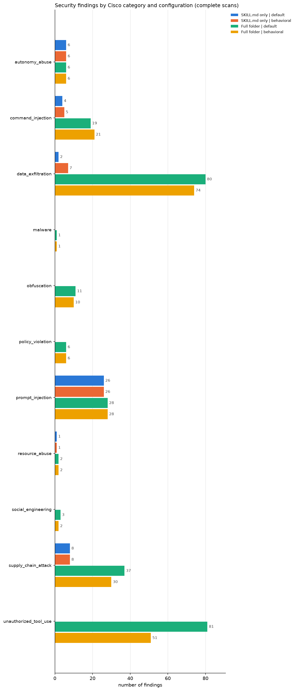
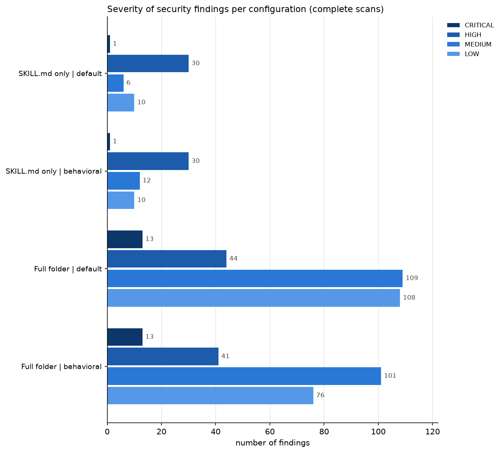
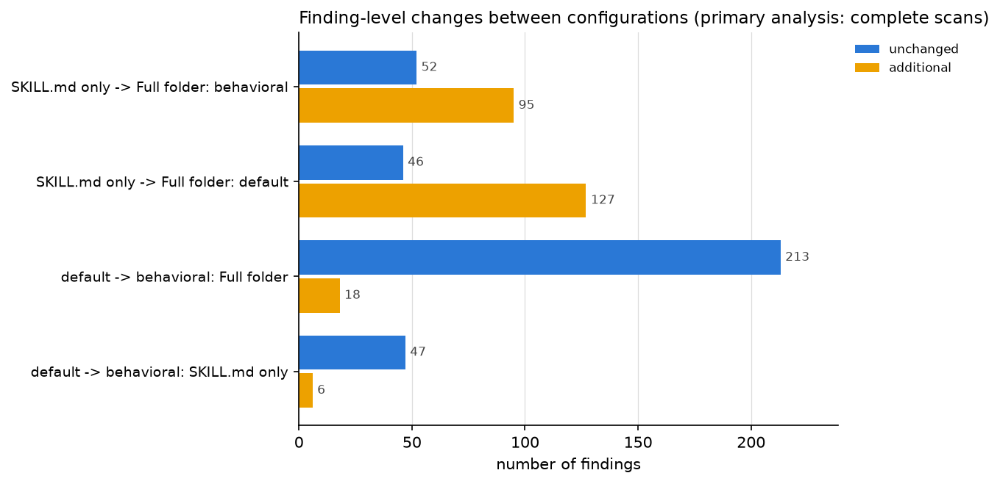

# Cisco Skill Scanner results: `2026-11-16_004059_sample1000-seed2030-batch4`

Generated automatically by `notebooks/01_cisco_scanner_dataset_ready.ipynb` on 2026-11-16T09:22:30+00:00. Every number below is computed from the files in this run folder. A finding is a Cisco rule match on an operation, not a confirmed vulnerability.

## A. Experiment overview

| item | value |
|---|---|
| Run ID | 2026-11-16_004059_sample1000-seed2030-batch4 |
| Run mode | scan (Cisco executed in this run) |
| Dataset | agent_skills_sample.db (SHA-256 683888c923a5...) |
| Sample | agent_skills_sample_seed2030_scripts400_supporting_no_scripts300_skill_md_only300 (250 skills; manifest results/skillguard_runs/main1000/manifests/batch4_of4_manifest.csv) |
| Scanner version that produced the reports | skill-scanner 2.3.1 |
| Scan policy (name / preset) | default / balanced |
| Policy fingerprint(s) | 3f48e661bfbc... |
| Scans executed (report timestamps, UTC) | 2026-11-16 08:41:02 to 2026-11-16 09:22:26 |
| Analysis written | 2026-11-16T09:22:30+00:00 |
| Skills selected / exported | 250 / 250 |
| Skill folders complete / incomplete | 214 / 36 |
| Configurations per skill | 4 |
| Configurations planned (skills x configurations) | 1000 |
| Cisco scans executed | 1000 |
| Configurations excluded by design: incomplete GitSkills folder (full-folder scan not run) | 0 |
| Outcomes of the executed scans | complete: 943, contract_only: 5, partial: 52, failed: 0 |
| Finding records (all readable reports) | 1634 (complete scans: 1444, contract-only scans: 79, partial scans: 111) |
| Security finding records in complete scans | 605 |
| Distinct rule/location combinations (skill, rule, file, line), all findings | 554 |
| Distinct rule/location combinations, security findings in complete scans | 285 |

Planned configurations, executed Cisco scans and outcomes per configuration. complete = primary results; contract_only = only Cisco's known rule-registration error, used in the sensitivity analysis only; partial = other analyzer problems, preliminary only; failed = Cisco ran but produced no usable report; excluded_incomplete_folder = design exclusion, Cisco was not run because GitSkills did not store the whole folder; missing = no saved report:

| configuration | planned | executed | complete | contract_only | partial | failed | excluded_incomplete_folder | missing |
|---|---|---|---|---|---|---|---|---|
| SKILL.md only \| default | 250 | 250 | 237 | 0 | 13 | 0 | 0 | 0 |
| SKILL.md only \| behavioral | 250 | 250 | 237 | 0 | 13 | 0 | 0 | 0 |
| Full folder \| default | 250 | 250 | 237 | 0 | 13 | 0 | 0 | 0 |
| Full folder \| behavioral | 250 | 250 | 232 | 5 | 13 | 0 | 0 | 0 |
| total | 1000 | 1000 | 943 | 5 | 52 | 0 | 0 | 0 |

Results by sampling stratum. Strata were sampled with equal allocation, so counts within a stratum can be reported directly, but proportions for the whole population need the design weights in `sample/sampling_metadata.json`:

| stratum | skills | complete folders | configurations planned | scans executed | scans complete | scans contract_only | scans partial | scans failed | configurations excluded_incomplete_folder | configurations missing | skills with >= 1 security finding (complete scans) | security finding records (complete scans) |
|---|---|---|---|---|---|---|---|---|---|---|---|---|
| scripts | 100 | 72 | 400 | 400 | 371 | 5 | 24 | 0 | 0 | 0 | 50 | 439 |
| supporting_no_scripts | 75 | 67 | 300 | 300 | 288 | 0 | 12 | 0 | 0 | 0 | 8 | 158 |
| skill_md_only | 75 | 75 | 300 | 300 | 284 | 0 | 16 | 0 | 0 | 0 | 1 | 8 |

## B. Security findings (complete scans only)

B1. Findings by severity

| configuration | CRITICAL | HIGH | MEDIUM | LOW |
|---|---|---|---|---|
| SKILL.md only \| default | 1 | 30 | 6 | 10 |
| SKILL.md only \| behavioral | 1 | 30 | 12 | 10 |
| Full folder \| default | 13 | 44 | 109 | 108 |
| Full folder \| behavioral | 13 | 41 | 101 | 76 |

B2. Findings by Cisco category (per configuration) and distinct skills affected (any complete configuration)

| cisco_category | SKILL.md only \| default | SKILL.md only \| behavioral | Full folder \| default | Full folder \| behavioral | distinct_skills |
|---|---|---|---|---|---|
| autonomy_abuse | 6 | 6 | 6 | 6 | 1 |
| command_injection | 4 | 5 | 19 | 21 | 12 |
| data_exfiltration | 2 | 7 | 80 | 74 | 32 |
| malware | 0 | 0 | 1 | 1 | 1 |
| obfuscation | 0 | 0 | 11 | 10 | 10 |
| policy_violation | 0 | 0 | 6 | 6 | 6 |
| prompt_injection | 26 | 26 | 28 | 28 | 1 |
| resource_abuse | 1 | 1 | 2 | 2 | 2 |
| social_engineering | 0 | 0 | 3 | 2 | 3 |
| supply_chain_attack | 8 | 8 | 37 | 30 | 9 |
| unauthorized_tool_use | 0 | 0 | 81 | 51 | 31 |

B3. Findings by research category (our mapping; categories without Cisco rules stay at zero)

| research_category | SKILL.md only \| default | SKILL.md only \| behavioral | Full folder \| default | Full folder \| behavioral | distinct_skills |
|---|---|---|---|---|---|
| Credential / secret access or exposure | 0 | 0 | 3 | 3 | 2 |
| External network communication / data exfiltration | 0 | 4 | 72 | 57 | 24 |
| Command execution / dangerous shell operations | 6 | 8 | 22 | 33 | 17 |
| File-system access or modification | 0 | 0 | 2 | 2 | 2 |
| Prompt injection / instruction manipulation | 26 | 26 | 31 | 30 | 4 |
| Excessive permissions / privilege escalation | 6 | 6 | 86 | 56 | 31 |
| Supply-chain / dependency risks | 8 | 8 | 38 | 31 | 10 |
| Account modification / sensitive external actions | 0 | 0 | 0 | 0 | 0 |
| Other (malware) | 0 | 0 | 1 | 1 | 1 |
| Other (obfuscation) | 0 | 0 | 11 | 10 | 10 |
| Other (policy_violation) | 0 | 0 | 6 | 6 | 6 |
| Other (resource_abuse) | 1 | 1 | 2 | 2 | 2 |

B4. Most frequently triggered security rules

| rule_id | cisco_category | findings | distinct_skills | severities |
|---|---|---|---|---|
| YARA_jailbreak_generic | prompt_injection | 108 | 1 | HIGH |
| DATA_EXFIL_NETWORK_REQUESTS | data_exfiltration | 103 | 19 | MEDIUM |
| SUPPLY_CHAIN_UNPINNED_DEPENDENCY | supply_chain_attack | 83 | 9 | LOW |
| UNDECLARED_NETWORK_DESTINATION | unauthorized_tool_use | 75 | 17 | LOW |
| TOOL_ABUSE_UNDECLARED_NETWORK | unauthorized_tool_use | 39 | 22 | MEDIUM |
| YARA_autonomy_abuse_generic | autonomy_abuse | 24 | 1 | MEDIUM |
| YARA_sql_injection_generic | command_injection | 14 | 2 | CRITICAL |
| FILE_MAGIC_MISMATCH | obfuscation | 14 | 6 | LOW, MEDIUM |
| PIPELINE_TAINT_FLOW | data_exfiltration | 14 | 2 | LOW |
| DATA_EXFIL_JS_FS_ACCESS | data_exfiltration | 12 | 2 | LOW |

B5. Where the findings point

| location | SKILL.md only \| default | SKILL.md only \| behavioral | Full folder \| default | Full folder \| behavioral |
|---|---|---|---|---|
| SKILL.md | 47 | 53 | 87 | 86 |
| supporting file | 0 | 0 | 187 | 145 |

B6. Findings outside the primary group: contract-only and partial scans (excluded from B1-B5)

| run_status | configuration | rule_id | severity | findings |
|---|---|---|---|---|
| CONTRACT_ONLY | Full folder \| behavioral | BEHAVIOR_CROSSFILE_ENV_VAR_EXFILTRATION | CRITICAL | 5 |
| CONTRACT_ONLY | Full folder \| behavioral | BEHAVIOR_CROSSFILE_EXFILTRATION_CHAIN | CRITICAL | 2 |
| CONTRACT_ONLY | Full folder \| behavioral | BEHAVIOR_ENV_VAR_EXFILTRATION | CRITICAL | 5 |
| CONTRACT_ONLY | Full folder \| behavioral | CORRELATED_NETWORK_EXECUTION_FLOW | HIGH | 1 |
| CONTRACT_ONLY | Full folder \| behavioral | CORRELATED_SENSITIVE_NETWORK_FLOW | HIGH | 2 |
| CONTRACT_ONLY | Full folder \| behavioral | DATA_EXFIL_NETWORK_REQUESTS | MEDIUM | 19 |
| CONTRACT_ONLY | Full folder \| behavioral | LAZY_LOAD_DEEP_NESTING | MEDIUM | 1 |
| CONTRACT_ONLY | Full folder \| behavioral | MDBLOCK_PYTHON_EVAL_EXEC | HIGH | 1 |
| CONTRACT_ONLY | Full folder \| behavioral | SOCIAL_ENG_MISLEADING_DESC | MEDIUM | 1 |
| CONTRACT_ONLY | Full folder \| behavioral | SUPPLY_CHAIN_UNPINNED_DEPENDENCY | LOW | 7 |
| CONTRACT_ONLY | Full folder \| behavioral | TOOL_ABUSE_UNDECLARED_NETWORK | MEDIUM | 5 |
| CONTRACT_ONLY | Full folder \| behavioral | UNDECLARED_NETWORK_DESTINATION | LOW | 25 |
| PARTIAL | Full folder \| default | COMMAND_INJECTION_OS_SYSTEM | CRITICAL | 1 |
| PARTIAL | Full folder \| default | DATA_EXFIL_ENV_VARS | MEDIUM | 1 |
| PARTIAL | Full folder \| default | DATA_EXFIL_NETWORK_REQUESTS | MEDIUM | 9 |
| PARTIAL | Full folder \| default | FILE_MAGIC_MISMATCH | LOW | 3 |
| PARTIAL | Full folder \| default | SUPPLY_CHAIN_UNPINNED_DEPENDENCY | LOW | 3 |
| PARTIAL | Full folder \| default | UNDECLARED_NETWORK_DESTINATION | LOW | 10 |
| PARTIAL | Full folder \| behavioral | BEHAVIOR_CROSSFILE_ENV_VAR_EXFILTRATION | CRITICAL | 1 |
| PARTIAL | Full folder \| behavioral | BEHAVIOR_CROSSFILE_EXFILTRATION_CHAIN | CRITICAL | 1 |

_8 more row(s) in the CSV files._

## C. Configuration comparisons

The **primary analysis** uses only pairs in which both scans are COMPLETE (and, for SKILL.md-only vs full-folder, the folder is complete). The **sensitivity analysis** adds pairs that contain a CONTRACT_ONLY scan. Contract-only scans are not assumed complete or accurate; the sensitivity analysis only shows whether including them would change a result.

C1. Sample sizes and excluded pairs per comparison (`excluded_*` = pairs left out of the primary analysis, by reason; contract-only pairs are added back in the sensitivity analysis)

| comparison | pairs_total | primary_n | sensitivity_n | excluded_contract_only | excluded_partial | excluded_incomplete_folder | excluded_not_comparable |
|---|---|---|---|---|---|---|---|
| SKILL.md only -> Full folder: default | 250 | 203 | 203 | 0 | 11 | 36 | 0 |
| SKILL.md only -> Full folder: behavioral | 250 | 199 | 203 | 4 | 11 | 36 | 0 |
| default -> behavioral: SKILL.md only | 250 | 237 | 237 | 0 | 13 | 0 | 0 |
| default -> behavioral: Full folder | 250 | 232 | 237 | 5 | 13 | 0 | 0 |

C2. Primary analysis (complete scans only): finding-level changes summed over the pairs used

| comparison | pairs_used | pairs_with_findings | unchanged | changed | possibly_equivalent | additional | missing | skills_with_additional |
|---|---|---|---|---|---|---|---|---|
| SKILL.md only -> Full folder: default | 203 | 41 | 46 | 0 | 0 | 127 | 0 | 38 |
| SKILL.md only -> Full folder: behavioral | 199 | 39 | 52 | 0 | 0 | 95 | 0 | 35 |
| default -> behavioral: SKILL.md only | 237 | 11 | 47 | 0 | 0 | 6 | 0 | 3 |
| default -> behavioral: Full folder | 232 | 54 | 213 | 0 | 0 | 18 | 0 | 9 |

C3. Files that contribute the additional findings in the primary SKILL.md-only vs full-folder comparison (a SKILL.md row means Cisco re-read the instructions once the scripts were present)

| location | file_path | findings | skills | rules |
|---|---|---|---|---|
| SKILL.md | SKILL.md | 46 | 18 | ALLOWED_TOOLS_GLOB_VIOLATION, ALLOWED_TOOLS_GREP_VIOLATION, ALLOWED_TOOLS_NETWORK_USAGE, ALLOWED_TOOLS_WRITE_VIOLATION, LAZY_LOAD_DEEP_NESTING, SOCIAL_ENG_MISLEADING_DESC, TOOL_ABUSE_UNDECLARED_NETWORK |
| supporting file | .clawhub/origin.json | 2 | 1 | HIDDEN_DATA_FILE |
| supporting file | .openskills.json | 2 | 1 | HIDDEN_DATA_FILE |
| supporting file | .skillfish.json | 2 | 1 | HIDDEN_DATA_FILE |
| supporting file | connectors/http.py | 2 | 1 | DATA_EXFIL_NETWORK_REQUESTS |
| supporting file | connectors/impl/biorxiv.py | 2 | 1 | UNDECLARED_NETWORK_DESTINATION |
| supporting file | connectors/impl/europepmc.py | 2 | 1 | UNDECLARED_NETWORK_DESTINATION |
| supporting file | connectors/impl/openalex.py | 1 | 1 | UNDECLARED_NETWORK_DESTINATION |
| supporting file | connectors/impl/pdb.py | 3 | 1 | UNDECLARED_NETWORK_DESTINATION |
| supporting file | connectors/impl/semantic_scholar.py | 2 | 1 | UNDECLARED_NETWORK_DESTINATION |
| supporting file | connectors/impl/uniprot.py | 2 | 1 | UNDECLARED_NETWORK_DESTINATION |
| supporting file | connectors/types.py | 1 | 1 | UNDECLARED_NETWORK_DESTINATION |
| supporting file | exa/http.py | 2 | 1 | DATA_EXFIL_NETWORK_REQUESTS |
| supporting file | git-hooks/pre-push | 1 | 1 | BEHAVIOR_BASH_TAINT_FLOW |
| supporting file | literature/crossref_backend.py | 1 | 1 | UNDECLARED_NETWORK_DESTINATION |
| supporting file | literature/http_client.py | 6 | 1 | DATA_EXFIL_NETWORK_REQUESTS |
| supporting file | package.json | 4 | 1 | SUPPLY_CHAIN_UNPINNED_DEPENDENCY |
| supporting file | references/api-reference.md | 3 | 2 | MDBLOCK_PYTHON_HTTP_POST, MDBLOCK_PYTHON_SUBPROCESS |
| supporting file | references/cninfo-api.md | 1 | 1 | MDBLOCK_PYTHON_HTTP_POST |
| supporting file | references/sections/skills.md | 4 | 1 | YARA_jailbreak_generic |

_34 more row(s) in the CSV files._

C4. Sensitivity analysis (complete + contract-only scans): finding-level changes summed over the pairs used

| comparison | pairs_used | pairs_with_findings | unchanged | changed | possibly_equivalent | additional | missing | skills_with_additional |
|---|---|---|---|---|---|---|---|---|
| SKILL.md only -> Full folder: default | 203 | 41 | 46 | 0 | 0 | 127 | 0 | 38 |
| SKILL.md only -> Full folder: behavioral | 203 | 43 | 52 | 0 | 0 | 143 | 0 | 39 |
| default -> behavioral: SKILL.md only | 237 | 11 | 47 | 0 | 0 | 6 | 0 | 3 |
| default -> behavioral: Full folder | 237 | 59 | 274 | 0 | 0 | 31 | 0 | 14 |

C5. Does including contract-only scans change the comparisons?

- SKILL.md only -> Full folder: default: no contract-only pairs, so the sensitivity analysis equals the primary analysis (n = 203).
- SKILL.md only -> Full folder: behavioral: primary n = 199, sensitivity n = 203. Additional findings 95 vs 143, missing 0 vs 0, unchanged 52 vs 52; skills gaining findings 35 vs 39 (primary vs sensitivity).
- default -> behavioral: SKILL.md only: no contract-only pairs, so the sensitivity analysis equals the primary analysis (n = 237).
- default -> behavioral: Full folder: primary n = 232, sensitivity n = 237. Additional findings 18 vs 31, missing 0 vs 0, unchanged 213 vs 274; skills gaining findings 9 vs 14 (primary vs sensitivity).
- 7 finding record(s) in contract-only scans carry Cisco's own `rule_contract = invalid` flag (rules: BEHAVIOR_CROSSFILE_ENV_VAR_EXFILTRATION, BEHAVIOR_CROSSFILE_EXFILTRATION_CHAIN); Cisco excludes these from its policy gating.

C6. Pair status per skill

| comparison | skill_id | before | after | pair_status |
|---|---|---|---|---|
| SKILL.md only -> Full folder: default | bybit-trade-852feb828834 | SKILL.md only \| default (COMPLETE) | Full folder \| default (COMPLETE) | eligible |
| SKILL.md only -> Full folder: behavioral | bybit-trade-852feb828834 | SKILL.md only \| behavioral (COMPLETE) | Full folder \| behavioral (CONTRACT_ONLY) | sensitivity: contract-only scan |
| SKILL.md only -> Full folder: default | open-carbon-calc-dexuwang627-cloud-a37d9b28d9d3 | SKILL.md only \| default (COMPLETE) | Full folder \| default (COMPLETE) | eligible |
| SKILL.md only -> Full folder: behavioral | open-carbon-calc-dexuwang627-cloud-a37d9b28d9d3 | SKILL.md only \| behavioral (COMPLETE) | Full folder \| behavioral (COMPLETE) | eligible |
| SKILL.md only -> Full folder: default | ui-ux-pro-max-a4c9ad4eb68a | SKILL.md only \| default (COMPLETE) | Full folder \| default (COMPLETE) | preliminary: incomplete folder |
| SKILL.md only -> Full folder: behavioral | ui-ux-pro-max-a4c9ad4eb68a | SKILL.md only \| behavioral (COMPLETE) | Full folder \| behavioral (COMPLETE) | preliminary: incomplete folder |
| SKILL.md only -> Full folder: default | ali-data-quality-auditor-2de804dada1b | SKILL.md only \| default (COMPLETE) | Full folder \| default (COMPLETE) | eligible |
| SKILL.md only -> Full folder: behavioral | ali-data-quality-auditor-2de804dada1b | SKILL.md only \| behavioral (COMPLETE) | Full folder \| behavioral (COMPLETE) | eligible |
| SKILL.md only -> Full folder: default | pod-weekly-report-ee9fa361258e | SKILL.md only \| default (COMPLETE) | Full folder \| default (COMPLETE) | eligible |
| SKILL.md only -> Full folder: behavioral | pod-weekly-report-ee9fa361258e | SKILL.md only \| behavioral (COMPLETE) | Full folder \| behavioral (COMPLETE) | eligible |
| SKILL.md only -> Full folder: default | triage-ee78fa10da87 | SKILL.md only \| default (COMPLETE) | Full folder \| default (COMPLETE) | eligible |
| SKILL.md only -> Full folder: behavioral | triage-ee78fa10da87 | SKILL.md only \| behavioral (COMPLETE) | Full folder \| behavioral (COMPLETE) | eligible |
| SKILL.md only -> Full folder: default | kafka-event-driven-866d18f7c6c2 | SKILL.md only \| default (COMPLETE) | Full folder \| default (COMPLETE) | eligible |
| SKILL.md only -> Full folder: behavioral | kafka-event-driven-866d18f7c6c2 | SKILL.md only \| behavioral (COMPLETE) | Full folder \| behavioral (COMPLETE) | eligible |
| SKILL.md only -> Full folder: default | persona-9f6e9bebcfe5 | SKILL.md only \| default (COMPLETE) | Full folder \| default (COMPLETE) | preliminary: incomplete folder |
| SKILL.md only -> Full folder: behavioral | persona-9f6e9bebcfe5 | SKILL.md only \| behavioral (COMPLETE) | Full folder \| behavioral (CONTRACT_ONLY) | preliminary: incomplete folder |
| SKILL.md only -> Full folder: default | implementing-continuous-security-va-852c48151192 | SKILL.md only \| default (COMPLETE) | Full folder \| default (COMPLETE) | eligible |
| SKILL.md only -> Full folder: behavioral | implementing-continuous-security-va-852c48151192 | SKILL.md only \| behavioral (COMPLETE) | Full folder \| behavioral (COMPLETE) | eligible |
| SKILL.md only -> Full folder: default | git-cherry-pick-b6c416c81583 | SKILL.md only \| default (COMPLETE) | Full folder \| default (COMPLETE) | eligible |
| SKILL.md only -> Full folder: behavioral | git-cherry-pick-b6c416c81583 | SKILL.md only \| behavioral (COMPLETE) | Full folder \| behavioral (COMPLETE) | eligible |

_980 more row(s) in the CSV files._

## D. Scanner reliability

D1. Analyzer failures reported by Cisco

| skill_id | configuration | status | analyzer | failure_type | error |
|---|---|---|---|---|---|
| bybit-trade-852feb828834 | Full folder \| behavioral | CONTRACT_ONLY | behavioral | finding contract: unregistered rule (known Cisco issue) | FindingContract:BEHAVIOR_CROSSFILE_ENV_VAR_EXFILTRATION:UNKNOWN_BUNDLED_PYTHON_RULE |
| persona-9f6e9bebcfe5 | Full folder \| behavioral | CONTRACT_ONLY | behavioral | finding contract: unregistered rule (known Cisco issue) | FindingContract:BEHAVIOR_CROSSFILE_EXFILTRATION_CHAIN:UNKNOWN_BUNDLED_PYTHON_RULE |
| persona-9f6e9bebcfe5 | Full folder \| behavioral | CONTRACT_ONLY | behavioral | finding contract: unregistered rule (known Cisco issue) | FindingContract:BEHAVIOR_CROSSFILE_ENV_VAR_EXFILTRATION:UNKNOWN_BUNDLED_PYTHON_RULE |
| evaluator-7f0e4808619c | SKILL.md only \| default | PARTIAL | skill_loader | skill loader | SkillLoadError:MISSING_REQUIRED_MANIFEST_FIELD |
| evaluator-7f0e4808619c | SKILL.md only \| behavioral | PARTIAL | skill_loader | skill loader | SkillLoadError:MISSING_REQUIRED_MANIFEST_FIELD |
| evaluator-7f0e4808619c | Full folder \| default | PARTIAL | skill_loader | skill loader | SkillLoadError:MISSING_REQUIRED_MANIFEST_FIELD |
| evaluator-7f0e4808619c | Full folder \| behavioral | PARTIAL | skill_loader | skill loader | SkillLoadError:MISSING_REQUIRED_MANIFEST_FIELD |
| apple-calendar-1f34694960ac | SKILL.md only \| default | PARTIAL | skill_loader | skill loader | SkillLoadError:MISSING_REQUIRED_MANIFEST_FIELD |
| apple-calendar-1f34694960ac | SKILL.md only \| behavioral | PARTIAL | skill_loader | skill loader | SkillLoadError:MISSING_REQUIRED_MANIFEST_FIELD |
| apple-calendar-1f34694960ac | Full folder \| default | PARTIAL | skill_loader | skill loader | SkillLoadError:MISSING_REQUIRED_MANIFEST_FIELD |
| apple-calendar-1f34694960ac | Full folder \| behavioral | PARTIAL | skill_loader | skill loader | SkillLoadError:MISSING_REQUIRED_MANIFEST_FIELD |
| search-8f4c56101ffd | Full folder \| behavioral | CONTRACT_ONLY | behavioral | finding contract: unregistered rule (known Cisco issue) | FindingContract:BEHAVIOR_CROSSFILE_EXFILTRATION_CHAIN:UNKNOWN_BUNDLED_PYTHON_RULE |
| search-8f4c56101ffd | Full folder \| behavioral | CONTRACT_ONLY | behavioral | finding contract: unregistered rule (known Cisco issue) | FindingContract:BEHAVIOR_CROSSFILE_ENV_VAR_EXFILTRATION:UNKNOWN_BUNDLED_PYTHON_RULE |
| config-ae2a0e439d42 | SKILL.md only \| default | PARTIAL | skill_loader | skill loader | SkillLoadError:MISSING_REQUIRED_MANIFEST_FIELD |
| config-ae2a0e439d42 | SKILL.md only \| behavioral | PARTIAL | skill_loader | skill loader | SkillLoadError:MISSING_REQUIRED_MANIFEST_FIELD |
| config-ae2a0e439d42 | Full folder \| default | PARTIAL | skill_loader | skill loader | SkillLoadError:MISSING_REQUIRED_MANIFEST_FIELD |
| config-ae2a0e439d42 | Full folder \| behavioral | PARTIAL | skill_loader | skill loader | SkillLoadError:MISSING_REQUIRED_MANIFEST_FIELD |
| mslearn-delegate-devbox-a7fc49f67a2f | SKILL.md only \| default | PARTIAL | skill_loader | skill loader | SkillLoadError:MISSING_REQUIRED_MANIFEST_FIELD |
| mslearn-delegate-devbox-a7fc49f67a2f | SKILL.md only \| behavioral | PARTIAL | skill_loader | skill loader | SkillLoadError:MISSING_REQUIRED_MANIFEST_FIELD |
| mslearn-delegate-devbox-a7fc49f67a2f | Full folder \| default | PARTIAL | skill_loader | skill loader | SkillLoadError:MISSING_REQUIRED_MANIFEST_FIELD |

_41 more row(s) in the CSV files._

D2. Skill folders

| skill_id | supporting_files_exported | files_missing | folder_complete | integrity |
|---|---|---|---|---|
| bybit-trade-852feb828834 | 1 | 0 | True | ok: written in this run |
| open-carbon-calc-dexuwang627-cloud-a37d9b28d9d3 | 9 | 0 | True | ok: written in this run |
| ui-ux-pro-max-a4c9ad4eb68a | 30 | 6 | False | ok: written in this run |
| ali-data-quality-auditor-2de804dada1b | 4 | 0 | True | ok: written in this run |
| pod-weekly-report-ee9fa361258e | 2 | 0 | True | ok: written in this run |
| triage-ee78fa10da87 | 1 | 0 | True | ok: written in this run |
| kafka-event-driven-866d18f7c6c2 | 8 | 0 | True | ok: written in this run |
| persona-9f6e9bebcfe5 | 28 | 10 | False | ok: written in this run |
| implementing-continuous-security-va-852c48151192 | 7 | 0 | True | ok: written in this run |
| git-cherry-pick-b6c416c81583 | 1 | 0 | True | ok: written in this run |
| evaluator-7f0e4808619c | 15 | 0 | True | ok: written in this run |
| doc-smith-build-a663c15e98ae | 4 | 0 | True | ok: written in this run |
| safe-reformat-copilot-dbba5169e0bc | 0 | 1 | False | ok: written in this run |
| url2png-eb370bbb687e | 2 | 0 | True | ok: written in this run |
| upload-to-stitch-c5f9b024010a | 1 | 0 | True | ok: written in this run |
| cybersec-exploiting-insecure-data-s-11d8bb4898c2 | 7 | 0 | True | ok: written in this run |
| dag-task-runner-499236702ceb | 6 | 1 | False | ok: written in this run |
| sherpa-onnx-tts-215bdd46db6d | 1 | 0 | True | ok: written in this run |
| guardrail-6402608f8e19 | 5 | 0 | True | ok: written in this run |
| walmart-sales-analyzer-307c84c8762a | 7 | 0 | True | ok: written in this run |

_230 more row(s) in the CSV files._

D3. Scanner verdict vs finding severity

| skill_id | configuration | outcome | is_safe | cisco_max_severity | highest_security_severity | security_findings | security_medium_or_lower | note |
|---|---|---|---|---|---|---|---|---|
| bybit-trade-852feb828834 | SKILL.md only \| default | complete | True | INFO | none | 0 | 0 | only metadata/coverage findings |
| bybit-trade-852feb828834 | SKILL.md only \| behavioral | complete | True | INFO | none | 0 | 0 | only metadata/coverage findings |
| bybit-trade-852feb828834 | Full folder \| default | complete | False | HIGH | HIGH | 8 | 6 | is_safe=False because of 2 CRITICAL/HIGH security finding(s) |
| bybit-trade-852feb828834 | Full folder \| behavioral | contract_only | False | CRITICAL | CRITICAL | 10 | 6 | is_safe=False because of 4 CRITICAL/HIGH security finding(s) |
| open-carbon-calc-dexuwang627-cloud-a37d9b28d9d3 | SKILL.md only \| default | complete | True | INFO | none | 0 | 0 | only metadata/coverage findings |
| open-carbon-calc-dexuwang627-cloud-a37d9b28d9d3 | SKILL.md only \| behavioral | complete | True | INFO | none | 0 | 0 | only metadata/coverage findings |
| open-carbon-calc-dexuwang627-cloud-a37d9b28d9d3 | Full folder \| default | complete | True | MEDIUM | MEDIUM | 1 | 1 | is_safe=True although there are 1 security finding(s) up to MEDIUM |
| open-carbon-calc-dexuwang627-cloud-a37d9b28d9d3 | Full folder \| behavioral | complete | True | MEDIUM | MEDIUM | 1 | 1 | is_safe=True although there are 1 security finding(s) up to MEDIUM |
| ui-ux-pro-max-a4c9ad4eb68a | SKILL.md only \| default | complete | True | INFO | none | 0 | 0 | only metadata/coverage findings |
| ui-ux-pro-max-a4c9ad4eb68a | SKILL.md only \| behavioral | complete | True | INFO | none | 0 | 0 | only metadata/coverage findings |
| ui-ux-pro-max-a4c9ad4eb68a | Full folder \| default | complete | True | MEDIUM | MEDIUM | 1 | 1 | is_safe=True although there are 1 security finding(s) up to MEDIUM |
| ui-ux-pro-max-a4c9ad4eb68a | Full folder \| behavioral | complete | True | MEDIUM | MEDIUM | 1 | 1 | is_safe=True although there are 1 security finding(s) up to MEDIUM |
| ali-data-quality-auditor-2de804dada1b | SKILL.md only \| default | complete | True | INFO | none | 0 | 0 | only metadata/coverage findings |
| ali-data-quality-auditor-2de804dada1b | SKILL.md only \| behavioral | complete | True | INFO | none | 0 | 0 | only metadata/coverage findings |
| ali-data-quality-auditor-2de804dada1b | Full folder \| default | complete | True | INFO | none | 0 | 0 | only metadata/coverage findings |
| ali-data-quality-auditor-2de804dada1b | Full folder \| behavioral | complete | True | INFO | none | 0 | 0 | only metadata/coverage findings |
| pod-weekly-report-ee9fa361258e | SKILL.md only \| default | complete | True | INFO | none | 0 | 0 | only metadata/coverage findings |
| pod-weekly-report-ee9fa361258e | SKILL.md only \| behavioral | complete | True | INFO | none | 0 | 0 | only metadata/coverage findings |
| pod-weekly-report-ee9fa361258e | Full folder \| default | complete | True | INFO | none | 0 | 0 | only metadata/coverage findings |
| pod-weekly-report-ee9fa361258e | Full folder \| behavioral | complete | True | INFO | none | 0 | 0 | only metadata/coverage findings |

_980 more row(s) in the CSV files._

D4. Evidence check of reported locations (counts of finding records per rule)

| rule_id | ambiguous | exact | mismatch | unavailable |
|---|---|---|---|---|
| ACTIVE_DYNAMIC_EXECUTION | 0 | 4 | 0 | 0 |
| ACTIVE_REMOTE_ACQUIRE_EXECUTE | 0 | 0 | 4 | 0 |
| ALLOWED_TOOLS_BASH_VIOLATION | 0 | 0 | 0 | 2 |
| ALLOWED_TOOLS_GLOB_VIOLATION | 0 | 0 | 0 | 4 |
| ALLOWED_TOOLS_GREP_VIOLATION | 0 | 0 | 0 | 4 |
| ALLOWED_TOOLS_NETWORK_USAGE | 0 | 0 | 0 | 6 |
| ALLOWED_TOOLS_WRITE_VIOLATION | 0 | 0 | 0 | 12 |
| BEHAVIOR_BASH_TAINT_FLOW | 0 | 8 | 2 | 0 |
| BEHAVIOR_CROSSFILE_ENV_VAR_EXFILTRATION | 0 | 0 | 0 | 6 |
| BEHAVIOR_CROSSFILE_EXFILTRATION_CHAIN | 0 | 0 | 0 | 3 |
| BEHAVIOR_ENV_VAR_EXFILTRATION | 0 | 0 | 0 | 7 |
| COMMAND_INJECTION_JS_CHILD_PROCESS | 0 | 6 | 0 | 0 |
| COMMAND_INJECTION_OS_SYSTEM | 0 | 6 | 0 | 0 |
| COMMAND_INJECTION_SHELL_TRUE | 0 | 2 | 0 | 0 |
| CORRELATED_NETWORK_EXECUTION_FLOW | 0 | 0 | 0 | 8 |
| CORRELATED_NETWORK_FILE_WRITE_FLOW | 0 | 0 | 0 | 2 |
| CORRELATED_SENSITIVE_NETWORK_FLOW | 0 | 0 | 0 | 8 |
| DATA_EXFIL_ENV_VARS | 0 | 6 | 0 | 0 |
| DATA_EXFIL_JS_FS_ACCESS | 0 | 12 | 0 | 0 |
| DATA_EXFIL_JS_NETWORK | 0 | 2 | 0 | 0 |

_25 more row(s) in the CSV files._

## E. Manual security review

`manual_review_template.csv` lists 330 distinct security finding location(s) (45 seen only in contract-only or partial scans) with Cisco's rule, severity, reported file and line, redacted evidence and evidence check. The columns `reviewer`, `evidence_verified`, `legitimate_purpose`, `interpretation` and `notes` are intentionally blank; no finding has been labelled as a vulnerability or a false positive.

## Figures

## Limitations

- 5 of 1000 executed scan(s) were CONTRACT_ONLY: their only recorded problem is Cisco's rule-registration error for BEHAVIOR_CROSSFILE_ENV_VAR_EXFILTRATION, BEHAVIOR_CROSSFILE_EXFILTRATION_CHAIN. Their 79 finding record(s) are excluded from primary results and used only in the sensitivity analysis; they are not assumed complete or accurate.
- 52 of 1000 executed scan(s) were PARTIAL (Cisco analyzer failure: skill loader: 52). Their 111 finding record(s) are preliminary evidence and are excluded from primary tables and comparisons.
- 36 skill folder(s) are incomplete in GitSkills (1162 supporting file(s) without stored text). This is a design exclusion, not a scanner failure: 0 of 1000 planned configuration(s) (their full-folder scans) were not run, so 1000 Cisco scans were executed. Their SKILL.md-only scans are kept, but their context-comparison pairs are reported as `excluded: incomplete folder`, and no finding count of zero is implied for the excluded configurations.
- 172 of 1634 finding record(s) do not have their evidence on the reported line (mismatch 164, ambiguous 8); rules involved: YARA_jailbreak_generic (104), YARA_autonomy_abuse_generic (24), PIPELINE_TAINT_FLOW (14), MDBLOCK_PYTHON_HTTP_POST (11), MDBLOCK_PYTHON_SUBPROCESS (4), YARA_SUSP_Multi_Cryptomining_ConfigExec_Sep26 (4), ACTIVE_REMOTE_ACQUIRE_EXECUTE (4), YARA_sql_injection_generic (4), BEHAVIOR_BASH_TAINT_FLOW (2), MDBLOCK_PYTHON_EVAL_EXEC (1). Reported line numbers are kept unchanged.
- For MDBLOCK_* rules Cisco 2.3.1 counts lines from the code-block fence and, in SKILL.md, from the end of the YAML frontmatter, so their reported lines point above the code; use evidence_candidate_lines to locate it.
- 1188 finding record(s) could not be checked against the file (no file, line or evidence text).
- Scanner findings are rule matches on operations; they are not confirmed vulnerabilities, and nothing here is a false-negative claim (there is no ground truth).
- Finding counts are per matching line; one script can contribute many findings. Distinct skills are reported separately.
- Comparisons match findings by rule, file, reported line and evidence; equivalent behavior reported under different rule IDs is not matched automatically.

## Files in this run folder

- `scan_summary.csv`: one row per skill x configuration: status, outcome, analyzer failures, verdict, counts, versions
- `individual_findings.csv`: one row per Cisco finding: original fields, normalized path, evidence check
- `context_comparison.csv / analyzer_comparison.csv`: finding-level comparisons; pair_status says primary (eligible), sensitivity or preliminary
- `manual_review_template.csv`: blank reviewer columns for manual interpretation
- `run_metadata.json`: settings, dataset hash, scanner versions, policy fingerprints, outcome counts
- `<skill_id>/reports/*.json`: raw Cisco reports, unmodified
- `<skill_id>/manifest.json`: exported files with SHA-256 hashes and missing files
- `figures/*.png`: the charts above
