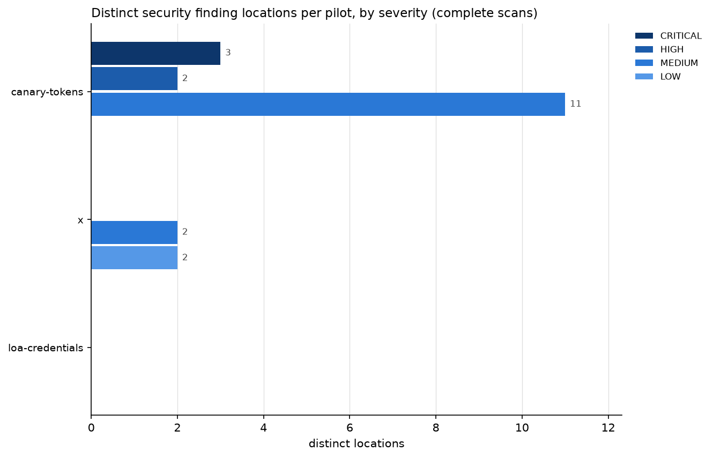
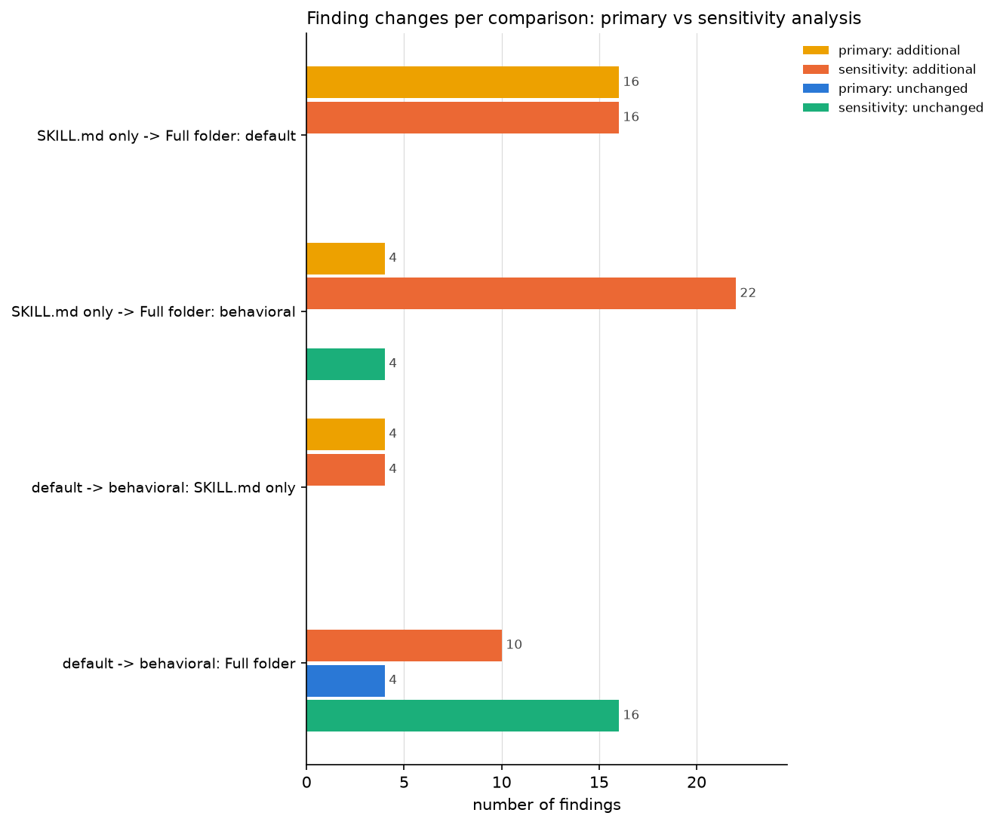

# Cisco Skill Scanner: combined pilot comparison

Generated by `notebooks/02_cisco_pilot_comparison.ipynb` on 2026-11-03 23:37 UTC from 3 run folders. Scanner `skill-scanner 2.3.1`, policy default / balanced (fingerprint 3f48e661bfbc...), configurations: SKILL.md only | default, SKILL.md only | behavioral, Full folder | default, Full folder | behavioral. LLM and OSV analyzers were not used.

> **Cisco findings are not confirmed vulnerabilities.** A finding means a Cisco rule matched an operation in a skill's files. Whether the operation is legitimate, risky or malicious requires manual review. **Primary** results use COMPLETE scans only; the **sensitivity analysis** adds CONTRACT_ONLY scans (only Cisco's known rule-registration error) and is reported separately. Contract-only scans are not assumed complete or accurate.

## 1. Pilots and scans

| pilot | repo / path | supporting files | folder complete | scans complete | scans contract_only | finding records (all readable scans) | security records, primary | security records, contract-only scans | metadata/coverage records | distinct security locations, primary | distinct security locations, sensitivity |
|---|---|---|---|---|---|---|---|---|---|---|---|
| canary-tokens | 26zl/cybersec-toolkit / .claude/skills/implementing-canary-tokens-for-network-intrusion/SKILL.md | 3 | True | 3 | 1 | 38 | 16 | 22 | 0 | 16 | 22 |
| x | AceDataCloud/Skills / skills/x/SKILL.md | 1 | True | 4 | 0 | 8 | 8 | 0 | 0 | 4 | 4 |
| loa-credentials | 0xHoneyJar/loa-dixie / .claude/skills/managing-credentials/SKILL.md | 1 | True | 4 | 0 | 4 | 0 | 0 | 4 | 0 | 0 |

Findings per configuration (all finding kinds; scan status in brackets):

| pilot | SKILL.md only \| default | SKILL.md only \| behavioral | Full folder \| default | Full folder \| behavioral |
|---|---|---|---|---|
| canary-tokens | 0 (COMPLETE) | 4 (COMPLETE) | 12 (COMPLETE) | 22 (CONTRACT_ONLY) |
| x | 0 (COMPLETE) | 0 (COMPLETE) | 4 (COMPLETE) | 4 (COMPLETE) |
| loa-credentials | 1 (COMPLETE) | 1 (COMPLETE) | 1 (COMPLETE) | 1 (COMPLETE) |

Cisco's maximum severity per configuration:

| pilot | SKILL.md only \| default | SKILL.md only \| behavioral | Full folder \| default | Full folder \| behavioral |
|---|---|---|---|---|
| canary-tokens | SAFE | MEDIUM | CRITICAL | CRITICAL |
| x | SAFE | SAFE | MEDIUM | MEDIUM |
| loa-credentials | INFO | INFO | INFO | INFO |

## 2. Total findings and severity distributions (primary: complete scans)

Security finding **records** by severity (one per finding per configuration):

| pilot | CRITICAL | HIGH | MEDIUM | LOW | INFO |
|---|---|---|---|---|---|
| canary-tokens | 3 | 2 | 11 | 0 | 0 |
| x | 0 | 0 | 4 | 4 | 0 |
| loa-credentials | 0 | 0 | 0 | 0 | 0 |

Distinct security finding **locations** by severity (each skill, rule, file, line once):

| pilot | CRITICAL | HIGH | MEDIUM | LOW | INFO |
|---|---|---|---|---|---|
| canary-tokens | 3 | 2 | 11 | 0 | 0 |
| x | 0 | 0 | 2 | 2 | 0 |
| loa-credentials | 0 | 0 | 0 | 0 | 0 |

Sensitivity: distinct locations when contract-only scans are added:

| pilot | CRITICAL | HIGH | MEDIUM | LOW | INFO |
|---|---|---|---|---|---|
| canary-tokens | 5 | 2 | 15 | 0 | 0 |
| x | 0 | 0 | 2 | 2 | 0 |
| loa-credentials | 0 | 0 | 0 | 0 | 0 |

## 3. SKILL.md only vs full folder, and default vs behavioral analyzer

Sample sizes and excluded pairs per comparison (`excluded_*` = left out of the primary analysis):

| comparison | pairs_total | primary_n | sensitivity_n | excluded_contract_only | excluded_partial | excluded_incomplete_folder | excluded_not_comparable |
|---|---|---|---|---|---|---|---|
| SKILL.md only -> Full folder: default | 3 | 3 | 3 | 0 | 0 | 0 | 0 |
| SKILL.md only -> Full folder: behavioral | 3 | 2 | 3 | 1 | 0 | 0 | 0 |
| default -> behavioral: SKILL.md only | 3 | 3 | 3 | 0 | 0 | 0 | 0 |
| default -> behavioral: Full folder | 3 | 2 | 3 | 1 | 0 | 0 | 0 |

### Primary analysis (complete scans only)

| comparison | pairs_used | pilots_used | unchanged | changed | possibly_equivalent | additional | missing | pilots_gaining_findings |
|---|---|---|---|---|---|---|---|---|
| SKILL.md only -> Full folder: default | 3 | canary-tokens, x, loa-credentials | 0 | 0 | 0 | 16 | 0 | canary-tokens, x |
| SKILL.md only -> Full folder: behavioral | 2 | x, loa-credentials | 0 | 0 | 0 | 4 | 0 | x |
| default -> behavioral: SKILL.md only | 3 | canary-tokens, x, loa-credentials | 0 | 0 | 0 | 4 | 0 | canary-tokens |
| default -> behavioral: Full folder | 2 | x, loa-credentials | 4 | 0 | 0 | 0 | 0 |  |

Per pilot:

| comparison | pilot | unchanged | changed | possibly_equivalent | additional | missing |
|---|---|---|---|---|---|---|
| SKILL.md only -> Full folder: default | canary-tokens | 0 | 0 | 0 | 12 | 0 |
| default -> behavioral: SKILL.md only | canary-tokens | 0 | 0 | 0 | 4 | 0 |
| SKILL.md only -> Full folder: default | x | 0 | 0 | 0 | 4 | 0 |
| SKILL.md only -> Full folder: behavioral | x | 0 | 0 | 0 | 4 | 0 |
| default -> behavioral: SKILL.md only | x | 0 | 0 | 0 | 0 | 0 |
| default -> behavioral: Full folder | x | 4 | 0 | 0 | 0 | 0 |
| SKILL.md only -> Full folder: default | loa-credentials | 0 | 0 | 0 | 0 | 0 |
| SKILL.md only -> Full folder: behavioral | loa-credentials | 0 | 0 | 0 | 0 | 0 |
| default -> behavioral: SKILL.md only | loa-credentials | 0 | 0 | 0 | 0 | 0 |
| default -> behavioral: Full folder | loa-credentials | 0 | 0 | 0 | 0 | 0 |

Files that contribute the additional findings when the full folder is scanned (primary; a SKILL.md row means Cisco re-read the instructions once the scripts were present):

| comparison | pilot | location | file_path | findings | rules |
|---|---|---|---|---|---|
| SKILL.md only -> Full folder: behavioral | x | SKILL.md | SKILL.md | 3 | ALLOWED_TOOLS_GREP_VIOLATION, ALLOWED_TOOLS_NETWORK_USAGE, TOOL_ABUSE_UNDECLARED_NETWORK |
| SKILL.md only -> Full folder: behavioral | x | supporting file | scripts/x.py | 1 | UNDECLARED_NETWORK_DESTINATION |
| SKILL.md only -> Full folder: default | canary-tokens | SKILL.md | SKILL.md | 1 | TOOL_ABUSE_UNDECLARED_NETWORK |
| SKILL.md only -> Full folder: default | canary-tokens | supporting file | scripts/agent.py | 11 | CORRELATED_SENSITIVE_NETWORK_FLOW, DATA_EXFIL_HTTP_POST, DATA_EXFIL_NETWORK_REQUESTS, DATA_EXFIL_SOCKET_CONNECT, SECRET_CONNECTION_STRING |
| SKILL.md only -> Full folder: default | x | SKILL.md | SKILL.md | 3 | ALLOWED_TOOLS_GREP_VIOLATION, ALLOWED_TOOLS_NETWORK_USAGE, TOOL_ABUSE_UNDECLARED_NETWORK |
| SKILL.md only -> Full folder: default | x | supporting file | scripts/x.py | 1 | UNDECLARED_NETWORK_DESTINATION |

### Sensitivity analysis (complete + contract-only scans)

| comparison | pairs_used | pilots_used | unchanged | changed | possibly_equivalent | additional | missing | pilots_gaining_findings |
|---|---|---|---|---|---|---|---|---|
| SKILL.md only -> Full folder: default | 3 | canary-tokens, x, loa-credentials | 0 | 0 | 0 | 16 | 0 | canary-tokens, x |
| SKILL.md only -> Full folder: behavioral | 3 | canary-tokens, x, loa-credentials | 4 | 0 | 0 | 22 | 0 | canary-tokens, x |
| default -> behavioral: SKILL.md only | 3 | canary-tokens, x, loa-credentials | 0 | 0 | 0 | 4 | 0 | canary-tokens |
| default -> behavioral: Full folder | 3 | canary-tokens, x, loa-credentials | 16 | 0 | 0 | 10 | 0 | canary-tokens |

Per pilot:

| comparison | pilot | unchanged | changed | possibly_equivalent | additional | missing |
|---|---|---|---|---|---|---|
| SKILL.md only -> Full folder: default | canary-tokens | 0 | 0 | 0 | 12 | 0 |
| SKILL.md only -> Full folder: behavioral | canary-tokens | 4 | 0 | 0 | 18 | 0 |
| default -> behavioral: SKILL.md only | canary-tokens | 0 | 0 | 0 | 4 | 0 |
| default -> behavioral: Full folder | canary-tokens | 12 | 0 | 0 | 10 | 0 |
| SKILL.md only -> Full folder: default | x | 0 | 0 | 0 | 4 | 0 |
| SKILL.md only -> Full folder: behavioral | x | 0 | 0 | 0 | 4 | 0 |
| default -> behavioral: SKILL.md only | x | 0 | 0 | 0 | 0 | 0 |
| default -> behavioral: Full folder | x | 4 | 0 | 0 | 0 | 0 |
| SKILL.md only -> Full folder: default | loa-credentials | 0 | 0 | 0 | 0 | 0 |
| SKILL.md only -> Full folder: behavioral | loa-credentials | 0 | 0 | 0 | 0 | 0 |
| default -> behavioral: SKILL.md only | loa-credentials | 0 | 0 | 0 | 0 | 0 |
| default -> behavioral: Full folder | loa-credentials | 0 | 0 | 0 | 0 | 0 |

## 4. COMPLETE vs CONTRACT_ONLY

Contract-only scans:

| pilot | configuration | findings_count | max_severity | status_detail |
|---|---|---|---|---|
| canary-tokens | Full folder \| behavioral | 22 | CRITICAL | Cisco reported an analyzer failure (behavioral: FindingContract:BEHAVIOR_CROSSFILE_ENV_VAR_EXFILTRATION:UNKNOWN_BUNDLED_PYTHON_RULE) |

Does including them change the comparisons?

- SKILL.md only -> Full folder: default: no contract-only pairs; sensitivity = primary (n = 3).
- SKILL.md only -> Full folder: behavioral: primary n = 2 (x, loa-credentials), sensitivity n = 3 (canary-tokens, x, loa-credentials). Additional findings 4 vs 22; unchanged 0 vs 4; missing 0 vs 0; pilots gaining findings: x vs canary-tokens, x.
- default -> behavioral: SKILL.md only: no contract-only pairs; sensitivity = primary (n = 3).
- default -> behavioral: Full folder: primary n = 2 (x, loa-credentials), sensitivity n = 3 (canary-tokens, x, loa-credentials). Additional findings 0 vs 10; unchanged 4 vs 16; missing 0 vs 0; pilots gaining findings: none vs canary-tokens.
- 1 finding record(s) in contract-only scans carry Cisco's own `rule_contract = invalid` flag (BEHAVIOR_CROSSFILE_ENV_VAR_EXFILTRATION).

Rules that appear **only** in contract-only scans (not in any complete scan):

| rule_id | cisco_category | distinct_locations | pilots | severities |
|---|---|---|---|---|
| BEHAVIOR_CROSSFILE_ENV_VAR_EXFILTRATION | data_exfiltration | 1 | canary-tokens | CRITICAL |
| BEHAVIOR_ENV_VAR_EXFILTRATION | data_exfiltration | 1 | canary-tokens | CRITICAL |

## 5. Security categories and most frequent rules (primary, distinct locations)

Cisco categories:

| pilot | data_exfiltration | hardcoded_secrets | unauthorized_tool_use |
|---|---|---|---|
| canary-tokens | 14 | 1 | 1 |
| x | 0 | 0 | 4 |
| loa-credentials | 0 | 0 | 0 |

Research categories (our mapping; categories with no Cisco rule stay at zero):

| research_category | canary-tokens | x | loa-credentials | pilots_with_findings |
|---|---|---|---|---|
| Credential / secret access or exposure | 1 | 0 | 0 | 1 |
| External network communication / data exfiltration | 14 | 0 | 0 | 1 |
| Command execution / dangerous shell operations | 0 | 0 | 0 | 0 |
| File-system access or modification | 0 | 0 | 0 | 0 |
| Prompt injection / instruction manipulation | 0 | 0 | 0 | 0 |
| Excessive permissions / privilege escalation | 1 | 4 | 0 | 2 |
| Supply-chain / dependency risks | 0 | 0 | 0 | 0 |
| Account modification / sensitive external actions | 0 | 0 | 0 | 0 |

Rules:

| rule_id | cisco_category | distinct_locations | pilots | severities |
|---|---|---|---|---|
| DATA_EXFIL_NETWORK_REQUESTS | data_exfiltration | 6 | canary-tokens | MEDIUM |
| MDBLOCK_PYTHON_HTTP_POST | data_exfiltration | 4 | canary-tokens | MEDIUM |
| DATA_EXFIL_HTTP_POST | data_exfiltration | 2 | canary-tokens | CRITICAL |
| TOOL_ABUSE_UNDECLARED_NETWORK | unauthorized_tool_use | 2 | canary-tokens, x | MEDIUM |
| ALLOWED_TOOLS_GREP_VIOLATION | unauthorized_tool_use | 1 | x | LOW |
| ALLOWED_TOOLS_NETWORK_USAGE | unauthorized_tool_use | 1 | x | MEDIUM |
| CORRELATED_SENSITIVE_NETWORK_FLOW | data_exfiltration | 1 | canary-tokens | HIGH |
| DATA_EXFIL_SOCKET_CONNECT | data_exfiltration | 1 | canary-tokens | CRITICAL |
| SECRET_CONNECTION_STRING | hardcoded_secrets | 1 | canary-tokens | HIGH |
| UNDECLARED_NETWORK_DESTINATION | unauthorized_tool_use | 1 | x | LOW |

## 6. Examples that require manual security review

Selected by explicit rules (severity, context dependence, analyzer dependence, contract-only, unreliable location, manifest mismatch), ranked by how many rules apply. 20 of 26 distinct security locations match at least one rule; the table shows the highest-ranked example for each pilot and rule (12 rows). `combined_manual_review.csv` lists every location. None has been reviewed yet.

| pilot | rule_id | severity_reported | file_path | reported_line_number | evidence_snippet | evidence_status | configurations | why_review |
|---|---|---|---|---|---|---|---|---|
| canary-tokens | BEHAVIOR_CROSSFILE_ENV_VAR_EXFILTRATION | CRITICAL |  |  |  | unavailable | Full folder \| behavioral | CRITICAL/HIGH severity; only reported by the behavioral analyzer; seen only in a CONTRACT_ONLY/PARTIAL scan |
| canary-tokens | BEHAVIOR_ENV_VAR_EXFILTRATION | CRITICAL | scripts/agent.py |  |  | unavailable | Full folder \| behavioral | CRITICAL/HIGH severity; only reported by the behavioral analyzer; seen only in a CONTRACT_ONLY/PARTIAL scan |
| canary-tokens | MDBLOCK_PYTHON_HTTP_POST | MEDIUM | references/api-reference.md | 24 | resp = requests.post("https://canarytokens.org/generate", data={ | ambiguous | Full folder \| behavioral | only reported by the behavioral analyzer; seen only in a CONTRACT_ONLY/PARTIAL scan; reported line does not hold the evidence (ambiguous) |
| canary-tokens | TOOL_ABUSE_UNDECLARED_NETWORK | MEDIUM | SKILL.md |  |  | unavailable | Full folder \| default; Full folder \| behavioral | appears in SKILL.md only when the scripts are present (context re-interpretation); manifest vs code capability mismatch |
| x | ALLOWED_TOOLS_NETWORK_USAGE | MEDIUM | SKILL.md |  |  | unavailable | Full folder \| default; Full folder \| behavioral | appears in SKILL.md only when the scripts are present (context re-interpretation); manifest vs code capability mismatch |
| x | TOOL_ABUSE_UNDECLARED_NETWORK | MEDIUM | SKILL.md |  |  | unavailable | Full folder \| default; Full folder \| behavioral | appears in SKILL.md only when the scripts are present (context re-interpretation); manifest vs code capability mismatch |
| x | ALLOWED_TOOLS_GREP_VIOLATION | LOW | SKILL.md |  |  | unavailable | Full folder \| default; Full folder \| behavioral | appears in SKILL.md only when the scripts are present (context re-interpretation); manifest vs code capability mismatch |
| canary-tokens | DATA_EXFIL_HTTP_POST | CRITICAL | scripts/agent.py | 402 | resp = requests.post(webhook_url, json=payload, timeout=10) | exact | Full folder \| default; Full folder \| behavioral | CRITICAL/HIGH severity |
| canary-tokens | DATA_EXFIL_SOCKET_CONNECT | CRITICAL | scripts/agent.py | 683 | resolved = socket.getaddrinfo(token_hostname, None) | exact | Full folder \| default; Full folder \| behavioral | CRITICAL/HIGH severity |
| canary-tokens | CORRELATED_SENSITIVE_NETWORK_FLOW | HIGH | scripts/agent.py | 91 |  | unavailable | Full folder \| default; Full folder \| behavioral | CRITICAL/HIGH severity |
| canary-tokens | SECRET_CONNECTION_STRING | HIGH | scripts/agent.py | 331 | "DATABASE_URL=post****db.internal:5432/app", | exact | Full folder \| default; Full folder \| behavioral | CRITICAL/HIGH severity |
| x | UNDECLARED_NETWORK_DESTINATION | LOW | scripts/x.py | 144 |  | unavailable | Full folder \| default; Full folder \| behavioral | manifest vs code capability mismatch |

## 7. Scanner reliability

Scan outcomes:

| pilot | complete | contract_only |
|---|---|---|
| canary-tokens | 3 | 1 |
| x | 4 | 0 |
| loa-credentials | 4 | 0 |

Analyzer failures reported by Cisco:

| pilot | configuration | status | analyzer | failure_type | error |
|---|---|---|---|---|---|
| canary-tokens | Full folder \| behavioral | CONTRACT_ONLY | behavioral | finding contract: unregistered rule (known Cisco issue) | FindingContract:BEHAVIOR_CROSSFILE_ENV_VAR_EXFILTRATION:UNKNOWN_BUNDLED_PYTHON_RULE |

Evidence check of reported locations (finding records):

| pilot | exact | ambiguous | mismatch | unavailable |
|---|---|---|---|---|
| canary-tokens | 20 | 9 | 3 | 6 |
| x | 0 | 0 | 0 | 8 |
| loa-credentials | 0 | 0 | 0 | 4 |

Scans that Cisco calls `is_safe = True` although they contain security findings:

| pilot | configuration | status | is_safe | max_severity | security_findings | medium_or_lower |
|---|---|---|---|---|---|---|
| canary-tokens | SKILL.md only \| behavioral | COMPLETE | True | MEDIUM | 4 | 4 |
| x | Full folder \| default | COMPLETE | True | MEDIUM | 4 | 4 |
| x | Full folder \| behavioral | COMPLETE | True | MEDIUM | 4 | 4 |

## Figures

## Limitations

- Only 3 hand-picked pilot skill(s): these are illustrative observations, not estimates for GitSkills.
- 1 scan(s) were CONTRACT_ONLY (canary-tokens / Full folder | behavioral); comparisons that rely on them appear only in the sensitivity analysis.
- Primary comparisons rest on 2 to 3 pair(s) each; differences between configurations cannot be generalised.
- 12 finding record(s) have a reported line that does not hold their evidence (Cisco's Markdown code-block line numbering); reported lines were kept unchanged.
- 18 of 50 finding record(s) carry no snippet or no line, so their location could not be checked automatically.
- No security findings in complete scans for: loa-credentials. Absence of a finding is not evidence of absence of a behavior; nothing here is a false-negative claim.
- Cisco findings are rule matches, not confirmed vulnerabilities; the manual-review columns are intentionally blank.
- Finding records count once per configuration; distinct locations count each (skill, rule, file, line) once.

## Sources

- `canary-tokens`: `results/cisco_dataset_runs/agent_skills_sample/runs/2026-11-03_152815_pilot-canary-reanalysis`
- `x`: `results/cisco_dataset_runs/agent_skills_sample/runs/2026-11-03_153247_pilot-x`
- `loa-credentials`: `results/cisco_dataset_runs/agent_skills_sample/runs/2026-11-03_153301_pilot-loa-credentials`
