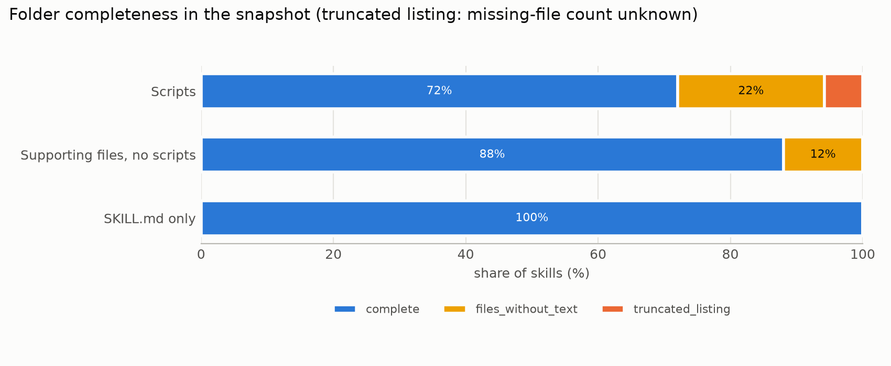
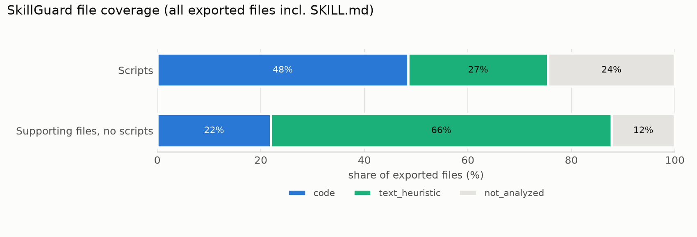
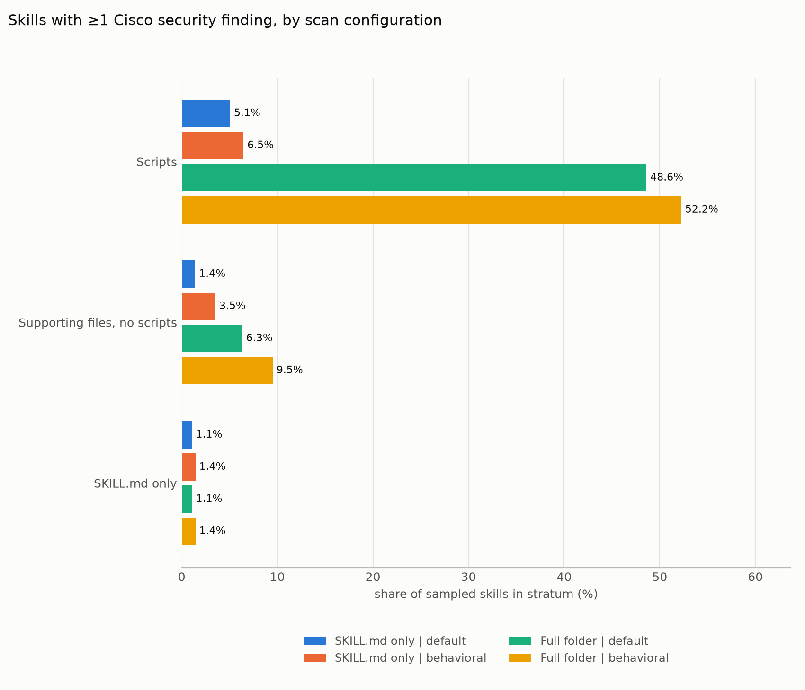
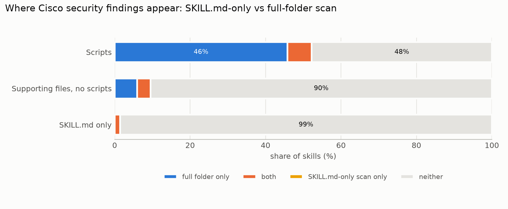
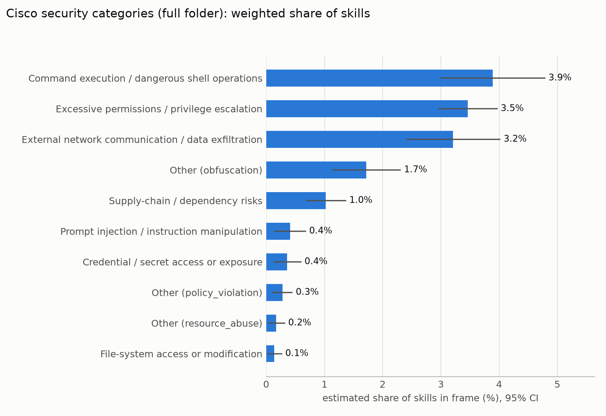
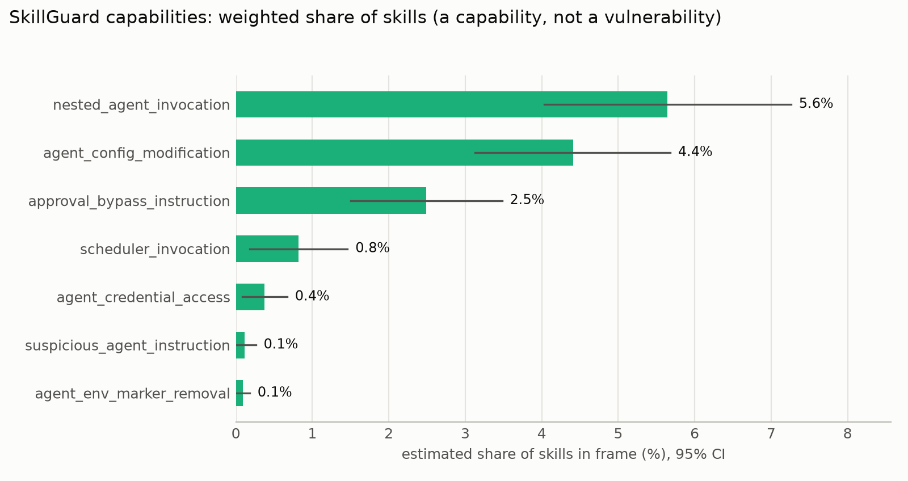

# 1,000-skill experiment: Cisco skill-scanner 2.3.1 and SkillGuard V3.1 (seed 2030)

**Status:** all 4 batches finished, and all 4,000 Cisco scans were verified. This is a consolidated analysis; nothing has been committed.
**Consolidated outputs:** `consolidated/2026-11-16_012423_4runs/` (`summary.json`, `tables/*.csv`, `figures/fig1–fig6.png`). They are produced by `analyze_main1000.py` (sha256 `summary.json → analysis_sha256`).
**Raw inputs, all preserved:**

- Cisco runs: `results/cisco_dataset_runs/agent_skills_sample/runs/*_sample1000-seed2030-batch{1..4}/`
- SkillGuard outputs: `skillguard/<run>/`
- Executed notebook copies: `provenance/`
- Run log: `main_run_log.jsonl`
- Gate investigations: `SCAN_STATUS_INVESTIGATION.md`, covering batches 1, 3 and 4

## How to read this report

- **Cisco security finding:** a notebook-01 row with `finding_kind = security`. Metadata-quality and scan-coverage rows are counted separately.
  - A finding is an **alert, not a confirmed vulnerability**.
  - **A missing Cisco alert is not a false negative.** No ground truth exists for these 1,000 skills, and none was created (no manual labeling).
- **SkillGuard behavior:** a grouped agent-specific *capability*, such as invoking a nested agent, editing agent configuration, or an instruction to bypass approval.
  - Every behavior keeps `assessment = needs_context`.
  - **A capability is not a vulnerability.** The SkillGuard numbers below are a *capability inventory*. They are not validated detection performance, and no precision or recall figures are reported or implied.
- **Unit of analysis:** the skill (the share of skills with at least one item), unless a figure says findings or files.
- **Population estimates ("weighted"):**
  - stratified design weights N_h/n_h: scripts 1,404/400, supporting files without scripts 2,634/300, SKILL.md only 7,260/300
  - finite-population-corrected variance, normal 95% CI
  - per-stratum rates use Wilson CIs
  - **Frame:** the 11,298 deduplicated representatives in the GitSkills sample DB, not every skill on GitHub. The SKILL.md-only stratum dominates the weighted figures (64% of the frame).
- **Primary analysis set (Cisco): 919 skills** whose 4 scans are all `COMPLETE`. This follows notebook 01's convention. The other 81 skills are described in §1 and come back in a sensitivity row (§7).

## 1. Scan execution

| | |
|---|---|
| Cisco scans | 4,000 of 4,000 executed (250 skills × 4 configurations × 4 batches); scanner 2.3.1, policy `balanced`, fingerprint `3f48e661…`; no LLM or OSV analyzers |
| Status | **3,712 `COMPLETE`**, 272 `PARTIAL`, 12 `CONTRACT_ONLY`, 4 `FAILED_SCANNER_ERROR` |
| Runtime | 3.18 h of scan time (mean 2.87 s per scan); batch 1 averaged 4.0 s and batches 2–4 averaged 2.5 s |
| SkillGuard V3.1 | frozen `eebc59e7` (hash-checked on every batch); 1,000 skills, 5,280 files, about 11 s total; skill code is never executed |
| Restarts | none needed. The orchestrator paused 3 times at the strict status gate; each pause was investigated, and no scan was repeated |

**The 81 skills outside the primary set.** Every one has a known cause in its input or a known Cisco issue:

| Reason | Skills | Configurations affected | Cisco output |
|---|---|---|---|
| Cisco's `skill_loader` rejects the SKILL.md frontmatter: missing `name`/`description`, malformed YAML, or no `---` block. In 1 skill Cisco is stricter than the DB flag (`owner: Your Organization---`). | 68 | all 4 (`PARTIAL`) | report with a fallback load (`SKILL_LOAD_FALLBACK_USED`) and usually a few findings |
| Known `FindingContract` / `UNKNOWN_BUNDLED_PYTHON_RULE` registration error | 12 | Full folder, behavioral only (`CONTRACT_ONLY`) | findings kept; the other 3 configurations are complete |
| SKILL.md contains a NUL byte that is also in the source DB text (`android-icon-processing`); Cisco refuses binary content | 1 | all 4 (`FAILED_SCANNER_ERROR`) | none |

By stratum the 81 are: scripts 44 of 400 (11%), supporting files 16 of 300 (5%), SKILL.md only 21 of 300 (7%). Skills with malformed frontmatter are not missing at random, so the primary Cisco rates describe skills that Cisco can load fully. SkillGuard analyzed all 1,000 skills, including these 81.

## 2. Coverage limitations

| Stratum | Complete folder | Listed files without stored text | Truncated listing (missing count **unknown**) |
|---|---|---|---|
| Scripts (400) | 288 | 89 | 23 |
| Supporting files, no scripts (300) | 264 | 36 | 0 |
| SKILL.md only (300) | 300 | 0 | 0 |

- **Missing files.** 2,848 listed files have no stored text in the snapshot. That count covers only skills with a complete listing. For the 23 truncated-listing skills, the number of missing files is **unknown, not zero**: `coverage_per_skill.csv` records them as `"unknown"`. Both tools saw exactly the same partial folders.
- **What SkillGuard analyzes** (fig. 5, share of exported files):
  - Scripts: 48% parsed as code (Python, shell, PowerShell), 27% covered only by the Markdown/text heuristic, 24% not analyzed.
  - Supporting files: 22% code, 66% text, 12% not analyzed.
  - Most common file types not analyzed: `.json` 291, `.mjs` 124, `.yaml` 112, `.txt` 89, `.ts` 77, `.js` 71.
  - **SkillGuard has no JavaScript/TypeScript analysis**, whereas Cisco reports many JS findings (§4). This is a known coverage gap, not evidence that those files are benign.
- **Cisco coverage notes:**
  - The only scan-coverage rule that fired is `SKILL_LOAD_FALLBACK_USED`, 272 times: the 68 frontmatter skills × 4 configurations.
  - Cisco 2.3.1 does not report unparsed files.

## 3. Cisco: overall rates and scan configurations

Primary set, 919 skills (scripts 356, supporting 284, SKILL.md only 279). Table: `cisco_by_configuration.csv`.

| Configuration | Skills flagged | Scripts | Supporting | SKILL.md only | Weighted (95% CI) | Findings |
|---|---|---|---|---|---|---|
| SKILL.md only, default | 25 | 5.1% | 1.4% | 1.1% | 1.65% (0.79–2.50) | 81 |
| SKILL.md only, behavioral | 37 | 6.5% | 3.5% | 1.4% | 2.55% (1.51–3.58) | 121 |
| Full folder, default | 194 | 48.6% | 6.3% | 1.1% | 8.21% (7.07–9.34) | 1,059 |
| **Full folder, behavioral** | **217** | **52.2%** | **9.5%** | **1.4%** | **9.63% (8.34–10.92)** | 1,182 |

- **Other finding kinds** (all 1,000 skills, any configuration): metadata-quality notes appear in 798 skills (weighted 82%), about 8.5 times as often as security findings (9.7%). They are not security findings.
- **Severity** (full folder, highest severity per skill): CRITICAL 48 skills (13.2% of scripts, weighted 1.87%), HIGH 41, MEDIUM 80, LOW 48.
- **What drives CRITICAL:** almost entirely code-execution rules in bundled code:
  - `COMMAND_INJECTION_JS_CHILD_PROCESS` (17 skills), `COMMAND_INJECTION_OS_SYSTEM` (12), `COMMAND_INJECTION_EVAL` (9)
  - `PATH_TRAVERSAL_OPEN` (4)
  - `COMPOUND_FETCH_EXECUTE` (3) and `DATA_EXFIL_SOCKET_CONNECT` (3)

**Default vs behavioral (full folder, primary set):**

- The behavioral dataflow analyzer adds 23 flagged skills (194 → 217) and 123 distinct findings.
- It removes none: every skill flagged in default mode is also flagged in behavioral mode.

## 4. SKILL.md-only vs full-folder scans

Table: `skill_only_vs_full_per_skill.csv` (fig. 2).

| Stratum | Flagged only by full folder | Both | Only by the SKILL.md-only scan | Neither |
|---|---|---|---|---|
| Scripts (356) | **163 (46%)** | 23 | 0 | 170 |
| Supporting (284) | 17 (6%) | 10 | 0 | 257 |
| SKILL.md only (279) | 0 | 4 | 0 | 275 |

- **Scope.** Most Cisco findings are invisible in a SKILL.md-only scan:
  - 180 of 217 flagged skills (83%) are flagged only when bundled files are included.
  - 969 of 1,172 distinct full-folder findings sit outside SKILL.md.
  - By file type, distinct findings sit in `.py` 344, `.mjs` 242, SKILL.md 226, `.js` 159, `.sh` 83, other `.md` 79.
  - A SKILL.md-only audit therefore misses most of what Cisco reports in script-bearing skills.
- **No reverse case.** No skill is flagged by the SKILL.md-only scan but not by the full-folder scan.
- **The same SKILL.md can give different findings.** In 69 skills, the findings on SKILL.md itself differ between the two scopes. Cisco's cross-file analyzers use the folder as context, for example taint flows and manifest-vs-code checks.
- **Skills with no supporting files.** Here the two scopes are expected to be identical, and they give the same flag rate (1.1% default, 1.4% behavioral). This is the internal consistency check.

## 5. Cisco detection categories

Full folder, both modes combined, findings deduplicated per (skill, rule, file, line); 1,172 distinct findings in total. Tables: `cisco_categories_full_folder.csv`, `cisco_rules_full_folder.csv`.

| Category (notebook-01 `research_category`) | Skills | Scripts | Weighted |
|---|---|---|---|
| Command execution / dangerous shell operations | 88 | 21.6% | 3.89% |
| Excessive permissions / privilege escalation* | 99 | 27.8% | 3.46% |
| External network communication / data exfiltration | 78 | 20.8% | 3.21% |
| Other (obfuscation) | 33 | 5.9% | 1.72% |
| Supply-chain / dependency risks | 28 | 7.6% | 1.02% |
| Prompt injection / instruction manipulation | 9 | 2.0% | 0.41% |
| Credential / secret access or exposure | 9 | 2.3% | 0.36% |
| Policy violation, resource abuse, file system, malware | ≤ 8 each | | ≤ 0.3% |

\***Caveat on "Excessive permissions".** This category is mostly *undeclared network use*: `TOOL_ABUSE_UNDECLARED_NETWORK` and `UNDECLARED_NETWORK_DESTINATION`, 61 skills each. In other words, code that uses the network when the manifest or documentation does not say so. It is a declaration mismatch, not privilege escalation in the usual sense.

- The `ALLOWED_TOOLS_*_VIOLATION` rules account for only 7–11 skills each.
- `ALLOWED_TOOLS_BASH_VIOLATION` (7 skills) is affected by the known Cisco 2.3.1 allowed-tools parsing bug documented in the earlier Cisco study.

**Most common rules (skills flagged):**

- `UNDECLARED_NETWORK_DESTINATION` 55, `TOOL_ABUSE_UNDECLARED_NETWORK` 49
- `DATA_EXFIL_NETWORK_REQUESTS` 36, `BEHAVIOR_BASH_TAINT_FLOW` 28
- `SUPPLY_CHAIN_UNPINNED_DEPENDENCY` 25, `FILE_MAGIC_MISMATCH` 23
- `DATA_EXFIL_JS_FS_ACCESS` 19 (285 findings), `DATA_EXFIL_JS_NETWORK` 19
- `COMMAND_INJECTION_JS_CHILD_PROCESS` 16

## 6. SkillGuard V3.1 capability inventory

All 1,000 skills. Tables: `skillguard_capabilities.csv`, `skillguard_behaviors_all.csv`.

- 244 behaviors in 149 skills: weighted **10.99% (8.87–13.11)** of the frame.
- Per stratum: scripts 19.3%, supporting 16.7%, SKILL.md only 7.3%.

| Capability | Skills | Behaviors | Weighted | Evidence: instruction / documented example / code |
|---|---|---|---|---|
| nested_agent_invocation | 72 | 82 | 5.64% | 64 / 6 / 12 |
| agent_config_modification | 72 | 103 | 4.41% | 71 / 23 / 9 |
| approval_bypass_instruction | 37 | 37 | 2.49% | 37 / 0 / 0 |
| scheduler_invocation | 10 | 11 | 0.82% | 6 / 3 / 2 |
| agent_credential_access | 6 | 6 | 0.37% | 3 / 2 / 1 |
| agent_env_marker_removal | 3 | 3 | 0.09% | 0 / 0 / 3 |
| suspicious_agent_instruction | 2 | 2 | 0.11% | 2 / 0 / 0 |

- **Evidence levels.**
  - 183 of 244 behaviors (75%) are *instruction-only* (Markdown text telling the agent to do something); 34 are documented examples and 27 come from code.
  - Only 18 skills (weighted 0.56%) have a code-level behavior, and all of them are in the scripts stratum.
- **Review priority:** 18 high, 186 medium, 40 low.
  - The high-priority behaviors cover 17 skills (weighted 0.95%).
  - They are: approval bypass (6), credential access (6), removal of the agent's environment marker (3), suspicious future-session instructions (2) and 1 nested agent invocation.
  - "High" means *look at this first*, not *malicious*.

## 7. How Cisco and SkillGuard relate

This section describes overlap only; it does not measure accuracy.

**Skill level** (primary set, 919 skills; Cisco = full folder, either mode):

| | Cisco security finding | No Cisco security finding |
|---|---|---|
| **SkillGuard behavior** | 55 | 81 |
| **No SkillGuard behavior** | 162 | 621 |

**Location level:**

- Only **4 of 244** SkillGuard behaviors have a Cisco security finding within ±3 lines of the same file.
  - The 4 are: a scheduler instruction next to `ACTIVE_OS_PERSISTENCE_DIRECTIVE`, a suspicious instruction next to `PIPELINE_TAINT_FLOW`, and nested-agent / approval-bypass instructions next to `BEHAVIOR_BASH_TAINT_FLOW`.
  - One of them (`launchd-cron-installer`) comes from a `PARTIAL` scan.
- In the 55 skills flagged by both tools, the two flag different things. Cisco's categories in those skills are mostly command execution (38), excessive permissions / undeclared network (20) and network / exfiltration (19).

**Interpretation:**

- The two tools measure different properties:
  - **Cisco** mostly flags code-level patterns in bundled scripts: JS/Python execution, network use, and manifest mismatches.
  - **SkillGuard** mostly inventories agent-directed instructions in Markdown: spawning sub-agents, editing agent config, and skipping approvals. These are not Cisco rule categories.
- **The 81 "SkillGuard only" skills are not Cisco false negatives**, and the 162 "Cisco only" skills are not SkillGuard misses: neither tool claims to cover the other's property, and no ground truth was established. Whether any of these capabilities is *harmful* in context was not assessed.
- SkillGuard's controlled test cases (55 tests) and the earlier provisional evaluations remain the only evidence of its correctness. This experiment measures **prevalence and coverage, not detection performance**.

## 8. Sensitivity analyses

Table: `sensitivity.csv`. Weighted % with 95% CI.

| Subset | n | Cisco security (full folder) | SkillGuard any behavior |
|---|---|---|---|
| Primary (all 4 scans complete) | 919 | 9.63 (8.34–10.92) | 10.68 (8.54–12.82) |
| Primary, excluding the 44 previously examined skills | 880 | 9.82 (8.50–11.13) | 10.89 (8.71–13.06) |
| Primary, complete folders only | 787 | 9.15 (7.79–10.52) | 9.13 (6.98–11.27) |
| Primary, excluding previously examined, complete folders only | 748 | 9.36 (7.95–10.76) | 9.24 (7.06–11.42) |
| All 1,000 skills, including findings from `PARTIAL`/`CONTRACT_ONLY` scans | 1,000 | 9.70 (8.48–10.91) | 10.99 (8.87–13.11) |

- **Previously examined skills.** Excluding the skills used during SkillGuard development or earlier held-out testing changes nothing materially (SkillGuard 10.68% → 10.89%), so the development overlap does not inflate the inventory.
- **Incomplete folders.** These matter mainly for SkillGuard in the scripts stratum. Script skills whose folder has *files without stored text* carry SkillGuard behaviors far more often (36 of 89) than complete script folders (34 of 288).
  - The likely reason is that such folders belong to larger agent-framework repositories. This was **not verified**; it is an observation for follow-up.
  - Cisco's flag rate among script skills is similar across complete (128/257 primary), files-without-text (43/77) and truncated (15/22) folders.
- **Exclusions.** Including the 81 excluded skills, with their partial findings, moves the Cisco estimate by under 0.1 percentage points.

## 9. Limitations

1. **No ground truth.** Cisco alerts and SkillGuard capabilities are unverified. A missing Cisco alert is not a false negative, and a SkillGuard capability is not a vulnerability.
2. **Partial coverage.**
   - 148 incomplete folders, including 23 truncated listings whose missing-file count is unknown.
   - SkillGuard does not analyze JS/TS, JSON or YAML.
   - Both tools saw identical partial inputs, but neither sees files missing from the snapshot.
3. **Primary set.** 81 skills (8.1%) are not in the primary Cisco set because of malformed frontmatter, the known contract issue, or a NUL byte. This loss is not random.
4. **Scanner version.** All results are for Cisco skill-scanner 2.3.1 static and behavioral analyzers with the balanced policy, without the LLM or meta analyzers, plus SkillGuard V3.1.
5. **Category labels.** The category labels are notebook 01's mapping of Cisco rules. "Excessive permissions" is mostly undeclared network use (§5).
6. **Frame.** Weighted estimates apply to the GitSkills sample DB frame (11,298 representatives), not to all public skills.
7. **Gate changes during the run.** The status gate was revised 3 times (batches 1, 3 and 4) to accept explained, input-caused outcomes. No scan was repeated or altered. `SCAN_STATUS_INVESTIGATION.md` records each change.

## Reproducibility

- **Sample:** notebook 03, seed 2030, byte-identical when re-drawn.
- **Batches:** manifests in `manifests/`.
- **Scans:** notebook 01 executed headless by `run_notebook.py` with the pilot-validated settings. The notebooks on disk were unchanged, as asserted after each run.
- **SkillGuard:** `run_skillguard_on_run.py`, which hash-checks frozen V3.1.
- **Consolidated analysis:** `analyze_main1000.py <batch1..4 run dirs>`. Re-running gave identical numbers: a first pass with layout-only figure fixes is identical apart from timestamps.
- **Pilot evidence:** reproducibility and crash recovery are covered in `PILOT_REPORT.md`.
- **Repository state:**
  - Tracked `results/reports/README.md` and `index.html` were restored after every batch.
  - The per-run report folders under `results/reports/agent_skills_sample/` were kept.
  - Nothing was committed or pushed.
