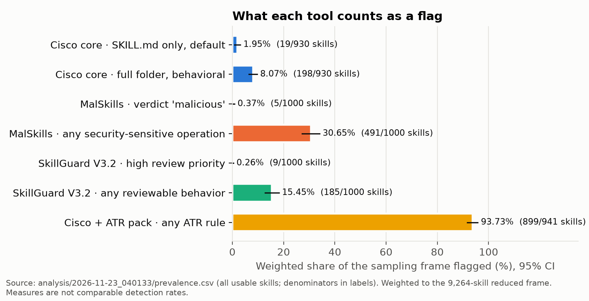
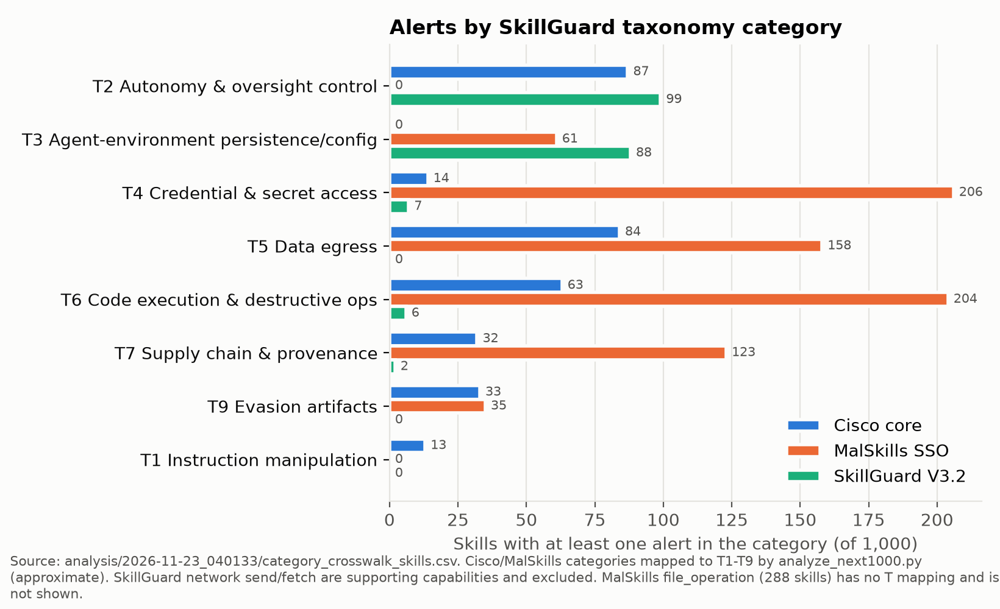
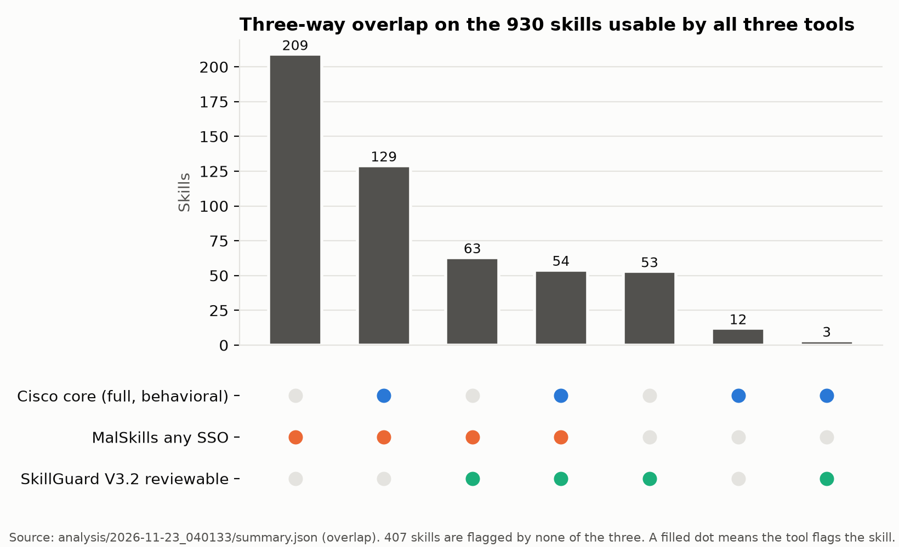
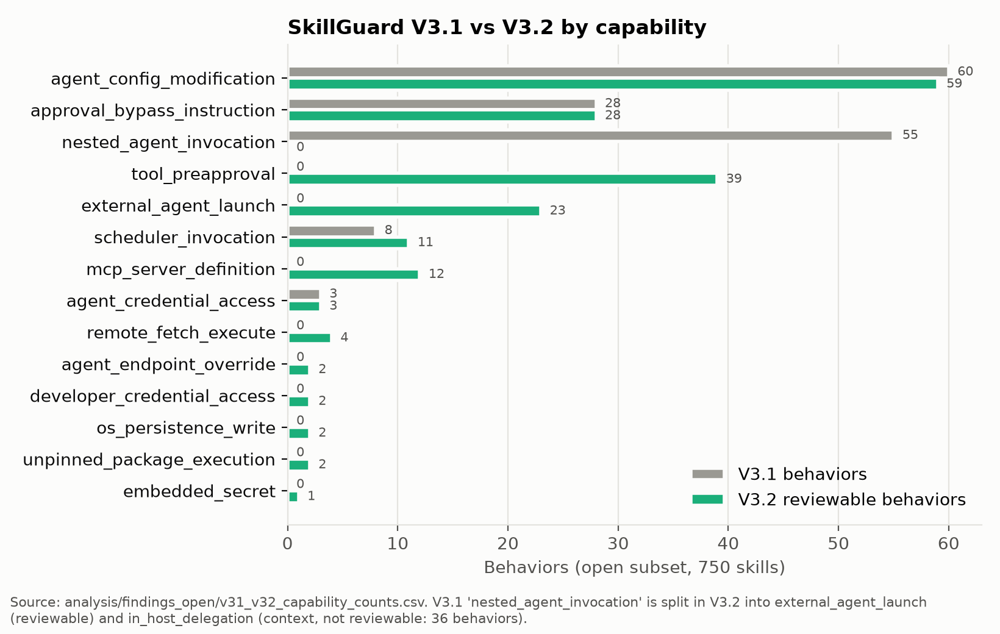
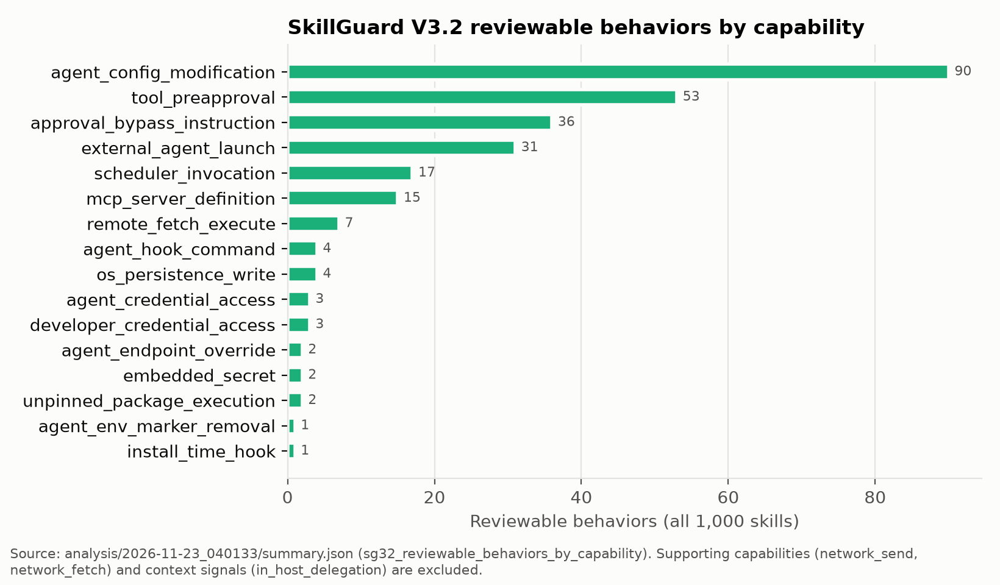
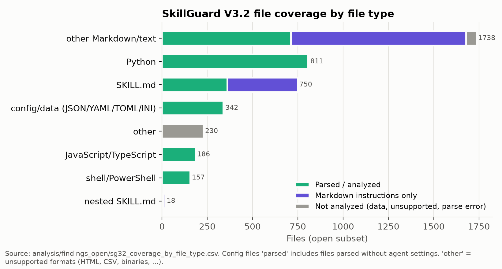

# Comparing three security scanners on 1,000 new agent skills

**Study:** next 1,000-skill experiment (seed 2031), SkillGuard project, MSR 2027 Mining Challenge
**Run:** 2026-11-22 22:35 to 2026-11-23 04:00 (plus a MalSkills re-run of one batch). **Branch:** `skillguard-v3.2`
**Companion documents:**
- [ANALYSIS_next1000.md](ANALYSIS_next1000.md): what was actually detected, with worked examples.
- [MENTOR_BRIEF.md](MENTOR_BRIEF.md): short research update.
- [README.md](README.md): how to run and where the files are.

> **How to read the numbers.**
> - **Unit:** a *skill* means one representative `SKILL.md` and its exported folder.
> - **Kinds of numbers:**
>   - *Raw counts* are given with their denominator, e.g. 198/930.
>   - *Percentages* without further qualification are unweighted shares of the stated denominator.
>   - *Weighted estimates* project to the sampling frame using the stratified design weights. They come with normal 95% confidence intervals and a finite-population correction.
> - **Alerts:** an alert is a tool output, not a vulnerability. Nothing in this report measures accuracy; the skills have no ground-truth labels.

## 1. Background

**What a skill is.** An agent skill is a folder that teaches an AI coding agent how to do a task. Agents that load skills include Claude Code, Codex, Cursor and similar tools. The folder contains:
- a `SKILL.md` file, with YAML frontmatter (name, description, optionally `allowed-tools`) and Markdown instructions;
- often scripts, reference documents and configuration files.

When a task matches the description, the agent reads the instructions and may run the bundled scripts with its own permissions.

**Why skills are a security problem.** A skill mixes two kinds of content that security tools traditionally treat separately: code that runs, and natural-language text that steers an agent which itself can run code. This creates risks that ordinary code scanners do not model:
- a skill can instruct the agent to skip confirmations;
- it can pre-approve shell access through its metadata;
- it can modify the agent's own configuration (`CLAUDE.md`, `settings.json`, MCP server lists);
- it can launch another agent with its safety checks disabled.

Skills are shared in public GitHub repositories and installed with little review.

**What this project investigates.** We study how existing scanners characterize real skills, and we are building **SkillGuard**, a static analyzer for agent-specific capabilities. Three questions:
- What does each tool detect?
- Where do the tools agree, and where do they disagree?
- Does an agent-aware analyzer surface behaviors that generic scanners do not?

## 2. Objective of this experiment

Earlier work compared Cisco's skill-scanner with SkillGuard V3.1 on 1,000 skills ([main1000](../main1000/REPORT_main1000.md)). A teammate ran MalSkills separately on a different 1,100-skill sample. This experiment compares **Cisco, MalSkills and SkillGuard on the exact same 1,000 skills**, none of which was used during SkillGuard development. It also runs the frozen SkillGuard V3.1 next to the new V3.2.

We wanted to learn:
1. how often each tool raises an alert, and under what definition of "alert";
2. which kinds of behavior each tool reports, mapped to a common taxonomy;
3. how much the tools overlap, at the level of skills and at the level of file and line;
4. what V3.2 changes relative to V3.1 on unseen data.

We deliberately did **not** try to measure which tool is "right". That requires human labels, and those are planned separately, on the evaluation lockbox (section 3.4).

## 3. Dataset and sampling

### 3.1 Source

All skills come from the GitSkills sample database (`data/sample/agent_skills_sample.db`, sha256 `683888c9…`, opened read-only).
- **Frame:** the database deduplicates identical `SKILL.md` files. Notebook 03 builds the frame from 11,298 deduplicated representatives.
- **Files on disk:** each skill's files are exported from the stored database text, never fetched from GitHub. The export is therefore reproducible, but limited to what the database stored (section 5.2).

### 3.2 Exclusions

To keep the sample new, we excluded every `SKILL.md` identity (`file_sha`) used in any earlier SkillGuard or MalSkills experiment, 2,174 identities in total:

| Source | Identities |
|---|---|
| main1000 sample (seed 2030) | 1,000 |
| Development sample (seed 2027) | 30 |
| Held-out samples (seeds 2028, 2029) | 190 |
| Notebook-01 pilots | 5 |
| Both MalSkills samples | 1,098 of 1,100 |

- **Overlap with the frame:** 2,034 of the 2,174 excluded identities were eligible representatives in the frame, so the reduced frame has **9,264** skills.
- **Unmapped MalSkills entries:** 2 cannot be mapped to the database and are listed in `exclusions/unresolved.csv`. Mapping the MalSkills identities required reproducing the Windows text-mode newline translation of the original export.
- **Provenance:** `results/samples/…seed2031…/exclusion_provenance.json`.

### 3.3 Stratification (400 / 300 / 300)

The sample was drawn by notebook 03's own code (via `draw_sample.py`, seed 2031). It uses the same three strata and the same sample sizes as main1000, so the two experiments are comparable:

| Stratum | Definition | Frame N (after exclusions) | Sample n | Design weight |
|---|---|---|---|---|
| scripts | skill folder contains executable scripts | 860 | 400 | 2.15 |
| supporting_no_scripts | supporting files, no scripts | 2,069 | 300 | 6.90 |
| skill_md_only | `SKILL.md` only | 6,335 | 300 | 21.12 |

- **Why the strata are unequal:** the scripts stratum is heavily oversampled because code-bearing skills carry most code-level alerts. A proportional sample would contain fewer than 100 of them.
- **Consequence:** unweighted rates over the 1,000 are dominated by scripts and do not describe the frame. Weighted estimates correct for this. In the weighted figures, SKILL.md-only skills count for about two thirds of the frame.
- **Diversity:** the 1,000 skills come from 873 repositories. The median repository has 1 GitHub star, so this is mostly long-tail, individually published content.

### 3.4 Evaluation lockbox

250 of the 1,000 skills (100 / 75 / 75) form an evaluation lockbox, reserved for testing a future SkillGuard version on data that did not influence it. The rules:
- **Scanned like the rest:** every tool scanned the lockbox skills, and aggregate statistics include them.
- **Sealed outputs:** item-level outputs for these skills are written to `sealed/` folders. They are not used in any analysis here.
- **Item-level discussion:** every example in this report and in the analysis comes from the 750 open skills.

The item-level lockbox outputs were accidentally published on 2026-11-23 and were publicly accessible for about 18 hours. They were then removed from the branch and, by a history rewrite, from its history. Copies made in that window, and GitHub's cache of the old commit, may persist. [LOCKBOX_POLICY.md](LOCKBOX_POLICY.md) records the details.

### 3.5 Limitations of the sample

The frame is the GitSkills database, not all skills on GitHub. Skills are exported from stored text: files without stored text (binaries, large files) are absent, and some folder listings are truncated. Skills from a few known adversarial or scanner-fixture repositories are flagged (13), not removed. Every weighted rate changes by at most 0.2 points without them.

## 4. Experiment setup

| Tool | Version | Configurations | Why |
|---|---|---|---|
| **Cisco skill-scanner** | 2.3.1, policy `balanced` | four core configurations: {SKILL.md only, full folder} × {default, behavioral}. Run by notebook 01 in manifest mode, exactly as in main1000 | Industry scanner and the strongest existing baseline. The four configurations separate what the `SKILL.md` text alone triggers from what the folder triggers, and show what the behavioral (data-flow) analyzer adds. The primary configuration is **full folder + behavioral** |
| Cisco + ATR rule pack | same, `--rule-packs atr` (712 rules), full folder + behavioral | fifth configuration (`run_cisco_atr.py`) | ATR is an optional community rule pack for agent threats. Run once to see what agent-oriented rules add. Reported separately |
| **MalSkills** | commit `46d60f09` (latest public), Semgrep 1.186.0 | `scan-corpus --profile static --disable-yasa --retain all` (`malskills_runner.py`) | Academic malicious-skill detector. It extracts security-sensitive operations (SSOs) with Semgrep, links them across files, and applies formal malicious-behavior patterns. Static profile, no LLM, matching the teammate's earlier run (YASA was unavailable there too) |
| **SkillGuard V3.1** | frozen, sha `eebc59e7` | default (`run_skillguard.py`) | Our previous version, the baseline for V3.2 |
| **SkillGuard V3.2** | package sha256 `c15e43c3…`, frozen before the run | default | Our current analyzer (section 7.3) |

**Not enabled:** Cisco's LLM, meta and OSV analyzers, matching main1000. They need API keys or network access, and they would make results depend on a model.

**Same inputs for every tool.** Each skill was exported once from the database. Cisco and SkillGuard scanned the exported folders. MalSkills scanned a byte-identical copy, because it needs a different directory layout. Folder digests were checked before and after every scan, so no tool could have seen different bytes.

**Execution.** The 1,000 skills ran in four stratified batches of 250, orchestrated by `run_next1000.py`, which stops a batch for investigation on any failure. A 12-skill pilot came first, drawn from open skills only, and confirmed end-to-end determinism.

## 5. Execution results

### 5.1 Scans and completion

| Tool | Scans | Outcome |
|---|---|---|
| Cisco core, SKILL.md only (default, behavioral) | 2 × 1,000 | 941 COMPLETE, 59 PARTIAL each |
| Cisco core, full folder, default | 1,000 | 941 COMPLETE, 59 PARTIAL |
| Cisco core, full folder, behavioral | 1,000 | 930 COMPLETE, 59 PARTIAL, 11 CONTRACT_ONLY |
| Cisco + ATR | 1,000 | 941 COMPLETE, 59 PARTIAL |
| MalSkills | 1,000 | 1,000 ok. 0 identity mismatches, 0 scans from a nested skill file (after the fix in section 6) |
| SkillGuard V3.1 / V3.2 | 1,000 each | all scanned |

**Two different Cisco problems**, each affecting a fixed set of skills:
- **PARTIAL (59 skills, in every configuration):** Cisco's skill loader reported an error, usually malformed or non-standard frontmatter, and fell back to a partial load.
- **CONTRACT_ONLY (11 skills, full-folder behavioral only):** the behavioral analyzer failed its finding contract.

So **930 skills have all four core configurations complete**. Cisco rates use only these, while the other tools are reported on all 1,000. The open skills among the 70 incomplete ones are listed in `analysis/2026-11-23_040133/incomplete_scans.csv` (46 skills); the 24 lockbox skills are sealed.

### 5.2 Input integrity and missing files

| Check | Result |
|---|---|
| Exported files whose bytes equal the database text | 5,680 of 5,680 (**0 mismatches**) |
| Folders with files listed in the database but without stored text | 122 skills (3,545 listed files have no stored text) |
| Folders with truncated listings | 27 skills |
| Folder digests changed by any scan | 0 |
| MalSkills corpus changed during the scan | 0 files (checksums after every batch) |

**The missing files are a limitation of the database, not an execution failure.** A skill whose scripts were never stored looks smaller to every tool than it is on GitHub. Restricting to complete folders lowers Cisco's weighted rate from 8.07% to 7.47% and SkillGuard V3.2's from 15.45% to 14.62% (`prevalence.csv`).

### 5.3 Runtime

| Batch | Wall time | Cisco core (4 configs) | Cisco + ATR | MalSkills (4 workers) | SkillGuard |
|---|---|---|---|---|---|
| 1 | 92.5 min | 61.1 min | 14.0 min | 17.4 min | 7.5 s |
| 2 | 87.5 min | 55.9 min | 14.4 min | 17.0 min | 7.5 s |
| 3 | 72.9 min | 41.4 min | 14.1 min | 17.3 min | 6.3 s |
| 4 | 72.5 min | 41.3 min | 13.9 min | 17.1 min | 6.3 s |

In total the run took 5.4 hours, plus 17 minutes for the MalSkills re-run of batch 1. Cisco's 4,000 core scans add up to 3.3 hours of scan time, about 3 s per scan. SkillGuard is several hundred times faster (about 7 s per batch of 250 skills), because it parses files without running scanner pipelines.

## 6. Engineering problems found and fixed

Both problems were in how MalSkills ran on our machine. Its code was left unchanged; the fixes are in our runner.

### 6.1 Markdown findings silently dropped on macOS

**Cause.** MalSkills extracts code blocks from Markdown into temporary files under `.malskills_fences/`, runs Semgrep on them, and maps results back with `Path(result).resolve().relative_to(tempdir)`.
- On macOS the temp directory lives under `/var`, which is a symlink to `/private/var`, so the resolved path is not inside the unresolved temp path and the mapping fails.
- The fallback strips the prefix with `.lstrip("./")`. This removes characters, not a prefix, so `.malskills_fences/x.sh` becomes `malskills_fences/x.sh`, which matches no artifact.
- Every finding inside a Markdown code block was silently discarded.

**Effect.** Before the fix, MalSkills reproduced the teammate's earlier (Linux/WSL) results for only 18 of 40 re-exported skills. Many SSO counts dropped to zero.

**Fix.** The runner points `TMPDIR` at a directory without symlinks, where resolution behaves as on Linux.

**Verification.** After the fix, all **40/40** skills reproduce the earlier run exactly: verdicts, patterns, SSO counts, artifact counts and content hashes. The before and after validation outputs are both kept in `malskills_validation/`.

### 6.2 MalSkills scanned the wrong `SKILL.md` in folders with nested skills

**Cause.** MalSkills chooses one skill file per folder by ranking all `SKILL.md` files by exact name, then **newest modification time**, and scans only that file's directory. In folders that contain nested `SKILL.md` files (examples, archived versions, sub-skills), the choice depended on file timestamps from our copy step.

**Effect.** In batch 1, MalSkills scanned 3 of 250 skills from a subfolder. Our importer caught this, because the `SKILL.md` hash MalSkills reported did not match the exported one.

**Fix.**
- The runner now gives every file one fixed timestamp and the top-level `SKILL.md` one second more, so MalSkills always selects it. Only timestamps change, never bytes. This is applied when the corpus is prepared and again just before each run.
- The importer now fails a batch if any scan used a nested skill file or does not match the `SKILL.md` identity.

**Verification.**
- **Batch 1 re-run.** Two of the three affected skills gained findings (SSO count 0→23 and 0→26), still with benign verdicts. The third gave the same result. The other 247 were identical to the first run, which is kept as `…batch1__malskills_output__run1_nested_selection/`.
- **Batches 2–4.** These ran with the fix: 0 nested selections, 0 identity mismatches.
- **Pilot.** The pilot had no nested skill files, so its validation stands.

**Both bugs would have biased the comparison in the same direction.** MalSkills would have looked weaker on Markdown-heavy skills than it really is. This is why the identity check and the reproduction against the earlier run matter.

## 7. Results by tool

All numbers in this section cover the whole sample. Item-level breakdowns and examples, from the open subset, are in [ANALYSIS_next1000.md](ANALYSIS_next1000.md).

### 7.1 Cisco skill-scanner

| Configuration | Skills flagged / usable | Scripts | Supporting | SKILL.md only | Weighted (95% CI) |
|---|---|---|---|---|---|
| SKILL.md only, default | 19 / 930 | 2.8% | 1.1% | 2.1% | 1.95% (0.79–3.11) |
| **Full folder, behavioral** | **198 / 930** | 47.3% | 5.6% | 3.6% | **8.07% (6.48–9.67)** |

**Most findings come from code, not from the instructions.** Scanning the full folder instead of only `SKILL.md` multiplies the number of flagged skills about tenfold. On the open subset:
- **File types:** Python and JavaScript/TypeScript produce 58% of primary-configuration findings.
- **Categories:** excessive permissions (undeclared network use), network communication, and command execution.
- **Behavioral analyzer:** adds a bash data-flow rule and code-block rules for Python inside Markdown, which flag 13 more open skills than full-folder default.

**Severity.** Among open flagged skills the highest severity is CRITICAL for 39, HIGH 24, MEDIUM 65, LOW 25. Many CRITICAL findings are pattern-level matches, for example a `child_process` import. The examples in the analysis show why severity labels need to be read next to the source.

**Comparison with main1000.** The primary rate is close to main1000 on a disjoint sample: 8.07% here, 9.63% (8.34–10.92) there.

**ATR pack.**
- **Volume:** ATR rules fired in **899 of 941** skills, weighted 93.73% (91.64–95.82), with 39,352 findings. `ATR_2026_00099` alone produced 21,384 of them, and the top three rules produced 77%.
- **Where they fire:** in the open subset, ATR findings occur only in Markdown files.
- **Why:** the rule descriptions show they were written for runtime agent traffic (tool calls, MCP arguments). On static documentation they match ordinary tokens, such as a ```` ```bash ```` fence label, a `$TOKEN` placeholder or a `${variable}` template.

We report ATR separately and never pool it into Cisco's rates. Without ground truth we do not call these alerts false positives, but they are not informative as a prevalence measure.

### 7.2 MalSkills

| Measure | Skills | Scripts | Supporting | SKILL.md only | Weighted (95% CI) |
|---|---|---|---|---|---|
| Verdict "malicious" | 5 / 1,000 | 0.8% | 0.3% | 0.3% | 0.37% (0.00–0.83) |
| Any security-sensitive operation (SSO) | 491 / 1,000 | 81.3% | 32.0% | 23.3% | 30.65% (27.25–34.04) |

**Two layers.** MalSkills produces two outputs that must not be confused:
- **SSOs:** individual operations such as reading a file, calling `subprocess.run`, accessing environment variables, installing a package, or receiving remote data. There are 7,545 SSO findings across the sample.
- **Malicious verdict:** given only when SSOs, linked across artifacts, satisfy one of its formal patterns.

**Results.** About half of the sampled skills (491) contain some SSO, but only 5 satisfy a malicious pattern.
- **Patterns:** in all four open cases the patterns were `Malware_Delivery` and `Remote_Code_Execution`.
- **What triggered them:** each time, one line of documentation that pipes a download into an interpreter.
  - Three are standard installer one-liners from the projects' own domains, e.g. `curl -SsL https://get.riot.ml | sh -`.
  - One pipes a downloaded web page into `python3 -c "<inline parser>"`, where the remote content is parsed as data, not executed.

The verdict marks a structural pattern. It is not evidence of intent (analysis section A).

### 7.3 SkillGuard V3.1 and V3.2

| Measure | Skills / 1,000 | Scripts | Supporting | SKILL.md only | Weighted (95% CI) |
|---|---|---|---|---|---|
| V3.1: any behavior | 157 | 18.8% | 17.0% | 10.3% | 12.60% (10.12–15.08) |
| **V3.2: any reviewable behavior** | **185** | 21.8% | 19.3% | 13.3% | **15.45% (12.71–18.20)** |
| V3.2: high review priority | 9 | 2.0% | 0.3% | 0.0% | 0.26% (0.10–0.42) |
| V3.2: agent-specific category | 140 | 18.3% | 14.7% | 7.7% | 10.21% (8.02–12.40) |

**What V3.2 reports.** Each finding is a *behavior*, with:
- a capability, a taxonomy category (T1–T9) and an evidence level;
- independent severity, confidence and review-priority fields.

"Reviewable" excludes supporting capabilities, such as plain network requests, and context signals, such as ordinary sub-agent delegation.

**What it found.** Across the sample V3.2 reports **271 reviewable behaviors**:
- agent configuration modification 90, tool pre-approval 53, approval-bypass instructions 36;
- external agent launches 31, scheduler invocations 17, MCP server definitions 15;
- remote fetch-and-execute 7, and 22 across seven rarer capabilities.

It also links behaviors across files into **50 chains**, for example an unscoped shell pre-approval combined with launching an external agent.

**SkillGuard's alerts are spread more evenly across strata than the other tools'.** About a fifth of supporting-file skills are flagged, and 13% of SKILL.md-only skills, compared with 3.6% for Cisco. Agent-steering behavior lives largely in instructions and metadata, which every skill has.

## 8. Comparison

**Overlap at the skill level.** On the 930 skills usable by all three tools (Cisco core full-folder behavioral, MalSkills any SSO, SkillGuard V3.2 reviewable), see figure 3:

| Cisco | MalSkills SSO | SG V3.2 | Skills |
|---|---|---|---|
| – | – | – | 407 |
| – | ✓ | – | 209 |
| ✓ | ✓ | – | 129 |
| – | ✓ | ✓ | 63 |
| ✓ | ✓ | ✓ | 54 |
| – | – | ✓ | 53 |
| ✓ | – | – | 12 |
| ✓ | – | ✓ | 3 |

**Cisco and MalSkills see largely the same thing.** 183 of Cisco's 198 flagged skills also contain MalSkills SSOs, and 312 of 713 Cisco full-folder alert locations (44%) have a MalSkills SSO within three lines (aggregate over the 930 comparable skills). Both tools respond mainly to code operations: network calls, subprocesses, file access. MalSkills' SSO layer is simply broader.

**SkillGuard sees something different.** Its location agreement with the other tools is low. Of the 246 reviewable V3.2 behaviors in the 930 comparable skills, only 5 have a Cisco core alert within three lines, and 32 have a MalSkills SSO. In the open subset alone, the figures are 1 and 25 of 180. In 53 skills, SkillGuard is the only one of the three that flags anything.

**The category crosswalk shows why** (figure 2). The categories are mapped to SkillGuard's taxonomy, approximately.
- **SkillGuard's alerts:** concentrated in T2 (autonomy and oversight control, 99 skills) and T3 (agent-environment configuration, 88).
- **MalSkills' alerts:** concentrated in T4–T7 (credentials, egress, execution, supply chain: 123–206 skills each).
- **Cisco's alerts:** both groups, but none in T3.

**The strict outputs do not coincide.** MalSkills' 5 malicious verdicts and SkillGuard's 9 high-priority skills share no skill. In the open subset, the reason is visible:
- MalSkills' verdicts rest on installer one-liners. SkillGuard flags three of the four as `remote_fetch_execute` at the same lines, but at medium or low priority, because they are documented installation steps.
- SkillGuard's high-priority skills involve launching other agents with approvals disabled, which is not a MalSkills pattern.

**V3.1 vs V3.2 on new data.**
- **Agreement:** the versions agree on 912 of 1,000 skills (785 neither, 127 both).
- **Newly flagged by V3.2 (58 skills):** in the open subset this is mostly tool pre-approval (32 of 42). V3.1 did not parse `allowed-tools`.
- **No longer flagged (30 skills):** in the open subset, all 21 were flagged by V3.1 only as `nested_agent_invocation`. V3.2 now separates ordinary sub-agent delegation from launching an external agent CLI.

Analysis section E explains this with examples.

## 9. Limitations

- **No accuracy is measured.** All numbers describe alerts. Agreement between tools is not correctness, and a skill flagged only by SkillGuard is neither a confirmed issue nor a false negative of the others. In an informal reading of the open SkillGuard-only cases (analysis section D), several approval-bypass and config-modification alerts were negations or mere mentions. That reading was done by one person and is not validated.
- **The definitions differ.** Cisco counts any non-metadata security finding, MalSkills either an operation or a pattern verdict, and SkillGuard reviewable behaviors. Comparing rates across tools compares definitions as much as detectors.
- **Tool configurations are partial.** MalSkills ran without its LLM stage and without YASA, and Cisco without LLM, meta or OSV analyzers. The full profiles may behave differently.
- **Inputs are incomplete.** 122 folders lack some files, and 70 skills have incomplete Cisco scans. The latter are concentrated in skills with malformed frontmatter, so they are not missing at random.
- **The category mapping is approximate.** Cisco and MalSkills categories were mapped to SkillGuard's taxonomy by rule, not by reviewing individual findings.
- **The lockbox outputs were publicly exposed** for about 18 hours (section 3.4). No team member opened them, but the lockbox can no longer be described as never accessible, and a future evaluation on it must state the exposure.
- **The frame is a database snapshot** with mostly low-star repositories. Rates may differ for popular, curated skill collections.

## 10. Conclusion

**What the experiment contributes:**
- **A reproducible three-way comparison on identical inputs.** It covers the sampling code, exclusions, byte-verified exports, pinned tool versions and per-step logs. Every reported number regenerates from saved outputs with the scripts in this folder.
- **Two corrections to running MalSkills.** These are needed to reproduce MalSkills' published behavior on macOS and on folders with nested skills. The importer now checks for both automatically.

**What the data shows:**
- **Cisco and MalSkills** mostly overlap on code-level operations. MalSkills' malicious verdict is rare and, in the open cases, driven by installer one-liners.
- **Cisco's ATR pack** fires on almost every skill, because its rules target runtime agent traffic rather than static documentation.
- **SkillGuard V3.2** reports a different class of behavior, agent control and configuration. It locates it mostly in instructions and metadata, where the other tools rarely look.
- **V3.1 to V3.2:** the version change on unseen data is explained by two deliberate design decisions, parsing `allowed-tools` and separating in-host delegation from external agents.

**What remains open:**
- **Validation.** Whether SkillGuard's distinct alerts are *useful* is still unknown; that requires a labeling protocol and human review, ideally on the lockbox.
- **Precision of the instruction detectors.** The approval-bypass and config-modification detectors need work on negation and on "mentions vs writes".
- **Chain reporting** inflates counts (one skill produced 16 chains) and should be deduplicated.
- **Full tool profiles.** Running MalSkills and Cisco with their LLM stages would show whether the observed overlap holds.

## Figures

| Figure | Shows |
|---|---|
|  | **Figure 1.** Weighted flag rates with 95% CIs, by tool and definition |
|  | **Figure 2.** Skills with alerts per taxonomy category, by tool |
|  | **Figure 3.** Three-way overlap on 930 comparable skills |
|  | **Figure 4.** SkillGuard V3.1 vs V3.2 behaviors by capability (open subset) |
|  | **Figure 5.** SkillGuard V3.2 reviewable behaviors by capability |
|  | **Figure 6.** SkillGuard V3.2 file coverage by file type (open subset) |

## Sources for every number

| Numbers | File |
|---|---|
| Rates, CIs, overlap, crosswalk, location agreement, V3.1/V3.2 cross-tab | `analysis/2026-11-23_040133/` (`summary.json`, `prevalence.csv`, `category_crosswalk_skills.csv`, `sg32_location_agreement_*.csv`), by `analyze_next1000.py` |
| Open-subset breakdowns (rules, file types, configurations, ATR, SSO rules, capabilities, SkillGuard-only skills) | `analysis/findings_open/`, by `analyze_findings_open.py` |
| Scan statuses, timings, re-run | `run_log.jsonl`; per-tool `scans.csv` and `summary.json` |
| Input integrity | `exports/<run>/export_summary.csv`, `folder_manifests.jsonl` |
| Figures | `figures/`, by `make_figures.py` |
